# ADetailer Ultimate

<div align="center">
  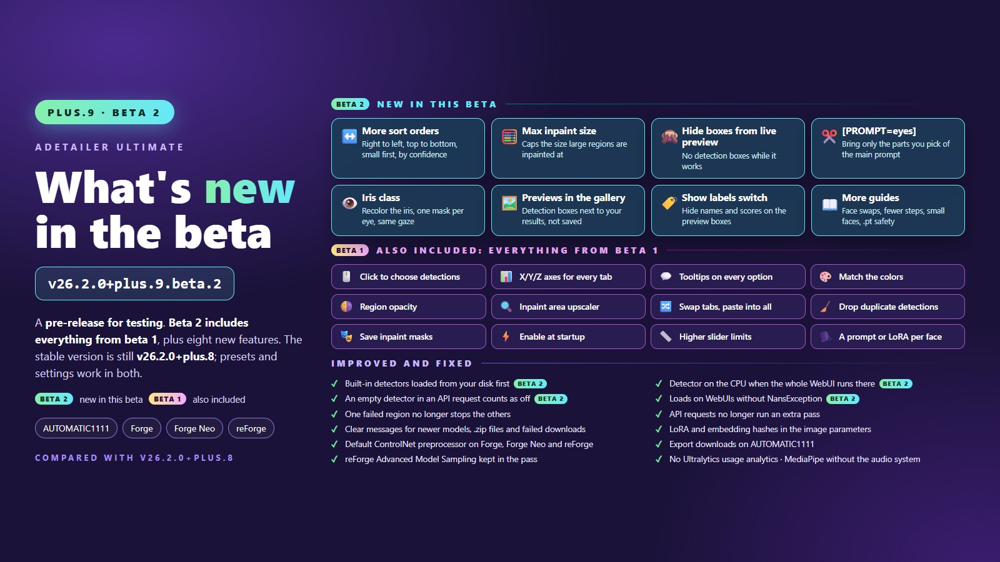

  <br /><br />

  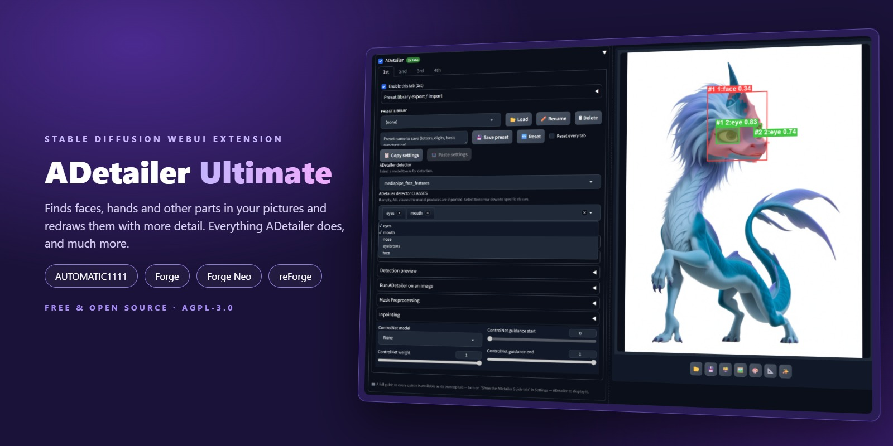

  <br /><br />

  [](https://github.com/xXIlRizzoXx/adetailer-ultimate/releases/latest) [](https://github.com/xXIlRizzoXx/adetailer-ultimate/releases) [](#compatibility) [](LICENSE.md)

</div>

> **Unofficial fork of [Bing-su/adetailer](https://github.com/Bing-su/adetailer), the extension that finds faces, hands and other parts in your pictures and redraws them with more detail. Everything ADetailer does, plus class filters, presets, remembered settings and more.**
>
> For AUTOMATIC1111, Forge, Forge Neo and reForge (tested live on AUTOMATIC1111 and Forge Neo). Stable [v26.2.0+plus.8](https://github.com/xXIlRizzoXx/adetailer-ultimate/releases/latest) · Beta [v26.2.0+plus.9.beta.2](#beta-in-testing) (pre-release).
>
> This project is **not affiliated with or endorsed by Bing-su**, the author of the original ADetailer. For the official ADetailer, go to [Bing-su/adetailer](https://github.com/Bing-su/adetailer). All credit for the original ADetailer goes to Bing-su: this fork extends that work, it does not replace it. Licensed under AGPL-3.0, the same license as the original ([LICENSE.md](LICENSE.md)), with the original author's credits kept. Who made what: [Credits](#credits).

**New here?** [Install](#install), then the three-step [Quick start](#quick-start). **Already using the original ADetailer?** Read [Coming from the original ADetailer?](#coming-from-the-original-adetailer) first.

🟡 **The second beta of plus.9 is out** as a pre-release (v26.2.0+plus.9.beta.2). Beta 2 adds a `[PROMPT=eyes]` token that brings only the matching parts of the main prompt into the ADetailer prompt, so a wildcard's eye colour carries over to the detailer pass, an `iris` class for the face parts detector, one mask per eye, and a "Show labels" switch that hides the names and numbers on the Detection preview. It adds four settings: more sort orders for the detections (right to left, top to bottom, small to large, by confidence), a maximum inpaint size so a large region cannot run out of video memory, an option that hides the detection boxes from the live preview, and one that shows the detection previews in the results gallery. Built-in detectors already on your disk now load without contacting Hugging Face, so at startup the WebUI no longer tries to reach Hugging Face for them, and it starts fine offline; the detector runs on the CPU when the whole WebUI does; an API tab with an empty model counts as off; and the Guide tab answers five frequent questions (face-swap order, fewer steps in the detail pass, model file safety, a quick switch for "Save images before ADetailer", background faces). Everything of beta 1 is still there: you can click the boxes of the Detection preview to choose which detections to inpaint, use X/Y/Z axes for every tab and an Enable axis, read a tooltip on the options that have no help line, and swap two tabs or paste one tab into all the others. New settings match the colors of each inpainted region to the picture, blend it with the original, pick the upscaler of the inpaint area, drop a face found twice, save the inpaint masks and start ADetailer already switched on; the mask sliders go further. One failed region no longer stops the others, the LoRAs and embeddings of the ADetailer prompts are listed for sites such as Civitai, ADetailer's detections no longer send Ultralytics' usage analytics, and Export downloads the preset library on AUTOMATIC1111 too. It also fixes ten known issues of plus.8, among them ControlNet preprocessors, prompt comments, Skip img2img, pasted samplers and "Overlay original for inpaint". The stable release is still v26.2.0+plus.8. → [Beta in testing](#beta-in-testing)

## ✨ What it does

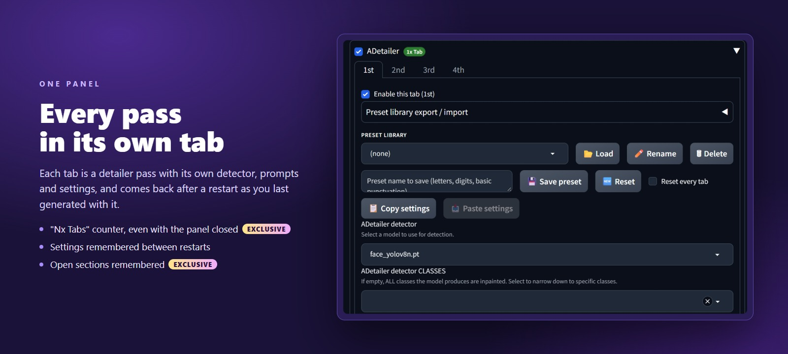

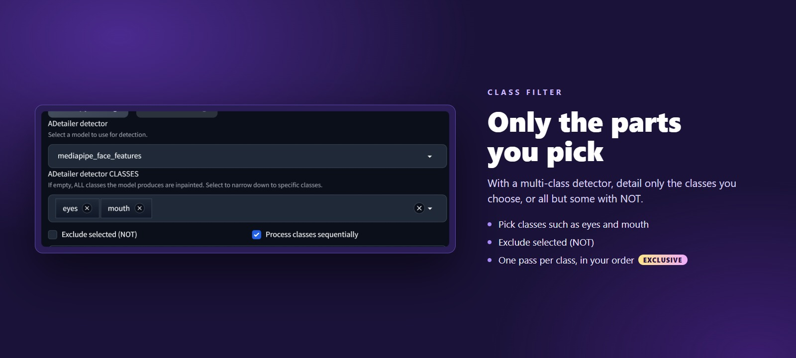

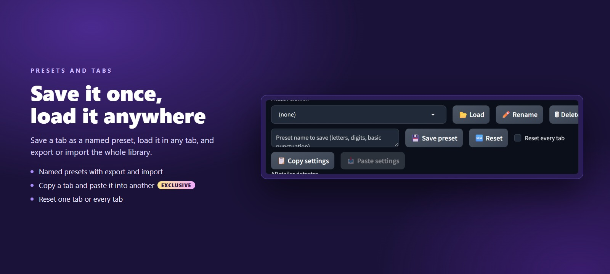

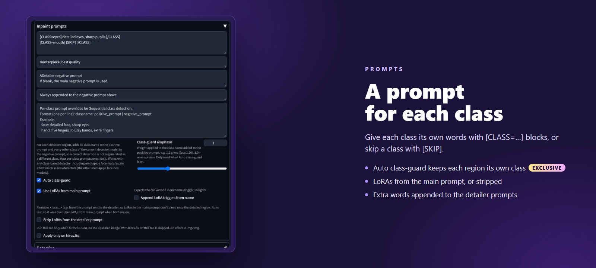

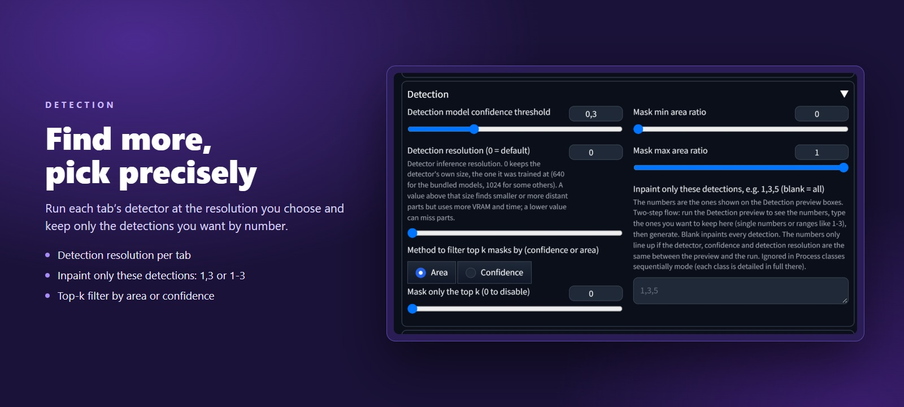

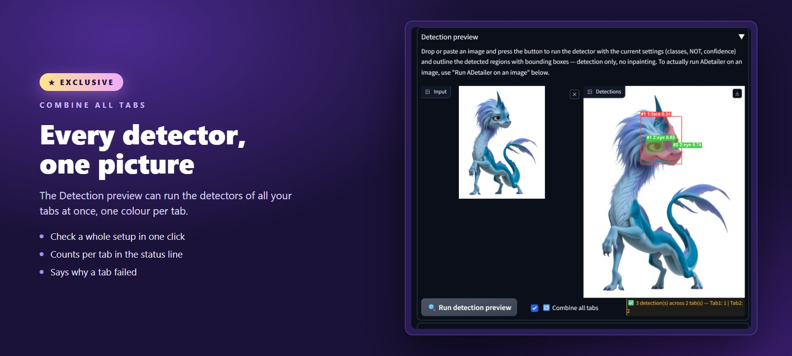

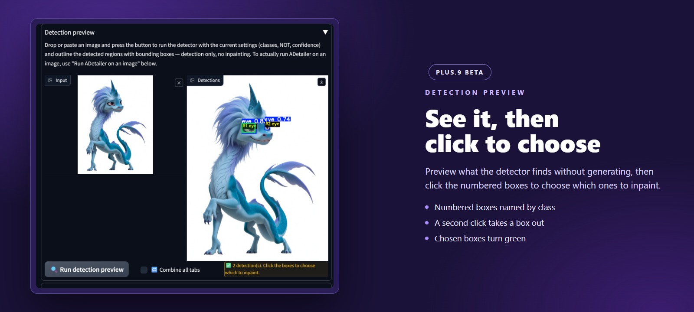

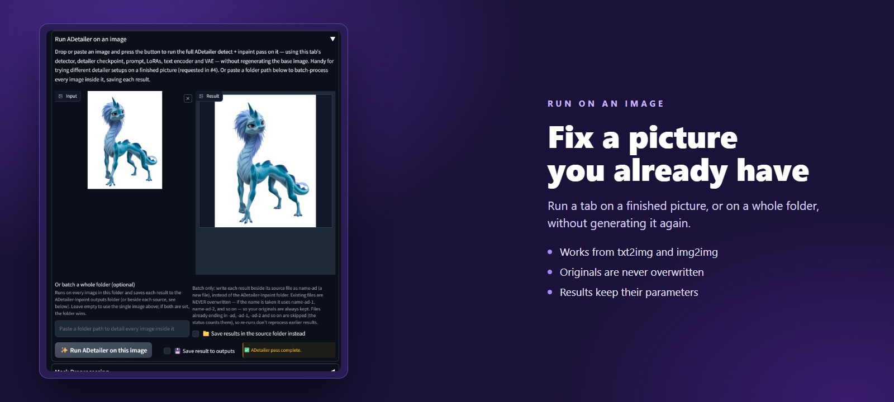

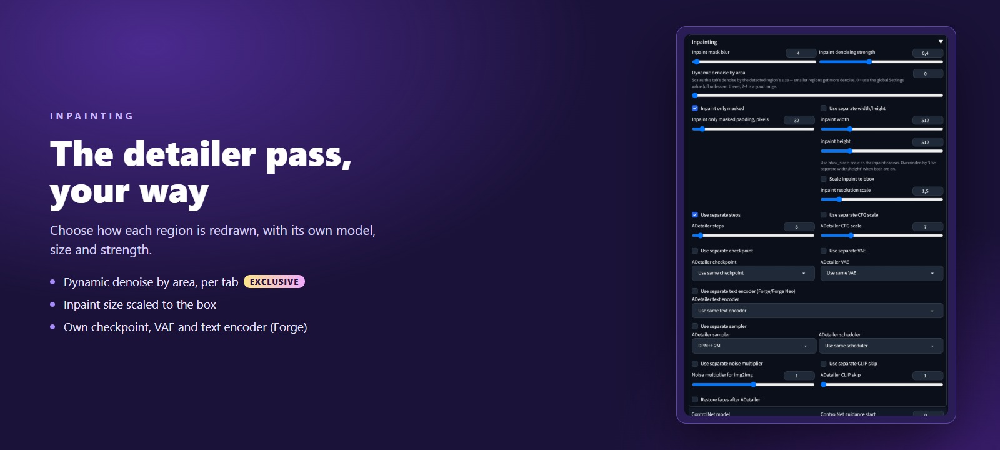

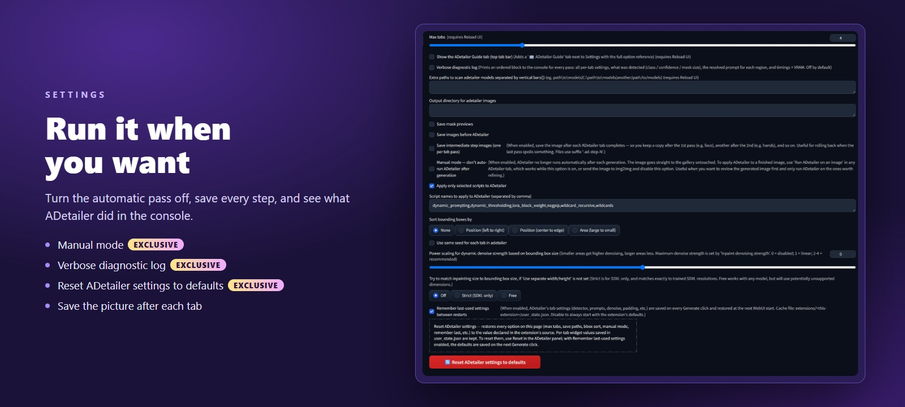

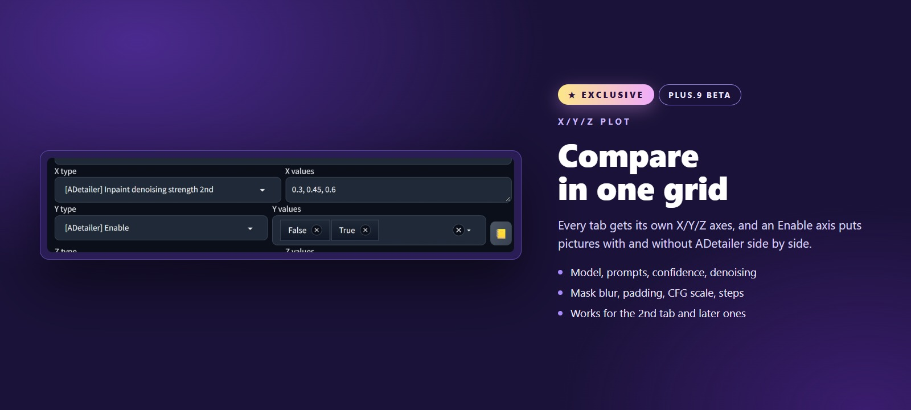

<sub>Screenshots taken on AUTOMATIC1111 1.10. "Exclusive" marks what neither the original ADetailer nor any other fork we know of offers.</sub>

## Contents

1. [Main features](#-main-features)
2. [More features](#more-features)
3. [Requested by users](#-requested-by-users)
4. [Beta in testing](#beta-in-testing): [new in plus.9 beta 2](#new-in-plus9-beta-2), [notes on plus.9 beta 2](#notes-on-plus9-beta-2), [new in plus.9 beta 1](#new-in-plus9-beta-1), [notes on plus.9 beta 1](#notes-on-plus9-beta-1)
5. [What is new in plus.8](#what-is-new-in-plus8): [new and fixed](#new-and-fixed), [fixed in beta 1](#fixed-in-beta-1), [known issues](#known-issues)
6. [Install](#install): [coming from the original ADetailer?](#coming-from-the-original-adetailer), [update](#update), [switch to the beta and back](#switch-to-the-beta-and-back)
7. [Quick start](#quick-start)
8. [Using each feature](#using-each-feature)
9. [Settings](#settings)
10. [Upstream options](#upstream-options)
11. [Models](#models)
12. [Problems and fixes](#problems-and-fixes)
13. [FAQ](#faq)
14. [Compatibility](#compatibility)
15. [Roadmap](#roadmap)
16. [For developers](#for-developers)
17. [License](#license), [Credits](#credits) and [See also](#see-also)

## ⭐ Main features

🟢 available in the stable release · 🟡 new in the beta, in testing. What the beta adds is in [Beta in testing](#beta-in-testing), and what the stable release changed in [What is new in plus.8](#what-is-new-in-plus8).

1. 🟢 **Class filter** — detail only the classes you pick from a multi-class detector, for example only face and hand, or all but some with "Exclude selected (NOT)". [How to use it](#class-filter)
2. 🟢 **Run ADetailer on a finished image or a whole folder** — detail pictures you already have with the tab's own settings, without generating them again; originals are never overwritten. [How to use it](#run-adetailer-on-an-image)
3. 🟢 **Detection preview, then pick which detections to inpaint** — see numbered boxes of what the detector finds, without generating anything, then type the numbers you want, such as `1,3`. From plus.8 it also names the class next to each number. 🟡 From plus.9 beta 1 you can also click the boxes instead of typing. [How to use it](#detection-preview)
4. 🟢 **Named presets** — save a tab's whole setup under a name, load it in any tab, and export or import the whole library. From plus.8 it also says what a preset from another WebUI needs that this one does not have. [How to use it](#preset-library)
5. 🟢 **Your tabs come back as you last generated with them** — each tab's settings return at the next WebUI start. From plus.8 it also reopens the sections you left open. [How to use it](#remember-last-used-settings)
6. 🟢 **Copy, paste and reset tabs** — copy a tab's setup into any other tab of the same panel, or put one tab or every tab back to its defaults. [How to use it](#copy-settings-between-tabs)
7. 🟢 **A prompt per class** — `[CLASS=hand] five fingers [/CLASS]` in the tab prompt gives the hands their own text, and `[CLASS=hand] [SKIP] [/CLASS]` skips only the hands. [How to use it](#inline-class-blocks-and-skip)
8. 🟢 **Face parts detector** — `mediapipe_face_features` finds eyes, mouth, nose, eyebrows and face separately, so you can detail only the eyes or only the mouth. [How to use it](#face-parts-detector-mediapipe_face_features)
9. 🟢 **Separate checkpoint, VAE and text encoder for the detailer pass** — on Forge and Forge Neo the detailer can also use its own text encoder and VAE, so it can run a checkpoint from another model family than your base model. From plus.8 they are always switched back after the pass. [How to use it](#separate-checkpoint-vae-text-encoder-and-clip-skip)
10. 🟢 **Runs on Forge Neo**, where the original ADetailer stops with errors, and installs on AUTOMATIC1111 without breaking it. Tested live on AUTOMATIC1111 1.10 and Forge Neo; classic Forge and reForge are checked in the code. [How to install](#install)

### Original vs Ultimate

| What you want to do | Original ADetailer | ADetailer Ultimate |
| --- | --- | --- |
| Detail only some classes, for example only the hands of a face-and-hand detector | Every class the detector finds is detailed; only YOLO-World detectors let you type what to look for | Pick the classes in a list, or all but some with "Exclude selected (NOT)" |
| Detail a picture you already have | Send it to img2img and tick "Skip img2img" | "Run ADetailer on an image" in any tab, in txt2img too, or a whole folder in one click |
| Save a setup and use it again | No presets; PNG Info brings back the settings of an image made with ADetailer | Named presets for every tab, with import, and export as a file on Forge and Forge Neo |
| Find your settings after a restart | Every tab starts from its defaults (the WebUI's Settings → Defaults can change them) | Every tab comes back as you last generated with it |
| Use it on Forge Neo | Stops with errors; Forge Neo recommends the separate ADetailer-Neo port instead | Runs there, and is tested live on it |

Everything else the original ADetailer does is still here, some of it with the fixes listed below; its options are listed in [Upstream options](#upstream-options). Moving over from the original? See [Coming from the original ADetailer?](#coming-from-the-original-adetailer).

## More features

Everything else this fork adds, grouped by area, in a short entry each. Smaller fixes are in [CHANGELOG.md](CHANGELOG.md).

🟢 available in the stable release · 🟡 new in the beta, in testing

Some 🟢 entries came with plus.8 and are not in v26.3.0+plus.7.4: [What is new in plus.8](#what-is-new-in-plus8) lists them.

### Detection and classes

- 🟢 **Detection resolution** — the "Detection resolution (0 = default)" slider in each tab runs a YOLO detector at a higher resolution than the one it was trained at (for example 1024 for the built-in detectors, which use 640), so it finds small or distant faces and hands. It uses more VRAM and time. 0 keeps each detector's own size. MediaPipe detectors ignore it, and the "Combine all tabs" preview stays at each detector's own size.
- 🟢 **Process classes sequentially** — runs a separate detailing pass for each selected class, in the order you clicked them, each on the result of the previous one. It needs two or more selected classes and does not run in "Exclude selected (NOT)" mode. MediaPipe detectors other than `mediapipe_face_features` ignore it. With the "Merge and Invert" mask mode, plus.8 runs one pass for all the selected classes instead, so a class is no longer repainted with another class's prompt.
- 🟢 **Detection numbers typed your way** — "Inpaint only these detections" reads `1,3,5` and `1-3`, and also `#2`, numbers separated by spaces, and the commas and dashes a Chinese or Japanese keyboard types (`1，3`, `1、3`, `1～3`). Leave it blank for all. It is not used while "Process classes sequentially" runs its passes.
- 🟢 **Class picks apply at once** — the classes you pick are used even if you press Generate straight away or another job is still running.
- 🟢 **Class names in any case** — a class name such as "Face" from a preset, pasted parameters or an API request matches the detector's "face", in the class filter and in per-class prompt lines.
- 🟢 **Your own class names** — a `<model>.names.json` file next to a detector gives it class names or replaces them. Files saved by Windows PowerShell or with Notepad's "Unicode" option are read too, and unrelated metadata files next to your models are ignored.
- 🟢 **YOLO-World works with class blocks** — regions found by a YOLO-World detector carry the class names typed in its CLASSES field, so `[CLASS=person]` blocks apply to them. "Exclude selected (NOT)", which has no effect with YOLO-World, is hidden for it.
- 🟢 **Accurate masks at the edges** — a mask moved with the "Mask x(→) offset" or "Mask y(↑) offset" slider stops at the image border instead of wrapping round to the other side, and segmentation masks line up on non-square images.
- 🟢 **Class numbers kept** — when PNG Info, Send to, Paste settings or loading a preset brings a class filter written as class numbers (such as `1`, as an API request may send it) and also changes the detector, the class filter keeps the number instead of going empty and detailing every class.
- 🟢 **More ways to type detection numbers** — "Inpaint only these detections" also reads the Japanese long-vowel mark and middle dot (`1ー3`, `1・3`) and a doubled dash (`1——3`, `1--3`).
- 🟢 **Better boxes for faces cut by the edge** — with `mediapipe_face_short` or `mediapipe_face_full`, a face cut off by the left or top edge gets a box that fits the visible face.
- 🟢 **Odd digits in a class filter** — a class written with a character such as `²` or `①` (from the API, a preset or pasted parameters) is ignored and named in the console, like any name the detector does not have, instead of stopping ADetailer for the image.
- 🟡 **Click the boxes to choose detections** — after a single-tab Detection preview, a click on a numbered box adds its number to "Inpaint only these detections" and a second click takes it out; the chosen boxes are marked in green, also when you type the numbers. See [Detection preview](#detection-preview).
- 🟡 **Iris class** — `mediapipe_face_features` has an `iris` class, used only when you pick it: one mask per eye over the whole iris, cut to the opening of the eye, to change the eye colour without redrawing the eyelids. See [Face parts detector](#face-parts-detector-mediapipe_face_features).

### Prompts

- 🟢 **LoRA control for the detailer pass** — "Use LoRAs from main prompt" brings the main prompt's LoRAs into the detailer prompt. "Strip LoRAs from the detailer prompt" removes them all, so a style LoRA does not bleed onto faces and hands.
- 🟢 **Prompt append fields** — two one-line fields add a few words to the end of the detailer prompt and negative prompt, so you don't have to copy the whole main prompt.
- 🟢 **Auto class-guard** — adds each region's own class to its prompt and the detector's other classes to its negative prompt, so a detected face is not redrawn as a hand, for example. Off by default; the "Class-guard emphasis" slider sets how strongly the class name is weighted. It works with detectors that have class names (YOLO models other than YOLO-World, and `mediapipe_face_features`). In sequential mode a per-class prompt line takes its place.
- 🟢 **Append LoRA triggers from name** — for a LoRA whose name holds a trigger phrase in round brackets (a file named `my_style (cool style)`, used as `<lora:my_style (cool style):1>` in the main prompt), the phrase is added to the detailer prompt. It needs "Use LoRAs from main prompt" turned on.
- 🟢 **No doubled LoRAs** — "Use LoRAs from main prompt" leaves out a LoRA that the tab prompt already names, so the tab's own weight is used.
- 🟢 **Styles applied once** — with Styles selected and a blank or `[PROMPT]` ADetailer prompt, the detailer pass gets the styles once instead of twice, also when the main prompt holds comments (not yet when another extension, such as Dynamic Prompts with wildcards, rewrites the main prompts, or when a Style adds its text on the line of a comment). With "Use LoRAs from main prompt" on, a LoRA that a selected Style adds is used once too, and with "Strip LoRAs from the detailer prompt" on, the styles' LoRAs are removed.
- 🟡 **Only some parts of the main prompt** — `[PROMPT=eyes,hair]` in a tab's prompt puts only the parts of this image's main prompt that name one of these words, so the eye colour a wildcard picked reaches the detailer pass without the rest of the main prompt; `[PROMPT=-beach]` puts everything except the parts that name it. See [Upstream options](#upstream-options).
- 🟢 **Spaces count as blank** — an ADetailer prompt that holds only spaces or line breaks now uses the main prompt instead of an empty one.
- 🟡 **Comments left out of the ADetailer prompts** — comments typed in a tab's prompt, negative prompt and append boxes (`#`, and on Forge Neo also `//` and `/* */`) are removed before the detailer pass, as the WebUI removes them from the main prompt, also with "Apply only selected scripts to ADetailer" on. A box that holds only a comment counts as blank. In plus.8 they reach the model: see [Known issues](#known-issues).
- 🟢 **Per-class prompts with class numbers** — in sequential mode, a class filter given as numbers (for example from an API request) uses the per-class prompt lines written with the class names, and the Auto class-guard stays on when none of the selected class names exists in the detector. A line written for a class number, such as `0: …`, takes the place of the Auto class-guard in its pass, as a line written with the class name does.

### Inpainting

- 🟢 **Apply only on hires.fix** — runs the tab only when hires.fix is on, on the upscaled image; with hires.fix off the tab is skipped (txt2img only).
- 🟢 **Scale inpaint to bbox** — sets each region's inpaint size from the size of its detection box (box size × a factor, 1.5 by default), so small and large regions both get enough detail. Only with "Inpaint only masked" on; "Use separate width/height" overrides it.
- 🟢 **Dynamic denoise by area, per tab** — smaller regions get a higher denoising strength. 0 uses the value in Settings → ADetailer, which is off unless you set it there.
- 🟢 **Use bbox as mask** — segmentation models inpaint the whole detection box instead of the tight outline, which gives the region more room to blend in.
- 🟢 **Separate VAE on Forge and Forge Neo** — "Use separate VAE" changes the VAE there too, where it had no effect in the original, and "Automatic" uses the detailer checkpoint's own VAE. In plus.7.4 and beta 1, on Forge Neo, pick a module once in the VAE / Text Encoder selector at the top of the page first, or the detailer pass fails.
- 🟢 **Distilled CFG Scale / Shift kept** — the detailer pass uses your value instead of always 3.5, so Flux guidance, or the shift of models like Z-Image, matches the rest of the image (Forge and Forge Neo only). When a separate checkpoint is picked it keeps 3.5, because a checkpoint of another model family reads this value differently.
- 🟢 **Image size kept when the whole picture is inpainted** — with "Inpaint only masked" off, a hires.fix image is no longer shrunk back to its first-pass size, and with Skip img2img the image keeps its own size (rounded down to a multiple of 8) instead of taking the size of the width and height sliders.
- 🟢 **Skip img2img uses your real settings** — "Use same sampler" uses your sampler, and the saved image records your real steps, sampler and size instead of placeholder values (img2img only).
- 🟢 **Merge and Invert safeguard** — with the "Merge and Invert" mask mode, when the detections cover the whole picture there is nothing left to inpaint, so the pass is skipped instead of repainting the whole picture.
- 🟢 **"Inpaint only masked" always pastes back** — with the WebUI's "Overlay original for inpaint" setting off, each region is still pasted back into the picture, instead of the region's crop replacing the whole picture. 🟡 From plus.9 beta 1 this no longer turns that setting on during the pass, so a settings save during the pass no longer stores it as on and frozen settings no longer stop ADetailer; in plus.8 these two limits remain: see [Known issues](#known-issues).
- 🟢 **Transparent input images** — with Skip img2img, the transparent parts of an input image get the WebUI's img2img background colour instead of turning black.
- 🟢 **Separate steps and sampler always used** — with "Apply only selected scripts to ADetailer" turned off in Settings → ADetailer (it is on by default), or with `sampler` added to "Script names to apply to ADetailer", "Use separate steps" and "Use separate sampler" now apply, also through the API, instead of being replaced by the main ones.
- 🟢 **Masks drawn on a transparent layer** — in img2img inpainting, a mask that holds the painted area in its transparency (from the Inpaint upload tab, an inpaint Batch mask folder or the API) is read as the WebUI reads it, also with Soft inpainting on, so ADetailer no longer switches itself off or details faces outside the painted area.
- 🟢 **ControlNet models in any letter case** — a ControlNet model whose file name writes its type with capitals, such as `OpenPoseXL2`, gets its preprocessor like the others.
- 🟡 **Larger mask sliders** — for large pictures, "Mask x(→) offset" and "Mask y(↑) offset" go from -512 to 512, "Mask erosion (-) / dilation (+)" from -256 to 256, "Inpaint mask blur" up to 256 and "Inpaint only masked padding, pixels" up to 512. The defaults are unchanged.
- 🟡 **ControlNet models start with their preprocessor on Forge** — on Forge, Forge Neo and reForge, choosing a ControlNet model selects its default preprocessor, such as `openpose_full` or `depth_midas`, as AUTOMATIC1111 does, instead of "None". In plus.8 it sets "None": see [Known issues](#known-issues).

### Working on existing images

- 🟢 **Save result to outputs** — saves the result of "Run ADetailer on an image" to an ADetailer-Inpaint folder next to your txt2img and img2img outputs, or inside the WebUI's "Output directory for images" when you have set one.
- 🟢 **Save results in the source folder** — a folder run saves each result next to its original as a new file ending in -ad (`photo.png` → `photo-ad.png`, or `photo-ad-1.png` when that name is taken). Originals are never overwritten, and earlier results are skipped when you run the folder again.
- 🟢 **A new result on every run** — each run of "Run ADetailer on an image" picks new random seeds for all regions, so pressing it again gives a different result.
- 🟢 **Combine all tabs** — the Detection preview runs every configured tab's detector on the image at once, one colour per tab.
- 🟢 **Rotated photos and .tif files** — rotated phone photos are detected upright, and folder runs include .tif files as well as .tiff.
- 🟢 **Tools wait their turn** — the Detection preview and "Run ADetailer on an image" wait for a running generation to finish, Interrupt stops a folder run before the next file, and a new run works after you cancel one. The WebUI hides its Interrupt and Skip buttons during these runs: press Alt+Enter to stop one (see [Run ADetailer on an image](#run-adetailer-on-an-image)).
- 🟢 **Preview on the CPU when ADetailer runs there** — with `--use-cpu adetailer`, or (except on macOS) `--lowvram`, `--medvram` or `--medvram-sdxl`, the Detection preview runs YOLO detectors on the CPU, like the generation does. Of these flags, Forge Neo has only `--lowvram`. 🟡 From plus.9 beta 2, both also use the CPU with `--use-cpu all`, `--cpu`, `--always-cpu` and, except on macOS, Forge Neo's `--novram`: see [Compatibility and reliability](#compatibility-and-reliability).
- 🟢 **Clearer folder runs** — the status counts files skipped as earlier results, and Settings → Defaults no longer saves a folder path as a startup default (which made a single-image run detail the whole folder).
- 🟢 **Combine all tabs explains failures** — the combined preview says why a tab's detector failed.
- 🟡 **Show labels** — a checkbox next to "🔍 Run detection preview" hides the class names, scores and numbers drawn on the preview, leaving only the boxes and masks. See [Detection preview](#detection-preview).
- 🟢 **GIFs in the Detection preview** — on Forge and Forge Neo, the MediaPipe detectors now find faces in a GIF dropped into the Detection preview.
- 🟢 **Failed regions counted** — when some regions fail with a NaN error (the WebUI's "A tensor with all NaNs was produced" error, which leaves the region unchanged) and others are detailed, "Run ADetailer on an image" says how many were left unchanged, instead of only reporting the pass as complete (AUTOMATIC1111, classic Forge and reForge).
- 🟢 **Class names on the preview numbers** — the numbers of the single-tab Detection preview also name the class, such as `#1 eyes`, so they no longer hide the part names of `mediapipe_face_features`. When the preview's font cannot draw a class name, as can happen with Chinese or Japanese names on some systems, the number stays plain, and the combined preview leaves the name out of its label instead of failing. On other systems, such as Windows, the font has no Chinese or Japanese letters, so such a class name shows as empty boxes after the number; the number itself is always readable.
- 🟢 **Transparency and colours kept** — "Run ADetailer on an image" and folder runs fill the transparent parts of a picture, such as a cut-out PNG, with the WebUI's img2img background colour instead of black. A copy saved next to its source keeps the source's colour profile, and a lossless WebP gives a lossless copy.
- 🟢 **Saved results keep their parameters** — results saved to the ADetailer-Inpaint folder record the detailer pass's settings, which PNG Info and Send to read, instead of the word "None". From plus.8 they also record the tab's ADetailer settings, and the PNG, JPEG and WebP copies a folder run saves next to their sources record the same parameters.
- 🟡 **Extra files keep their parameters** — the mask previews, step images and masks that "Run ADetailer on an image" and folder runs save record their parameters, and the console no longer prints "create_infotext failed" for each one. A `[user]` or `[denoising]` token in the WebUI's file or folder name pattern no longer prints a traceback for these files and for the results saved to `ADetailer-Inpaint`.

### Presets and tabs

- 🟢 **Complete paste from PNG Info** — PNG Info and Send to txt2img/img2img restore the ADetailer setup more completely than the original: they switch ADetailer and the tabs the image used on, switch the other tabs off (for an image made with ADetailer), and put the settings the image left at their defaults back to those defaults instead of keeping the tab's old values. Fields listed in "Disregard fields from pasted infotext" are left alone. From plus.8, a tab whose detector is not installed here keeps its own detector and is switched off, instead of making Generate fail, and an old sampler name such as "DPM++ 2M SDE Karras" is split into the sampler and its scheduler. 🟡 From plus.9 beta 1, "Skip img2img" is restored too, for images made with this beta or later, and a separate sampler this WebUI does not have becomes the first sampler with a console message; in plus.8, "Skip img2img" is not restored.
- 🟢 **ControlNet preprocessor kept** — loading a preset, pasting a tab or pasting parameters keeps a ControlNet preprocessor that fits the model instead of resetting it, and a restored ControlNet model shows its preprocessor after a restart.
- 🟢 **Only the first tab starts on** — on a fresh setup, "Enable this tab" starts unticked in tabs 2 and later, so the tab counter reads 1x Tab. When you pick a detector in another tab, tick its "Enable this tab" too.
- 🟢 **Safe preset and settings files** — saves from different tabs no longer overwrite each other, and a damaged file is set aside instead of being overwritten.
- 🟢 **Older presets load cleanly** — settings an older preset doesn't include go back to their defaults instead of keeping the tab's current values ("Enable this tab" is left as it is).
- 🟢 **Full preset list after a page reload** — reloading the browser page lists every preset saved, renamed or imported since the WebUI started.
- 🟢 **Presets saved as "Unicode" load** — preset and settings files saved in UTF-16 (for example with Notepad's "Unicode" option) are read instead of being set aside as damaged.
- 🟢 **Sampler after Reset** — Reset, "Reset every tab" and loading a preset without a sampler put "ADetailer sampler" back on the first sampler, as on a fresh setup. In plus.7.4 and beta 1, if you use "Use separate sampler", pick your sampler again after a Reset.
- 🟢 **Presets saved right after a Reset load cleanly** — a preset saved just after a Reset in an earlier release shows "Use same …" in the separate checkpoint, VAE and text encoder lists, instead of empty lists, and the first sampler or, with "Use separate sampler" ticked, the sampler and scheduler that the WebUI ran it with.
- 🟢 **Presets from another WebUI** — when a preset names a detector that is not installed here, Load keeps the tab's detector and class filter and loads the rest. A separate checkpoint, VAE, text encoder, scheduler or ControlNet model that this WebUI does not have is set to "Use same …" or "None", and, with "Use separate sampler" ticked, a missing sampler becomes the first sampler. The status says what was missing, so Generate no longer fails or quietly uses something else.
- 🟢 **Damaged preset files refused cleanly** — Import reports a damaged file as not imported, instead of failing without a message or emptying the preset lists.
- 🟡 **Export downloads on AUTOMATIC1111 too** — on AUTOMATIC1111 and other WebUIs with Gradio 3, such as reForge's main branch, Export now downloads `adetailer-ultimate-presets.json`, as on Forge and Forge Neo. In plus.8 it cannot download a file there: see [Known issues](#known-issues).
- 🟡 **Missing samplers named after a restart or a paste** — with "Use separate sampler" ticked, a sampler this WebUI does not have becomes the first sampler, after a restart and after pasting parameters, and the console says so; old names that end with a scheduler are split as Load splits them.

### Settings and output files

- 🟢 **Manual mode** — Settings → ADetailer → "Manual mode — don't auto-run ADetailer after generation" stops the automatic pass but keeps every tab setting, so you can generate drafts quickly and later detail the ones you keep with "Run ADetailer on an image".
- 🟢 **Save intermediate step images** — an option in Settings → ADetailer that saves the image after each tab's pass, and after each class pass in sequential mode (from plus.8 also with Skip img2img).
- 🟢 **Tidy output folder** — mask previews, before-images and step images go into an adetailer-steps sub-folder, so the main folder holds only final images.
- 🟢 **Extra images keep their own seed and prompt** — in a batch, the before, mask-preview and step images each record their own seed and prompt, and in sequential mode each class pass saves its own mask preview, named after the class.
- 🟢 **Reset ADetailer settings to defaults** — a button at the bottom of Settings → ADetailer resets every option on that page after you confirm. Your tabs and presets are not touched.
- 🟢 **Verbose diagnostic log** — an option in Settings → ADetailer that prints each active tab's settings, what was detected, and the time and VRAM each pass used to the console. Useful for bug reports.
- 🟢 **Manual mode changes wait for the next generation** — ticking Manual mode while an image is being made now applies from the next generation, instead of saving Skip img2img images at 128x128 or leaving other scripts such as ControlNet stopped.
- 🟢 **Verbose log complete in a log file** — when the WebUI's console output goes to a log file or another program on Windows, the Verbose diagnostic log keeps all its lines instead of losing the ones with characters the file cannot show.
- 🟢 **Quieter manual mode again** — as in plus.7.4, the console says that ADetailer was skipped only for a generation it would otherwise have detailed; beta 1 also said it with ADetailer switched off.
- 🟡 **Save inpaint masks** — an option in Settings → ADetailer that saves the black-and-white mask each region is inpainted with, as a PNG in the `adetailer-steps` sub-folder. See [Save inpaint masks](#save-inpaint-masks).
- 🟡 **Enable ADetailer at startup** — an option in Settings → ADetailer (Off, txt2img, img2img or Both) that starts the ADetailer panel already switched on in the chosen tabs, after a UI reload. See [Settings](#settings).
- 🟡 **Match the colors of each inpainted region** — an option in Settings → ADetailer (off by default) that matches the colors of each inpainted region to the picture, so a face no longer comes out with another tint. See [Settings](#settings).
- 🟡 **More sort orders** — an option in Settings → ADetailer that details the regions from right to left, from top to bottom, from small to large or by confidence, instead of the order of "Sort bounding boxes by"; it also decides which face gets which part of a `[SEP]` prompt. See [Settings](#settings).
- 🟡 **Max inpaint size** — an option in Settings → ADetailer (0, no limit, by default) that inpaints a region smaller, with the same shape, when its inpaint size would be larger, so "Scale inpaint to bbox" on a large detection does not run out of video memory. See [Scale inpaint to bbox](#scale-inpaint-to-bbox).
- 🟡 **Detection previews in the results gallery** — an option in Settings → ADetailer (off by default) that adds the picture with the detection boxes of every pass after the generated images, with the parameters of its image, without saving it to disk. See [Settings](#settings).

### Interface

- 🟢 **ADetailer Guide tab** — an optional top tab with a plain-language guide to the main options and to common problems (in English); while it is on, a "📖 Guide" link in the ADetailer header opens it. Turn it on in Settings → ADetailer → "Show the ADetailer Guide tab (top tab bar)", then reload the UI.
- 🟢 **Translated interface** — with the companion [Language Diffusion](https://github.com/xXIlRizzoXx/sd-webui-language-diffusion) extension, the fork's labels, buttons and hints can be shown in 10 languages. Options added in recent versions still show in English until the translations are updated.
- 🟢 **Active tabs counter** — a green pill next to the ADetailer title (for example "2x Tabs") shows how many tabs are enabled, even with the panel closed.
- 🟢 **Version badge** — the version label sits on the ADetailer header and also shows the installed build, so you can tell at a glance which ADetailer Ultimate you have.
- 🟡 **Tooltips on every option** — hover over an option of a tab, such as "Mask min area ratio" or "Use separate checkpoint", for about a second to see what it does. The options with a help line under them keep it.
- 🟢 **Interface polish** — tooltips on the fork's buttons, status messages that fade after a few seconds, same-size buttons and readable text on the light theme.
- 🟢 **Open sections are remembered** — the sections you leave open in each tab (Detection, Inpainting, Detection preview and the others) open again after a reload or restart. This is stored in your browser, so another browser starts with them closed ([issue #6](https://github.com/xXIlRizzoXx/adetailer-ultimate/issues/6)).
- 🟢 **Version badge fits a narrow panel** — in a narrow window the version badge no longer covers the ADetailer title and the tab counter; it shortens its text instead.
- 🟢 **Messages and counter keep up on Forge** — on Forge and Forge Neo, a repeated preset or import message shows again also after a very fast answer, and the tab counter follows Paste settings, Load and Reset.
- 🟢 **Translated values stay translated** — on Forge and Forge Neo, with Language Diffusion, the "Use same …" values of a tab's dropdowns stay translated after you change them.
- 🟢 **Guide corrections** — the Guide tab and the "Detection resolution" help text say what 0 means (each detector's own size), what Merge does, where the preview tools are and that tabs 2 and later need "Enable this tab".
- 🟡 **Detection boxes out of the live preview** — an option in Settings → ADetailer (off by default) keeps the picture with the detection boxes out of the WebUI's live preview and the progress API. See [Settings](#settings).
- 🟡 **More answers in the Guide tab** — the order of ADetailer and a face-swap extension, why the detail pass runs fewer steps, model file safety, a switch for "Save images before ADetailer" at the top of the page, and how to leave small or background faces alone. They are in [Problems and fixes](#problems-and-fixes) and the [FAQ](#faq) too.

### Compatibility and reliability

- 🟢 **MediaPipe detectors on newer builds** — the MediaPipe face detectors find faces on the MediaPipe 0.10.x builds that no longer have its old interface, such as the Python 3.13 builds Forge Neo uses, where they used to find nothing. Their two small model files download by themselves the first time (this needs an internet connection).
- 🟢 **MediaPipe with non-English folder names** — on Windows, the MediaPipe detectors work when the WebUI's folder path has an accented, Cyrillic, Chinese, Japanese or Korean character, for example in your user name.
- 🟢 **MediaPipe safety cap** — installs stay on the tested MediaPipe 0.10.x line, so a fresh install cannot pull MediaPipe 1.0.1, which crashes the whole WebUI on macOS.
- 🟢 **Interrupt and Skip behave predictably** — Interrupt or Skip during a tab's pass throws that whole pass away (the regions it already finished too) instead of keeping a half-finished region. Skip stops ADetailer for the rest of the current batch.
- 🟢 **A failed tab no longer breaks the batch** — when a tab stops with an error (for example a missing detector or out of memory), other scripts such as ControlNet on Forge Neo keep working for the rest of the batch.
- 🟢 **Your changes during a pass are kept** — if you change a setting while ADetailer is working, such as the checkpoint, it is no longer undone when the pass ends, unless the tab uses its own value for that same setting (for example a separate checkpoint). From plus.8 this holds for Clip skip and the VAE also when they have never been saved with Settings → Apply settings (in beta 1 only once they had been saved); plus.7.4 undoes every setting changed during a pass.
- 🟢 **Correct image data in X/Y/Z grids and img2img Batch** — the "[ADetailer] Prompt S/R" axes no longer print an error for every cell, each cell's images save only that cell's settings, and one empty mask no longer switches ADetailer off for the rest of a batch.
- 🟢 **API support for the new options** — every new per-tab option can be sent through the WebUI API. Most of them are written into the image parameters only when you change them; "Apply only on hires.fix", "Use bbox as mask", "Scale inpaint to bbox" (with its factor) and "Append LoRA triggers from name" are always written.
- 🟢 **No startup error when another ADetailer is also installed** — having the original ADetailer installed too no longer prints a startup error. Keep only one ADetailer anyway: with two, the panel appears twice (see [Coming from the original ADetailer?](#coming-from-the-original-adetailer)).
- 🟢 **No "outdated" message on Forge Neo** — Forge Neo's startup message that suggests ADetailer-Neo instead is no longer printed while this fork is installed (Forge Neo only).
- 🟢 **API requests no longer use your remembered UI settings for the tabs they leave out** — with "Remember last-used settings" on, a tab that an API request leaves out now gets a fresh setup's settings, as in the original ADetailer (only the 1st tab on, with the first detector), instead of the settings remembered in the UI.
- 🟢 **Separate CLIP skip, VAE and text encoder always switched back** — after every pass, your main Clip skip, VAE and (on Forge and Forge Neo) text encoder come back, also on a fresh install and after "Run ADetailer on an image", so a tab's own choice no longer reaches the next tabs or later images. On Forge Neo, "Use separate VAE" also works before the VAE / Text Encoder selector at the top of the page has ever been used.
- 🟢 **MediaPipe problems reported** — if MediaPipe is missing or broken, the console says so once, instead of every MediaPipe detector quietly finding nothing.
- 🟢 **Quieter start on AUTOMATIC1111** — a detector without a `<model>.names.json` file no longer fills the console with a long error report at startup. 🟡 From plus.9 beta 1 its CLASSES list shows the classes straight away, read from the detector file without loading it; in plus.8 it shows them once a generation or a Detection preview has found something with it and you switch to another detector and back, or straight away with a `<model>.names.json` file. Classic Forge (checked in its code) and Forge Neo list the classes straight away.
- 🟢 **Names and prompts in other alphabets no longer stop ADetailer** — on Windows, when the WebUI's console output is saved to a log file, a detector, class, folder or file name, or a prompt, with characters of another alphabet (for example Chinese or Cyrillic) or an emoji no longer makes ADetailer fail or keeps its panel from appearing.
- 🟢 **Prompt S/R images paste back correctly** — images from an X/Y/Z "[ADetailer] Prompt S/R" cell paste back the same ADetailer prompts in every tab, the per-class prompt lines of a sequential tab included, and each image records its own prompt, also with wildcards. The "(AD 1st and main prompt)" axis no longer replaces twice in the main prompt that a blank or `[PROMPT]` ADetailer prompt stands for.
- 🟢 **Dynamic Prompts templates kept** — with Dynamic Prompts' "Save template to metadata" on, the saved image parameters keep the wildcard template instead of the first image's resolved prompt.
- 🟢 **Detailer ControlNet on classic Forge** — the ControlNet model of an ADetailer tab now works on classic Forge, instead of doing nothing since that WebUI's Gradio 4 update (checked against its source code, not tested live).
- 🟢 **X/Y/Z detector axis on an empty tab** — an "[ADetailer] ADetailer model 1st" axis also runs a cell whose 1st tab is left on "None" in the panel.
- 🟢 **Starts with `--no-gradio-queue`** — AUTOMATIC1111 and other WebUIs with Gradio 3 start when launched with `--no-gradio-queue`, instead of stopping with a queue error.
- 🟢 **ControlNet preview shown once** — on Forge and Forge Neo, with ControlNet on, its preview appears once in the results instead of once more for every batch.
- 🟡 **X/Y/Z axes for every tab** — the 2nd and later tabs get X/Y/Z axes for their model, prompts, confidence, erosion / dilation, mask blur, denoising strength, padding, CFG scale and steps; the 1st tab gets confidence, mask blur and steps axes too; and "[ADetailer] Enable" switches ADetailer on or off for each cell. A CFG scale or Steps axis also ticks the tab's "Use separate CFG scale" or "Use separate steps" in each cell, so the cells differ. See [New in plus.9 beta 1](#new-in-plus9-beta-1).
- 🟡 **LoRAs and embeddings of the ADetailer prompts in the image parameters** — a LoRA or an embedding used only in an ADetailer prompt is listed in "Lora hashes" and "TI hashes" with those of the main prompt, so sites such as Civitai recognise it (a WebUI without "TI hashes", such as Forge Neo, lists only the LoRAs). Idea from the [diffus-me/adetailer](https://github.com/diffus-me/adetailer) fork.
- 🟡 **Detectors made with a newer Ultralytics explained** — a detector that the installed Ultralytics cannot load because it is too old, such as a recent YOLO12 or YOLO26 model, is named in the console and in the Detection preview status, with the installed version, instead of only "Can't get attribute '…'".
- 🟡 **`.zip` files in the detector folders pointed out** — at startup the console names up to 5 `.zip` files found in the detector folders and asks you to extract the `.pt` file, since ADetailer reads only `.pt` files.
- 🟡 **MediaPipe leaves your audio alone** — with the `sounddevice` package installed, MediaPipe no longer starts the audio system, which on Windows could stop the sound of other programs and list Python as using the microphone ([Bing-su/adetailer#508](https://github.com/Bing-su/adetailer/issues/508)).
- 🟡 **reForge's Advanced Model Sampling kept** — on reForge, the Advanced Model Sampling scripts always run in the detailer pass, so v-prediction and flow models are detailed correctly also with "Apply only selected scripts to ADetailer" on (checked in reForge's code).
- 🟡 **No Ultralytics usage analytics** — ADetailer switches off Ultralytics' anonymous usage analytics before its detections, in memory only: the Ultralytics settings file, which other programs share, is never written.
- 🟡 **MediaPipe pre-releases read correctly** — the macOS safety check no longer takes a MediaPipe pre-release such as 1.0.0rc1 for 1.0.1.
- 🟡 **Built-in detectors from your disk first** — a built-in detector in `models/adetailer` or an extra model folder is used from there, and one downloaded before loads from the Hugging Face cache, without contacting Hugging Face, so at startup the WebUI no longer tries to reach Hugging Face for them, and it starts fine offline. See [Built-in detectors](#built-in-detectors).
- 🟡 **Detector on the CPU with the whole WebUI** — with `--use-cpu all` (AUTOMATIC1111, Forge, reForge), `--cpu` (Forge Neo) or `--always-cpu` (Forge, reForge), and, except on macOS, with Forge Neo's `--novram`, the YOLO detectors run on the CPU, in generation and in the Detection preview, like the rest of the WebUI, instead of on the graphics card.
- 🟡 **Empty model in an API request** — a tab sent with `"ad_model": ""` counts as off, like `"None"`, instead of stopping with "Model '' not found" and skipping the tabs after it.
- 🟡 **Loads without `NansException`** — a WebUI whose `modules.devices` has no `NansException` still loads ADetailer, instead of the whole extension failing at startup.

How to use each feature is explained in [Using each feature](#using-each-feature). Every change, version by version, is in [CHANGELOG.md](CHANGELOG.md).

## 🙋 Requested by users

Thank you to everyone who opened an issue, tried a beta and reported back: these requests shaped ADetailer Ultimate.

🟢 available in the stable release · 🟡 new in the beta, in testing

| Request | Asked by | Status | Where to find it |
| --- | --- | --- | --- |
| [#1](https://github.com/xXIlRizzoXx/adetailer-ultimate/issues/1) Install on reForge: a startup error when another ADetailer is installed too | @kvsh88 | 🟢 [v26.3.0+plus.4](https://github.com/xXIlRizzoXx/adetailer-ultimate/releases/tag/v26.3.0%2Bplus.4) | [Install](#install) · [Can I keep the original ADetailer installed too?](#can-i-keep-the-original-adetailer-installed-too) |
| [#2](https://github.com/xXIlRizzoXx/adetailer-ultimate/issues/2) The extension did not load on AUTOMATIC1111 | @arch-official | 🟢 [v26.3.0+plus.4.1](https://github.com/xXIlRizzoXx/adetailer-ultimate/releases/tag/v26.3.0%2Bplus.4.1) and [v26.3.0+plus.5](https://github.com/xXIlRizzoXx/adetailer-ultimate/releases/tag/v26.3.0%2Bplus.5) | [Compatibility](#compatibility) · [Export and import presets](#export-and-import-presets) |
| [#3](https://github.com/xXIlRizzoXx/adetailer-ultimate/issues/3) Choose the text encoder for the detailer pass (Forge, Forge Neo) | @koblue | 🟢 [v26.3.0+plus.5](https://github.com/xXIlRizzoXx/adetailer-ultimate/releases/tag/v26.3.0%2Bplus.5) | [Separate checkpoint, VAE, text encoder and CLIP skip](#separate-checkpoint-vae-text-encoder-and-clip-skip) |
| [#4](https://github.com/xXIlRizzoXx/adetailer-ultimate/issues/4) Detail an image without generating it again | @koblue | 🟢 [v26.3.0+plus.6](https://github.com/xXIlRizzoXx/adetailer-ultimate/releases/tag/v26.3.0%2Bplus.6) | [Run ADetailer on an image](#run-adetailer-on-an-image) |
| [#5](https://github.com/xXIlRizzoXx/adetailer-ultimate/issues/5) Choose which detections to inpaint | @koblue | 🟢 [v26.3.0+plus.7.3](https://github.com/xXIlRizzoXx/adetailer-ultimate/releases/tag/v26.3.0%2Bplus.7.3) | [Inpaint only these detections](#inpaint-only-these-detections) |
| [#6](https://github.com/xXIlRizzoXx/adetailer-ultimate/issues/6) Restore the open sections and the panel's checkboxes at startup | @flux-error-man | 🟢 open sections: [v26.2.0+plus.8](https://github.com/xXIlRizzoXx/adetailer-ultimate/releases/tag/v26.2.0%2Bplus.8)<br>🟢 panel checkboxes: with the WebUI's Settings → Defaults, no update needed | [Remember last-used settings](#remember-last-used-settings) · [Startup defaults for the panel's checkboxes](#startup-defaults-for-the-panels-checkboxes) |

@arch-official confirmed the fixes for #2 on AUTOMATIC1111, and @koblue confirmed #3, #4 and #5 on Forge Neo. reForge (#1) and classic Forge are supported and checked in the code, but the live tests run on AUTOMATIC1111 1.10 and Forge Neo only. For #6, a preset still holds the settings of one tab on purpose, so loading one never opens or closes sections or switches the whole panel on.

### Also solved: requests from users of the original ADetailer

Requests and reports from users of the original ADetailer, on its tracker and on the trackers of a WebUI and an extension used with it, that ADetailer Ultimate answers:

- 🟢 **Save the settings as presets** — asked in [Bing-su/adetailer#108](https://github.com/Bing-su/adetailer/issues/108) and [discussion #530](https://github.com/Bing-su/adetailer/discussions/530). Save a tab's setup under a name and load it in any tab: [Preset Library](#preset-library).
- 🟢 **Save and load a tab's setup, to reuse it or change the order of the tabs** — asked in [discussion #743](https://github.com/Bing-su/adetailer/discussions/743). Copy one tab and paste it into others, or save each tab as a preset and load them back in the order you want: [Copy Settings Between Tabs](#copy-settings-between-tabs).
- 🟢 **A button to discard all changes** — asked in [Bing-su/adetailer#478](https://github.com/Bing-su/adetailer/issues/478). **🆕 Reset** puts a tab back to its defaults, and "Reset every tab" does it for every tab: [Reset](#reset).
- 🟢 **Add prompt text when a certain class is detected** — asked in [Bing-su/adetailer#412](https://github.com/Bing-su/adetailer/issues/412). Write `[PROMPT], [CLASS=hand] five fingers [/CLASS]` in the tab prompt: the hands get the main prompt plus "five fingers", the other regions the main prompt. Or use one line per class in sequential mode: [Inline class blocks](#inline-class-blocks-and-skip) and [Per-class prompts](#per-class-prompts).
- 🟢 **Detail only the mouth** — asked in [Bing-su/adetailer#807](https://github.com/Bing-su/adetailer/issues/807). The `mediapipe_face_features` detector has a mouth class, next to eyes, nose, eyebrows and face: [Face parts detector](#face-parts-detector-mediapipe_face_features).
- 🟢 **"Use separate steps" ignored** — reported for API requests in [Bing-su/adetailer#795](https://github.com/Bing-su/adetailer/issues/795). With "Apply only selected scripts to ADetailer" off, "Use separate steps" and "Use separate sampler" now work, in the UI and through the API, instead of being replaced by the WebUI's own sampler settings: [Upstream options](#upstream-options).
- 🟢 **Dynamic Prompts' template lost from the saved image** — reported in [adieyal/sd-dynamic-prompts#730](https://github.com/adieyal/sd-dynamic-prompts/issues/730) and [#703](https://github.com/adieyal/sd-dynamic-prompts/issues/703). With Dynamic Prompts' "Save template to metadata" on, the image parameters keep the template with its wildcards instead of the prompt already filled in: [What is new in plus.8](#what-is-new-in-plus8).
- 🟢 **ADetailer's ControlNet on the current classic Forge** — proposed in the upstream pull request [Bing-su/adetailer#745](https://github.com/Bing-su/adetailer/pull/745), not merged there because older Forge versions need the old format. The detailer's ControlNet model works again on classic Forge, and older Forge versions keep working; classic Forge and reForge were checked in their code only, not tested live: [Upstream options](#upstream-options).
- 🟡 **Count the faces and choose which to detail** — asked in [Bing-su/adetailer#635](https://github.com/Bing-su/adetailer/issues/635). Run the Detection preview, then click the numbered boxes to choose: [Detection preview](#detection-preview).
- 🟡 **Larger values for the mask offset and erosion / dilation sliders** — asked in [Bing-su/adetailer#111](https://github.com/Bing-su/adetailer/issues/111). They go from -512 to 512 and from -256 to 256: [Upstream options](#upstream-options).
- 🟡 **Save the masks** — asked in [Bing-su/adetailer#406](https://github.com/Bing-su/adetailer/issues/406). "Save inpaint masks" saves the mask each region is inpainted with: [Save inpaint masks](#save-inpaint-masks).
- 🟡 **Switch ADetailer on and off in an X/Y/Z grid** — asked in [Bing-su/adetailer#251](https://github.com/Bing-su/adetailer/issues/251). The "[ADetailer] Enable" axis does it, and the 2nd and later tabs get axes too: [New in plus.9 beta 1](#new-in-plus9-beta-1).
- 🟡 **Sound cuts out in other programs when MediaPipe starts** — reported in [Bing-su/adetailer#508](https://github.com/Bing-su/adetailer/issues/508). MediaPipe no longer starts the audio system: [Install and startup](#install-and-startup).
- 🟡 **reForge's Advanced Model Sampling in the detailer pass** — proposed in the upstream pull request [Bing-su/adetailer#818](https://github.com/Bing-su/adetailer/pull/818). It now always runs there: [Settings](#settings).
- 🟡 **Start with ADetailer switched on** — asked in [lllyasviel/stable-diffusion-webui-forge#1833](https://github.com/lllyasviel/stable-diffusion-webui-forge/issues/1833). Settings → ADetailer → "Enable ADetailer at startup": [Settings](#settings).
- 🟡 **Blend the detailed region with the original** — asked in [Bing-su/adetailer discussion #293](https://github.com/Bing-su/adetailer/discussions/293). Settings → ADetailer → "Detailed region opacity": [Settings](#settings).
- 🟡 **A real upscaler for the detailed region** — asked in [Bing-su/adetailer#711](https://github.com/Bing-su/adetailer/issues/711). Settings → ADetailer → "Upscaler for ADetailer's inpaint area": [Settings](#settings).
- 🟡 **The same face inpainted twice** — reported in [Bing-su/adetailer#669](https://github.com/Bing-su/adetailer/issues/669). Settings → ADetailer → "Drop overlapping detections (max overlap, 0 = off)": [Settings](#settings).
- 🟡 **Swap two tabs, or apply one tab to all** — asked in [Bing-su/adetailer#297](https://github.com/Bing-su/adetailer/issues/297) and [#320](https://github.com/Bing-su/adetailer/issues/320): [Copy Settings Between Tabs](#copy-settings-between-tabs).
- 🟡 **ADetailer runs once more than the tabs of an API request** — reported in [Bing-su/adetailer#485](https://github.com/Bing-su/adetailer/issues/485). A request that sends only the tabs now runs one pass per tab: [Does it work with the WebUI's API?](#does-it-work-with-the-webuis-api).
- 🟡 **A color correction option** — asked in [Bing-su/adetailer#731](https://github.com/Bing-su/adetailer/issues/731). Settings → ADetailer → "Match the colors of each inpainted region to the picture" matches each region to the picture: [Settings](#settings).
- 🟡 **Explain what each option does** — asked in [Bing-su/adetailer#23](https://github.com/Bing-su/adetailer/issues/23). Hover over an option of a tab to see a short explanation: [Interface](#interface).
- 🟡 **No Ultralytics usage analytics** — asked in [Bing-su/adetailer#613](https://github.com/Bing-su/adetailer/issues/613). ADetailer switches them off before its detections, without writing Ultralytics' settings file: [Compatibility](#compatibility).
- 🟡 **Hide the red detection boxes** — asked in [Bing-su/adetailer discussion #482](https://github.com/Bing-su/adetailer/discussions/482). From plus.9 beta 2, Settings → ADetailer → "Hide detection boxes from the live preview" keeps them out of the live preview and the progress API: [Settings](#settings).
- 🟡 **Run ADetailer after a face swap (roop, ReActor)** — asked in [Bing-su/adetailer#193](https://github.com/Bing-su/adetailer/issues/193), [#327](https://github.com/Bing-su/adetailer/issues/327) and [discussion #159](https://github.com/Bing-su/adetailer/discussions/159). The WebUI's Settings → Callbacks sets the order, when the other extension works in the same step: [The result looks wrong](#the-result-looks-wrong).
- 🟡 **"Use separate steps" runs fewer steps** — reported in [Bing-su/adetailer#649](https://github.com/Bing-su/adetailer/issues/649). The detail pass is an img2img pass, and a WebUI option runs the full number: [The result looks wrong](#the-result-looks-wrong).
- 🟡 **"Save images before ADetailer" in easy reach** — asked in [Bing-su/adetailer#726](https://github.com/Bing-su/adetailer/issues/726). Add it to the WebUI's Quicksettings list: [FAQ](#can-i-switch-save-images-before-adetailer-from-the-top-of-the-page).
- 🟡 **Only part of the main prompt in the ADetailer prompt, also with wildcards** — asked in [Bing-su/adetailer#805](https://github.com/Bing-su/adetailer/issues/805), [#764](https://github.com/Bing-su/adetailer/issues/764), [#673](https://github.com/Bing-su/adetailer/issues/673), discussions [#287](https://github.com/Bing-su/adetailer/discussions/287) and [#553](https://github.com/Bing-su/adetailer/discussions/553), and [adieyal/sd-dynamic-prompts#561](https://github.com/adieyal/sd-dynamic-prompts/issues/561). `[PROMPT=eyes]` brings only the parts of each image's main prompt that name the eyes: [Upstream options](#upstream-options).
- 🟡 **The detection previews in the results gallery, without saving them** — asked in [Bing-su/adetailer#113](https://github.com/Bing-su/adetailer/issues/113) and [#259](https://github.com/Bing-su/adetailer/issues/259). Settings → ADetailer → "Show detection previews in the results gallery": [Settings](#settings).

**Missing something?** [Open an issue](https://github.com/xXIlRizzoXx/adetailer-ultimate/issues/new) and describe what you would like to do. Ideas already being considered are in the [Roadmap](#roadmap).

## Beta in testing

The published beta is **v26.2.0+plus.9.beta.2**, released on 2026-10-24 as a pre-release on the [Releases page](https://github.com/xXIlRizzoXx/adetailer-ultimate/releases): the second beta of plus.9. It adds a `[PROMPT=words]` token that brings only some parts of the main prompt, an `iris` class for the face parts detector, a "Show labels" switch for the Detection preview and four settings (more sort orders for the detections, a maximum inpaint size, hiding the detection boxes from the live preview and showing the detection previews in the results gallery), loads built-in detectors from your disk before contacting Hugging Face, runs the detector on the CPU when the whole WebUI runs there, treats an API tab with an empty model as off, starts on WebUIs that lack `NansException` and answers five frequent questions in the Guide tab and below. It keeps everything of the first beta, which adds clickable boxes to the Detection preview, X/Y/Z axes for every tab, tooltips on every option, swapping and pasting tabs, new settings for the colors, the opacity and the upscaler of the inpainted regions, for duplicate detections, inpaint masks and starting ADetailer switched on, higher limits for the mask sliders and two new guides, and it fixes some problems with detectors, MediaPipe, reForge, ControlNet, prompts, Export and saved and pasted parameters. The stable version is still v26.2.0+plus.8: what it changed is in [What is new in plus.8](#what-is-new-in-plus8).

**Beta 2** (v26.2.0+plus.9.beta.2) is on the Releases page and the `beta` branch. Its changes since beta 1 are listed at the top of [CHANGELOG.md](CHANGELOG.md); with them, all 1539 offline regression tests pass on AUTOMATIC1111 and Forge Neo. Forge and reForge are supported and checked in the code. Please report any problem in the [Issues](https://github.com/xXIlRizzoXx/adetailer-ultimate/issues).

**Beta 1** (v26.2.0+plus.9.beta.1), released on 2026-10-22, stays on the Releases page; the `beta` branch moved on to beta 2, which includes everything of beta 1. Its changes are listed in the v26.2.0+plus.9.beta.1 section of [CHANGELOG.md](CHANGELOG.md), right below beta 2's; with them, all 1278 offline regression tests passed on AUTOMATIC1111 and Forge Neo.

**To try the beta**, follow [Switch to the beta and back](#switch-to-the-beta-and-back): two commands in a terminal, then a restart. The version badge in the ADetailer panel then shows `v26.2.0+plus.9.beta.2`. The beta adds no tab setting (only, in Settings → ADetailer, "Enable ADetailer at startup", "Save inpaint masks", "Match the colors of each inpainted region to the picture", "Detailed region opacity", "Drop overlapping detections" and "Upscaler for ADetailer's inpaint area" from beta 1, and "Hide detection boxes from the live preview", "Show detection previews in the results gallery", "More sort orders (overrides Sort bounding boxes by)" and "Max inpaint size, pixels per side (0 = no limit)" from beta 2), so your presets and remembered settings work in both versions, and switching does not touch them (see [Your data](#your-data)).

### New in plus.9 beta 2

🟢 available in the stable release · 🟡 new in the beta, in testing

> [!NOTE]
> **plus.9 beta 2 in short:**
>
> - 🟡 **Only some parts of the main prompt:** `[PROMPT=eyes]` in a tab's prompt brings only the parts of each image's main prompt that name the eyes, so the eye colour a wildcard picked reaches the detailer pass; `[PROMPT=-beach]` brings everything else.
> - 🟡 **Iris class:** `mediapipe_face_features` can detect the iris, one mask per eye, to change the eye colour without redrawing the eyelids.
> - 🟡 **Detection previews in the results gallery:** a new setting adds the picture with the detection boxes of every pass after the generated images, without saving it to disk.
> - 🟡 **Show labels:** a checkbox next to the Detection preview button hides the names, scores and numbers on the preview, leaving only the boxes and masks.
> - 🟡 **More sort orders:** a new setting details the detections from right to left, from top to bottom, from small to large or by confidence, and gives the parts of a `[SEP]` prompt in that order.
> - 🟡 **Max inpaint size:** a new setting limits the size a region is inpainted at, so "Scale inpaint to bbox" on a large detection does not run out of video memory.
> - 🟡 **Hide the detection boxes from the live preview:** a new setting keeps the picture with the boxes out of the live preview and the progress API.
> - 🟡 **Built-in detectors from your disk:** a built-in detector in `models/adetailer` or in the Hugging Face cache loads without contacting Hugging Face, so at startup the WebUI no longer tries to reach Hugging Face for them, and it starts fine offline.
> - 🟡 **Detector on the CPU with the whole WebUI:** `--use-cpu all`, `--cpu`, `--always-cpu` and, except on macOS, Forge Neo's `--novram` also run the detector on the CPU.
> - 🟡 **Empty model in an API request:** a tab sent with `"ad_model": ""` counts as off, like `"None"`, instead of failing.
> - 🟡 **Five new answers in the Guide tab:** the order of ADetailer and a face-swap extension, why the detail pass runs fewer steps, model file safety, a switch for "Save images before ADetailer" at the top of the page, and how to leave small or background faces alone.

The details are in the v26.2.0+plus.9.beta.2 section of [CHANGELOG.md](CHANGELOG.md).

#### New in plus.9 beta 2

- 🟡 **`[PROMPT=words]`** — puts only the parts of this image's main prompt (the parts between its commas, new lines, `BREAK` and `AND`) that name one of the words, with their weights: with `close-up, [PROMPT=eyes]` and the main prompt `1girl, green eyes, beach`, the detailer prompt is `close-up, green eyes`. `[PROMPT=-beach]` puts everything except the parts that name it. It works in batches, with wildcards and in the negative prompt too. Details: [Upstream options](#upstream-options).
- 🟡 **Iris class** — pick `iris` in the CLASSES list of `mediapipe_face_features` to get one mask per eye over the whole iris, cut to the opening of the eye (none for a closed or almost closed eye). It is never used when no class is picked. Details: [Face parts detector](#face-parts-detector-mediapipe_face_features).
- 🟡 **Detection previews in the results gallery** — Settings → ADetailer → "Show detection previews in the results gallery" (off by default) adds the picture with the detection boxes of every ADetailer pass after the generated images, each with the parameters of its image, so Send to, PNG Info and Save work on it; up to 32 per generation. They are not saved to disk, API responses do not include them, and they are left out while a script of the Script menu (X/Y/Z plot, SD upscale…) runs. Details: [Settings](#settings).
- 🟡 **Show labels** — a "Show labels" checkbox next to "🔍 Run detection preview" (on by default, remembered by the browser) hides the class names, scores and numbers drawn on the preview, for the single-tab preview and for "🔁 Combine all tabs"; the boxes can still be clicked. Details: [Detection preview](#detection-preview).
- 🟡 **More sort orders** — Settings → ADetailer → "More sort orders (overrides Sort bounding boxes by)": Off (the default), Position (right to left), Position (top to bottom), Area (small to large) or Confidence (high to low). Any choice but Off is used instead of "Sort bounding boxes by", for the order the regions are detailed in and for the parts of a `[SEP]` prompt; for example, with right to left the first part goes to the face on the right. Details: [Settings](#settings) and [A different prompt or LoRA for each face](#a-different-prompt-or-lora-for-each-face).
- 🟡 **Max inpaint size** — Settings → ADetailer → "Max inpaint size, pixels per side (0 = no limit)" (0 by default). With "Inpaint only masked" on and "Use separate width/height" off, a region whose inpaint size would have a side longer than the limit is inpainted smaller, with the same shape, and the console says so. When set, the limit is written into the image parameters ("ADetailer max inpaint size") if a tab it applies to is on. Details: [Scale inpaint to bbox](#scale-inpaint-to-bbox).
- 🟡 **Hide detection boxes from the live preview** — Settings → ADetailer → "Hide detection boxes from the live preview" (off by default) keeps the picture with the boxes ADetailer detected out of the WebUI's live preview and the progress API; the preview keeps its last picture until the inpainting steps replace it. The Detection preview button and "Save mask previews" are not affected. Asked for in [Bing-su/adetailer discussion #482](https://github.com/Bing-su/adetailer/discussions/482).
- 🟡 **Built-in detectors from your disk first** — a built-in detector such as `face_yolov8n.pt` in `models/adetailer` or an extra model folder is used from there, and one downloaded before loads from the Hugging Face cache, both without contacting Hugging Face; only a missing one is downloaded. Details: [Built-in detectors](#built-in-detectors).
- 🟡 **The detector on the CPU with the whole WebUI** — `--use-cpu all` (AUTOMATIC1111, Forge, reForge), `--cpu` (Forge Neo) and `--always-cpu` (Forge, reForge) run the detector, and the Detection preview, on the CPU, also on macOS; Forge Neo's `--novram` does too, except on macOS, like `--lowvram`.
- 🟡 **New answers in the Guide tab and the README** — [ADetailer and a face-swap extension run in the wrong order](#the-result-looks-wrong), [the detail pass runs fewer steps than you set](#the-result-looks-wrong), [small or background faces get detailed too](#the-result-looks-wrong), [is a detector file safe?](#is-a-detector-file-safe) and [a switch for "Save images before ADetailer"](#can-i-switch-save-images-before-adetailer-from-the-top-of-the-page).

#### Fixed in plus.9 beta 2

- 🟡 An API request that sends `"ad_model": ""` (or only spaces) for a tab no longer fails with "Model '' not found" and skips the tabs after it: that tab counts as off, like `"None"` (in plus.8 and beta 1, send `"None"`). See [Does it work with the WebUI's API?](#does-it-work-with-the-webuis-api).
- 🟡 The Guide tab says that "🔁 Combine all tabs" runs each detector at its own size, not at a fixed default.
- 🟡 ADetailer still loads on a WebUI whose `modules.devices` has no `NansException`: before, that missing name stopped the whole extension from loading. AUTOMATIC1111, Forge, Forge Neo and reForge all have it today, so nothing changes there.
- 🟡 With "Skip img2img", the "Verbose diagnostic log" header shows the width and height set in img2img instead of size=128x128.

### Notes on plus.9 beta 2

- **MediaPipe sends Google its own usage statistics.** Recent versions of the MediaPipe library, such as 0.10.35, the newest 0.10 version that ADetailer installs when MediaPipe is missing (on Python 3.13 the MediaPipe detectors need 0.10.30 or later), send Google statistics about how the library is used, to play.googleapis.com; Google says it never sends the pictures or other input. Unlike Ultralytics' analytics, this cannot be switched off from ADetailer: Google offers no setting for it ([google-ai-edge/mediapipe#6291](https://github.com/google-ai-edge/mediapipe/issues/6291)). To stop it, block play.googleapis.com in your firewall, or do not use the MediaPipe detectors. When the upload fails, the console can show a line such as "Failed to send to clearcut" from time to time; Google says a later MediaPipe release will stop printing it. Earlier releases of ADetailer Ultimate behave the same way with these MediaPipe versions.
- **A built-in detector already in the Hugging Face cache is no longer checked for a newer version.** If the Bingsu/adetailer page ever publishes an updated file under the same name, delete that detector from the Hugging Face cache (the `models--Bingsu--adetailer` folder, or `models--Bingsu--yolo-world-mirror` for the YOLO-World detector) and restart the WebUI online to download it again.
- **The four new options stay in English on a translated interface**, and so may the "Show labels" switch, until the Language Diffusion dictionaries have them.
- **A detection preview in the results gallery gives the first image's seed** to the WebUI's "Reuse seed" button, not the seed of its own image.
- **In an img2img batch from a folder, the detection previews count toward the WebUI's "Show the first N batch img2img results in UI" limit (on Forge Neo "Show the first N batch of img2img results in UI")**, so with "Show detection previews in the results gallery" on, fewer result images may be shown in the gallery (they are all saved as usual).
- **The download button of the Detection preview always saves the picture with the labels**, also while "Show labels" is off.
- **The face-swap tip works only when the other extension changes the image in the same step as ADetailer.** In which step ReActor and roop work was not checked: if moving the entry changes nothing, that extension works in a later step.
- **Going back to plus.8 or beta 1:** they ignore the four new options, so the order of "Sort bounding boxes by" applies, the inpaint size is not limited, the live preview shows the boxes and the results gallery shows no detection previews. The saved values are kept for when you come back. They do not know `[PROMPT=words]` either, so a prompt that holds it reaches the model as typed, and a `mediapipe_face_features` tab with only `iris` picked finds nothing there.
- The notes on beta 1 below still apply.

### New in plus.9 beta 1

🟢 available in the stable release · 🟡 new in the beta, in testing

> [!NOTE]
> **plus.9 beta 1 in short:**
>
> - 🟡 **Click to choose detections:** click the numbered boxes of the Detection preview to choose which detections to inpaint, instead of typing their numbers.
> - 🟡 **Save inpaint masks:** a new option saves the black-and-white mask each region is inpainted with.
> - 🟡 **X/Y/Z axes for every tab:** the 2nd and later tabs get their own axes, the 1st tab gets three more, and an "[ADetailer] Enable" axis compares pictures with and without ADetailer.
> - 🟡 **Higher slider limits:** the mask offset, erosion / dilation, mask blur and padding sliders go further, for large pictures.
> - 🟡 **Clearer messages:** a detector made with a newer Ultralytics, or left in a `.zip` file, is explained in the console.
> - 🟡 **Works better with other tools:** the LoRAs and embeddings of the ADetailer prompts are listed in the image parameters for sites such as Civitai, reForge's Advanced Model Sampling stays on in the detailer pass, and MediaPipe no longer starts the audio system.
> - 🟡 **Extra files with their parameters:** the mask previews, step images and masks of "Run ADetailer on an image" record their parameters.
> - 🟡 **Match the colors of each region:** a new setting matches the colors of each inpainted region to the picture, so a face no longer comes out with another tint.
> - 🟡 **New guides:** how to give each face its own prompt or LoRA, and where to find more detectors.
> - 🟡 **Region opacity and upscaler:** two new settings blend each inpainted region with the original and pick the upscaler that enlarges it.
> - 🟡 **Duplicate detections dropped:** a new setting inpaints a face found twice only once.
> - 🟡 **Swap tabs or paste into every tab:** two checkboxes next to Paste settings.
> - 🟡 **Sturdier passes:** an error in one region no longer stops the others, and a short API request no longer runs an extra pass.
> - 🟡 **Tooltips on the options:** hover over an option of a tab to see what it does.
> - 🟡 **Enable ADetailer at startup:** a new setting starts the ADetailer panel already switched on in txt2img, img2img or both.
> - 🟡 **No Ultralytics usage analytics:** ADetailer's detections no longer send Ultralytics' anonymous usage analytics.
> - 🟡 **Known issues of plus.8 fixed:** Export downloads on AUTOMATIC1111, a detector without a class-name file lists its classes straight away there, ControlNet models get their default preprocessor on Forge, comments typed in the ADetailer prompts are removed, pasted parameters restore "Skip img2img" and name a missing sampler, and "Inpaint only masked" no longer changes the WebUI's "Overlay original for inpaint" setting.

The details are in the v26.2.0+plus.9.beta.1 section of [CHANGELOG.md](CHANGELOG.md).

#### New

- 🟡 **Click the boxes of the Detection preview** — after a single-tab preview, a click on a numbered box adds its number to "Inpaint only these detections", a second click takes it out, and the chosen boxes are marked in green; numbers typed by hand mark their boxes too. Not with "🔁 Combine all tabs". Asked for upstream in [Bing-su/adetailer#635](https://github.com/Bing-su/adetailer/issues/635). Details: [Detection preview](#detection-preview).
- 🟡 **Save inpaint masks** — Settings → ADetailer → "Save inpaint masks" (off by default) saves, for every region inpainted, the black-and-white mask img2img gets, as a PNG ending in `-ad-mask-N-K` (tab N, region K) in the `adetailer-steps` folder. Asked for upstream in [Bing-su/adetailer#406](https://github.com/Bing-su/adetailer/issues/406). Details: [Save inpaint masks](#save-inpaint-masks).
- 🟡 **X/Y/Z axes for every tab** — the 2nd and later tabs, up to "Max tabs", get axes for ADetailer model, ADetailer prompt, ADetailer negative prompt, Detection confidence threshold, Mask erosion / dilation, Inpaint mask blur, Inpaint denoising strength, Inpaint only masked padding, CFG scale and Steps, such as "[ADetailer] Inpaint denoising strength 2nd". The 1st tab gets "[ADetailer] Detection confidence threshold 1st", "[ADetailer] Inpaint mask blur 1st" and "[ADetailer] Steps 1st". A tab's axes apply when its "Enable this tab" is ticked. The axes that existed before keep their names. Asked for upstream in [Bing-su/adetailer#251](https://github.com/Bing-su/adetailer/issues/251).
- 🟡 **"[ADetailer] Enable" axis** — False or True switches ADetailer off or on for each cell of an X/Y/Z grid, whatever "Enable ADetailer" says, so one grid compares pictures with and without it. The tabs run as set in the panel.
- 🟡 **Higher limits for the mask sliders** — "Mask x(→) offset" and "Mask y(↑) offset" go from -512 to 512, "Mask erosion (-) / dilation (+)" from -256 to 256, "Inpaint mask blur" up to 256 and "Inpaint only masked padding, pixels" up to 512. The defaults are unchanged. Asked for upstream in [Bing-su/adetailer#111](https://github.com/Bing-su/adetailer/issues/111). Details: [Upstream options](#upstream-options).
- 🟡 **Match the colors of each inpainted region** — Settings → ADetailer → "Match the colors of each inpainted region to the picture" (off by default) matches the colors of each region, with a little of its surroundings, to the same area of the picture before the pass, with the WebUI's own color correction, and blends the edge with "Inpaint mask blur". It is the WebUI's "Apply color correction to img2img results" for ADetailer's regions only. On AUTOMATIC1111 the WebUI's correction fixes the tint and keeps the brightness of the inpainted region; on Forge Neo it matches the brightness too. Asked for upstream in [Bing-su/adetailer#731](https://github.com/Bing-su/adetailer/issues/731).
- 🟡 **Detailed region opacity** — Settings → ADetailer → "Detailed region opacity" (100 by default, as before) blends each inpainted region with the picture before it: 50 keeps half of the change. Asked for in [Bing-su/adetailer discussion #293](https://github.com/Bing-su/adetailer/discussions/293).
- 🟡 **Upscaler for the inpaint area** — Settings → ADetailer → "Upscaler for ADetailer's inpaint area" picks an installed upscaler, such as an ESRGAN one, to enlarge the area ADetailer inpaints, and with "Inpaint only masked" the result back when the crop is bigger than the inpaint size; the first choice keeps the WebUI's "Upscaler for img2img", as before. Asked for upstream in [Bing-su/adetailer#711](https://github.com/Bing-su/adetailer/issues/711).
- 🟡 **Drop overlapping detections** — Settings → ADetailer → "Drop overlapping detections (max overlap, 0 = off)" (off by default) inpaints only the more confident of two detections of the same class that overlap, so a face found twice is inpainted once; the much smaller eyes inside a face are kept. Asked for upstream in [Bing-su/adetailer#669](https://github.com/Bing-su/adetailer/issues/669).
- 🟡 **Swap tabs or paste into every tab** — tick "Swap with the copied tab" or "Paste into every tab" next to "📥 Paste settings" before you click it. Asked for upstream in [Bing-su/adetailer#297](https://github.com/Bing-su/adetailer/issues/297) and [#320](https://github.com/Bing-su/adetailer/issues/320).
- 🟡 **Tooltips on the options** — hovering over an option of a tab, such as "Detection model confidence threshold" or "Inpaint mask blur", shows a short explanation, as the fork's buttons already did. Every option without a help line under it gets one, in every tab; the layout of the panel is unchanged. Asked for upstream in [Bing-su/adetailer#23](https://github.com/Bing-su/adetailer/issues/23).
- 🟡 **Enable ADetailer at startup** — a new option in Settings → ADetailer (Off, txt2img, img2img or Both; Off by default; it needs a UI reload) starts the ADetailer panel already switched on in the chosen tabs. With Off, the WebUI's Settings → Defaults decide as before; any other choice wins over Defaults for the on or off state of those tabs. API requests are not affected, and "Remember last-used settings" does not store the on or off state. Asked for upstream in [lllyasviel/stable-diffusion-webui-forge#1833](https://github.com/lllyasviel/stable-diffusion-webui-forge/issues/1833). Details: [Settings](#settings).
- 🟡 **No Ultralytics usage analytics** — ADetailer switches off Ultralytics' anonymous usage analytics before its detections, in memory only. The shared Ultralytics settings file is never written, and in the same WebUI session the analytics stay off for other extensions that use Ultralytics. Asked for upstream in [Bing-su/adetailer#613](https://github.com/Bing-su/adetailer/issues/613).

#### Fixed

**Detectors and MediaPipe**

- 🟡 On AUTOMATIC1111, a detector without a `<model>.names.json` now lists its classes straight away, as on Forge and Forge Neo. The names are read from the detector file's metadata without loading it: nothing in the file is run, and AUTOMATIC1111's safe-unpickle check stays on. In plus.8 the list stays empty until the first detection (see [Known issues](#known-issues)).
- 🟡 The MediaPipe safety check for macOS no longer takes a pre-release build such as 1.0.0rc1 for 1.0.1.

- 🟡 A detector made with a newer Ultralytics than the one in your WebUI, such as a recent YOLO12 or YOLO26 model, failed with only a message such as "Can't get attribute '…'". The console and the Detection preview status now say that the detector needs a newer Ultralytics, with the file name and the installed version (see [Nothing runs or nothing is detected](#nothing-runs-or-nothing-is-detected)).
- 🟡 A detector left in a `.zip` file, as many detectors on Civitai download, never showed up in the list and nothing said why. At startup, the console now names up to 5 `.zip` files in the detector folders and asks you to extract the `.pt` file (see [Install and startup](#install-and-startup)).
- 🟡 With the `sounddevice` package installed, the first MediaPipe detection started the audio system: on Windows, sound in other programs could stop, and Python was listed as using the microphone. ADetailer now loads MediaPipe without `sounddevice`, which detection does not need. Reported upstream in [Bing-su/adetailer#508](https://github.com/Bing-su/adetailer/issues/508).

**Saved parameters and X/Y/Z**

- 🟡 A LoRA or an embedding used only in an ADetailer prompt is now listed in the image's "Lora hashes" and "TI hashes", next to those of the main prompt and without doubles, so sites such as Civitai recognise it. Each image of a batch and each X/Y/Z cell lists only its own. A WebUI that writes no "TI hashes", such as Forge Neo, lists only the LoRAs.
- 🟡 An X/Y/Z "CFG scale" or "Steps" axis, the existing "[ADetailer] CFG scale 1st" included, also ticks the tab's "Use separate CFG scale" or "Use separate steps" in each cell. Before, without that box ticked, every cell came out the same (in plus.8, tick it in the tab before you start the grid).
- 🟡 With "Save mask previews", "Save intermediate step images" or "Save inpaint masks" on, the extra files of "Run ADetailer on an image" and folder runs record their parameters (the detailer pass, the loaded checkpoint and VAE, and the tab's ADetailer settings), and the console no longer prints "create_infotext failed" for each one.
- 🟡 A `[user]` or `[denoising]` token in the WebUI's file or folder name pattern no longer prints a traceback for each extra file and each result saved to `ADetailer-Inpaint` by "Run ADetailer on an image" and folder runs.
- 🟡 Pasted parameters (PNG Info, Send to, the paste button) and a restart now split a ticked separate sampler name the way Load and the WebUI do. A sampler this WebUI does not have, such as Res Multistep from Forge Neo on AUTOMATIC1111, becomes the first sampler, and the console says so, instead of the dropdown showing it blank (in plus.8, check "ADetailer sampler" and "ADetailer scheduler" after a restart or a paste).
- 🟡 img2img pictures now record "ADetailer skip img2img" (True or False), so PNG Info and Send to tick or untick the box as the picture was made. txt2img pictures and older images without the key leave it as it is (in plus.8, set it by hand).

**Prompts and ControlNet**

- 🟡 Comments typed in the ADetailer prompt, negative prompt and append boxes (`#`, and on Forge Neo also `//` and `/* */`) are now removed before the detailer pass, following the WebUI's own comment setting, also with "Apply only selected scripts to ADetailer" on. A box that holds only a comment counts as blank and takes the main prompt (in plus.8, leave comments out of those boxes).
- 🟡 On Forge, Forge Neo and reForge, choosing a ControlNet model now selects its default preprocessor, for example `openpose_full` or `depth_midas`, as AUTOMATIC1111 does, instead of "None". Picking "None" afterwards keeps it, and a saved "None" survives a restart; loading a preset or pasting parameters that change the model gives the model's default. An API request without `ad_controlnet_module` also uses the default (in plus.8, pick the preprocessor yourself).

**Inpainting**

- 🟡 "Inpaint only masked" no longer turns on the WebUI's "Overlay original for inpaint" setting to paste each region back. It now gives the pass the WebUI's own overlay, so the setting is no longer saved as on when the WebUI saves its settings during the pass, and frozen settings no longer stop ADetailer. The pasted result is unchanged (in plus.8, keep that setting on, or untick "Inpaint only masked").

**Presets and interface**

- 🟡 On AUTOMATIC1111 and other WebUIs with Gradio 3, such as reForge's main branch, Export now downloads `adetailer-ultimate-presets.json`, as on Forge. The browser saves the file itself, and no new event handler is added (in plus.8, back up `user_presets.json` by hand).
- 🟡 The preset export button reads "📤 Export"; before, its English label had a typo. With Language Diffusion, the button stays in English until its dictionaries are updated for the new label.

**reForge**

- 🟡 With "Apply only selected scripts to ADetailer" on (the default), reForge's Advanced Model Sampling was left out of the detailer pass, so the detailed regions of a v-prediction or flow model came out broken. It now always runs there, like Soft Inpainting and HyperTile, and so does the reForge-RescaleCFG extension, whose script file has the same name as one of Advanced Model Sampling's scripts. Checked in reForge's code. Idea from [Anzhc/aadetailer-reforge](https://github.com/Anzhc/aadetailer-reforge), also proposed upstream in [Bing-su/adetailer#818](https://github.com/Bing-su/adetailer/pull/818). In plus.8, add `advanced_model_sampling_script` (and, where reForge has it, `advanced_model_sampling_script_backported`) to "Script names to apply to ADetailer".

### Notes on plus.9 beta 1

- **X/Y/Z plot requests through the API:** a request picks an X/Y/Z axis by its position in the list. The new ADetailer axes move the axes of the extensions loaded after ADetailer further down, and their position also changes with "Max tabs". Look up the position from the axis name before a request instead of keeping a fixed number. ADetailer's own axes that existed before keep their positions, and the X/Y/Z plot in the browser is not affected.
- **The message for a detector made with a newer Ultralytics can appear twice in the console:** once as its own line and once in the error report that follows it.
- **Going back to plus.8:** its mask sliders do not go as far. If a tab or a preset uses a value above plus.8's limits (for example a padding of 300), check those sliders after switching back.
- **MediaPipe on Linux aarch64:** MediaPipe 0.10.x has Linux aarch64 wheels only up to 0.10.18 (Python 3.9 to 3.12), so those systems get 0.10.18; on Python 3.13 there is no supported MediaPipe wheel for aarch64, and the MediaPipe detectors cannot be used there; the other packages are still installed, so the YOLO detectors work.
- **The export button in English on a translated interface:** with Language Diffusion, "📤 Export" stays in English until its dictionaries have the new label.
- **The tooltips of the options in English on a translated interface:** with Language Diffusion, they stay in English until its dictionaries have them, and so do the new checkboxes next to Paste settings.
- **"Detailed region opacity" with a high denoising strength** can show a faint double outline: test it on your own pictures.
- **"Upscaler for ADetailer's inpaint area" is set for the pass only:** a settings save during a pass stores it as "Upscaler for img2img", as for the separate CLIP skip, checkpoint and VAE.
- **A pasted ControlNet preprocessor "None" on Forge, Forge Neo and reForge:** when PNG Info, Send to, Load or Paste settings also change the ControlNet model, the model's default preprocessor is chosen instead of "None". Pick "None" again after pasting, if you want it.
- **"Enable ADetailer at startup" needs a UI reload** to apply, and it does not change API requests.
- The known issues of v26.2.0+plus.8 still apply, except those this beta fixes (Export on AUTOMATIC1111, the classes of a detector without a class-name file on AUTOMATIC1111, "Skip img2img" and samplers in pasted parameters, prompt comments, the ControlNet preprocessor "None" on Forge, and the two about "Overlay original for inpaint"): see [Known issues](#known-issues).

## What is new in plus.8

**v26.2.0+plus.8**, released on 2026-10-10, is the stable release of the plus.8 reliability update: no new buttons, but the existing ones now do what you asked, keep your settings and report what really happened, and the sections you leave open are remembered. It was tested in three betas, each listed with its changes in the [CHANGELOG](CHANGELOG.md): beta 1 (v26.2.0+plus.8.beta.1, 2026-09-23), beta 2 (v26.2.0+plus.8.beta.2, 2026-10-01) and beta 3 (v26.2.0+plus.8.beta.3, 2026-10-08). The stable release is beta 3 with one more fix. The previous stable release is v26.3.0+plus.7.4, called plus.7.4 below. In this section and elsewhere in this README, "beta 1", "beta 2" and "beta 3" without a version mean the betas of plus.8.

All 1014 offline regression tests pass on AUTOMATIC1111 and Forge Neo, and the betas were also tested live in the browser on both (see [Testing](#testing)). Forge and reForge are supported and checked in the code, but not tested live. Please report any problem in the [Issues](https://github.com/xXIlRizzoXx/adetailer-ultimate/issues).

**To update** from plus.7.4, follow [Update](#update). Your presets and remembered settings are not touched (see [Your data](#your-data)).

Why the smaller number: version numbers now start with the version of the original ADetailer this fork is built on, 26.2.0, its latest release. Releases up to v26.3.0+plus.7.4 used 26.3.0, so by number plus.8 sorts before them although it is newer.

<a id="coming-in-beta-2"></a>

### New and fixed

🟢 available in the stable release · 🟡 new in the beta, in testing

> [!NOTE]
> **plus.8 in short:**
>
> - 🟢 **Open sections are remembered:** the sections you leave open in each tab open again after a reload or restart ([issue #6](https://github.com/xXIlRizzoXx/adetailer-ultimate/issues/6)).
> - 🟢 **The "Use separate …" options do what they say:** a tab's own steps and sampler are used also with "Apply only selected scripts to ADetailer" off, and your main Clip skip, VAE and text encoder always come back after its pass.
> - 🟢 **Works better with other tools:** ADetailer's ControlNet model on classic Forge (checked in its code), ControlNet's preview shown once on Forge and Forge Neo, Dynamic Prompts templates in the saved image, Styles and their LoRAs applied once (unless another extension rewrites the main prompts), X/Y/Z Prompt S/R images whose ADetailer prompts paste back as they were made, and AUTOMATIC1111 started with `--no-gradio-queue`.
> - 🟢 **Presets, pasted parameters and API requests behave:** a browser reload lists every preset, Reset puts the sampler back on the first one, a preset that names a detector, model or sampler this WebUI does not have loads safely and says what is missing, pasted parameters with a detector you do not have switch that tab off instead of making Generate fail, and a tab an API request leaves out gets a fresh setup, not your remembered UI settings.
> - 🟢 **Fewer silent failures:** a broken MediaPipe, a failed detector in the combined preview and regions left undetailed by a NaN error are reported, an inpaint mask drawn on a transparent layer no longer switches ADetailer off, and names and prompts in other alphabets no longer stop ADetailer when the console output goes to a log file or another program on Windows.
> - 🟢 **Your pictures keep what they had:** "Run ADetailer on an image" and folder runs fill a transparent background with the img2img background colour instead of black, a copy saved next to its source keeps its colour profile and lossless WebP quality, and saved results record their parameters with the tab's settings, also in the PNG, JPEG and WebP copies next to their sources, so pasting them brings back the tab's setup.
> - 🟢 **A clearer Detection preview:** each number also names its class, and a number or label that would cover another moves next to its box.
> - 🟢 **And the fixes of beta 1:** Interrupt and Skip, image sizes, presets, pasted parameters, X/Y/Z grids, folder runs and more: see [Fixed in beta 1](#fixed-in-beta-1).

The details are in the v26.2.0+plus.8 section of [CHANGELOG.md](CHANGELOG.md) and in the sections of the three betas below it. Where a fix removes a problem of plus.7.4 and beta 1, the line also says what to do there, when there is a way.

#### New

- 🟢 **Open sections are remembered** — the sections you leave open in each tab open again after a reload or restart, in the same browser ([issue #6](https://github.com/xXIlRizzoXx/adetailer-ultimate/issues/6)). Details: [Remember last-used settings](#remember-last-used-settings).

#### Fixed

**Generation**

- 🟢 A tab's separate CLIP skip or VAE no longer carries over to the next tabs or stays loaded afterwards, also after "Run ADetailer on an image" (in plus.7.4 and beta 1, save Clip skip once with Settings → Apply settings, on AUTOMATIC1111 the VAE too, and on Forge and Forge Neo pick a module once in the VAE / Text Encoder selector at the top of the page).
- 🟢 "Use separate steps" and "Use separate sampler" also apply with Settings → ADetailer → "Apply only selected scripts to ADetailer" turned off (it is on by default), or with `sampler` added to "Script names to apply to ADetailer". Before, the detailer pass then ran with the main generation's steps, sampler and scheduler, and through the API with the WebUI's default steps and sampler (for example 20 steps). Reported upstream in [Bing-su/adetailer#795](https://github.com/Bing-su/adetailer/issues/795) (in plus.7.4 and beta 1, keep that option on and leave `sampler` out of that list).
- 🟢 With the WebUI's "Overlay original for inpaint" setting off (Settings → img2img; on Forge Neo, "For inpainting, overlay the resulting image back onto the original image"), "Inpaint only masked" still pastes each region back into the picture, instead of keeping only the region's crop. Two limits remain: see [Known issues](#known-issues) (in plus.7.4 and beta 1, keep that setting on, or untick "Inpaint only masked").
- 🟢 Ticking Manual mode while an image is being made applies from the next generation (also in the img2img Batch tab and Loopback), instead of saving Skip img2img images at 128x128 or leaving other scripts stopped.
- 🟢 With Skip img2img, the transparent parts of an input image get the WebUI's img2img background colour instead of black.
- 🟢 After a NaN error on one region, the next region gets its own colour correction instead of the failed region's, when the WebUI's "Apply color correction to img2img results to match original colors" setting is on (AUTOMATIC1111, classic Forge and reForge).
- 🟢 In img2img inpainting, a mask drawn on a transparent layer (from the Inpaint upload tab, an inpaint Batch mask folder or the API) is read from its transparency, as the WebUI reads it, also with Soft inpainting on. Before, ADetailer read its brightness: it printed "img2img inpainting with no mask -- adetailer disabled." and detailed nothing, or detailed faces outside the painted area (in plus.7.4 and beta 1, use a black-and-white mask without transparency).
- 🟢 With Skip img2img, "Save intermediate step images" saves the step images of each tab and of each class pass; before, only the mask previews were saved there.
- 🟢 A ControlNet model whose file name writes its type with capitals, such as `OpenPoseXL2`, gets its preprocessor; before, no preprocessor ran for it (in plus.7.4 and beta 1, rename the file so that its type is in lower case, such as `openposeXL2`, and restart the WebUI).

**Classes and prompts**

- 🟢 With Styles selected and a blank or `[PROMPT]` ADetailer prompt, the selected Styles reach the detailer pass once, not twice, also when the main prompt holds comments. This does not apply when another extension rewrites the main prompts, for example Dynamic Prompts with wildcards, or when a Style adds its text on the line of a comment: there the styles can still be applied twice. "Strip LoRAs from the detailer prompt" removes the styles' LoRAs too.
- 🟢 With "Use LoRAs from main prompt", a LoRA that a selected Style adds is used once in the detailer pass, not twice; its trigger phrase is still added with "Append LoRA triggers from name" (in plus.7.4 and beta 1, move that LoRA from the Style into the main prompt).
- 🟢 An ADetailer prompt of only spaces or line breaks uses the main prompt, and it is no longer written into the image parameters, where AUTOMATIC1111 could not paste it back.
- 🟢 A class picked by its number (such as `1`) in pasted parameters or a preset is kept when the detector changes too.
- 🟢 In sequential mode, a class filter given as numbers uses the per-class prompt lines written with the class names, and the Auto class-guard stays on when none of the selected class names exists in the detector (in plus.7.4 and beta 1, remove the unknown names or turn sequential mode off).
- 🟢 In sequential mode, a per-class line written for a class number (`0: …`, with a class filter given as numbers) takes the place of the Auto class-guard in its pass, as a line written with the class name does (in plus.7.4 and beta 1, turn the Auto class-guard off in that tab).
- 🟢 In sequential mode with the "Merge and Invert" mask mode, the tab runs one pass that inverts every selected class together, with the tab prompt, as without sequential mode. Before, each class pass inverted only its own class and repainted the other classes with its prompt (in plus.7.4 and beta 1, turn sequential mode off when you use Merge and Invert).
- 🟢 A class such as `²` or `①` in the class filter of a YOLO detector (from the API, a preset or pasted parameters), which looks like a number but is not one, is ignored and named in the console like an unknown class name, instead of stopping ADetailer for the image.
- 🟢 "Inpaint only these detections" reads the Japanese long-vowel mark and middle dot (`1ー3`, `1・3`) and a doubled dash (`1——3`, `1--3`) (in beta 1, type a range with a single `-` or `～` and separate numbers with commas or spaces; in plus.7.4, use only a plain `-` and commas, such as `1-3,5`).

**Presets and settings**

- 🟢 Reset, "Reset every tab" and loading a preset without a sampler put "ADetailer sampler" back on the first sampler (in plus.7.4 and beta 1, if you use "Use separate sampler", pick your sampler again after a Reset).
- 🟢 A preset saved right after a Reset in an earlier release loads with "Use same checkpoint", "Use same VAE", "Use same text encoder" and the first sampler, as on a fresh setup, instead of empty lists and a sampler that is not in the list. With "Use separate sampler" ticked, its sampler name, such as "DPM++ 2M Karras", is shown as the sampler and scheduler the WebUI runs it as, DPM++ 2M with the Karras scheduler, so images come out the same (in plus.7.4 and beta 1, pick those entries and the sampler again after loading it, then save the preset).
- 🟢 Reloading the browser page lists every preset saved, renamed or imported since the WebUI started.
- 🟢 `user_presets.json`, `user_state.json` and imported preset files saved as UTF-16 (for example with Notepad's "Unicode" option) are read instead of being set aside.
- 🟢 Settings → Defaults no longer saves a path typed in "Or batch a whole folder" as a startup default.
- 🟢 The "Manual mode" help text on the Settings page points to "Run ADetailer on an image".
- 🟢 Loading a preset whose detector is not installed here (moved from another WebUI, or its file deleted or renamed) keeps the tab's detector and class filter, loads the rest and says so, instead of saying "Loaded" and making Generate fail for that tab and the later ones (in plus.7.4 and beta 1, pick an installed detector in the tab after loading such a preset).
- 🟢 Loading a preset whose separate checkpoint, VAE, text encoder, scheduler or ControlNet model is not in this WebUI sets that list to "Use same …" or "None", and with "Use separate sampler" ticked a sampler this WebUI does not have becomes the first sampler; the status names each one. Before, Load set them anyway and Generate quietly used something else. A checkpoint or ControlNet model named with or without its " [hash]" is still found, so a preset moved between AUTOMATIC1111 and Forge finds its ControlNet model (in plus.7.4 and beta 1, check those lists after loading a preset from another WebUI).
- 🟢 After a restart, a remembered old sampler name such as "DPM++ 2M Karras", with "Use separate sampler" ticked, comes back as that sampler and its scheduler, instead of the first sampler with "Use same scheduler", which then ran with the main pass's scheduler without a message. Some names are still not split: see [Known issues](#known-issues).
- 🟢 Import reports a damaged preset file as not imported, instead of failing without a message or emptying every preset list (in plus.7.4 and beta 1, import only files exported by ADetailer Ultimate or copies of your own `user_presets.json`).

**Saved and pasted parameters, X/Y/Z and the API**

- 🟢 A tab that an API request leaves out gets a fresh setup's settings, as in the original ADetailer (only the 1st tab on, with the first detector), instead of the settings remembered in the UI: a request that sends only a face tab no longer also runs, for example, a hand tab enabled in the UI.
- 🟢 With the Dynamic Prompts extension and its "Save template to metadata" option, the images keep the prompt template with its wildcards ("Template" and "Negative Template") in their saved parameters, instead of the first image's finished prompt. Reported to Dynamic Prompts in [#703](https://github.com/adieyal/sd-dynamic-prompts/issues/703) and [#730](https://github.com/adieyal/sd-dynamic-prompts/issues/730).
- 🟢 Images from an X/Y/Z "[ADetailer] Prompt S/R" cell paste back the same ADetailer prompts, in every tab and in the per-class prompt lines of sequential mode. With the "(AD 1st)" axis, a region that no `[CLASS=…]` block matches and a `[PROMPT]` in a per-class line still paste back with the main prompt as typed; the "(AD 1st and main prompt)" axis pastes them back the same as they were made.
- 🟢 An X/Y/Z cell that starts after Manual mode is ticked, and a file of the img2img Batch tab with an empty mask, no longer record the ADetailer parameters of the cell or file before them.
- 🟢 Pasted parameters (PNG Info, Send to, the paste button) whose detector is not installed here, as is common with pictures shared online, keep that tab's detector and class filter and switch the tab off: they no longer switch ADetailer on or make Generate fail, and the console names the missing detector (in plus.7.4 and beta 1, pick an installed detector in that tab, or switch the tab off, before you press Generate).
- 🟢 With "Use separate sampler" ticked in the pasted parameters, pasting splits an old sampler name made of a sampler of this WebUI and a scheduler's label, such as "DPM++ 2M SDE Karras" from a WebUI before 1.9, into the sampler and the scheduler; before, the "ADetailer sampler" list got a name it does not have. For the names it does not split, see [Known issues](#known-issues).
- 🟢 Each image of an X/Y/Z "[ADetailer] Prompt S/R" cell records its own ADetailer prompt, also in a batch whose images have different prompts and with a wildcard extension such as Dynamic Prompts. The "(AD 1st and main prompt)" axis no longer replaces twice in the main prompt that a blank or `[PROMPT]` ADetailer prompt stands for (with the values `smile, big smile`, the faces got "big big smile").
- 🟢 An X/Y/Z "[ADetailer] ADetailer model 1st" axis runs its detector in every cell, also when the 1st tab is left on "None" in the panel; a cell whose value is "None" still does not run ADetailer (in plus.7.4 and beta 1, pick a detector in the 1st tab before you start the grid).

**Detection and tools**

- 🟢 With `mediapipe_face_short` or `mediapipe_face_full`, a face cut off by the left or top edge gets a box that fits the visible face.
- 🟢 The Detection preview runs YOLO detectors on the CPU when ADetailer does (`--use-cpu adetailer`, or `--lowvram`, `--medvram` or `--medvram-sdxl` except on macOS). Of these flags, Forge Neo has only `--lowvram`.
- 🟢 With "🔁 Combine all tabs", the preview says why a tab's detector failed.
- 🟢 A folder run in the source folder counts the files it skips as earlier results (`-ad`, `-ad-1`, …) instead of leaving them out without a word.
- 🟢 When "Run ADetailer on an image" details some regions and others fail with a NaN error, the status says how many were left unchanged, instead of only "pass complete" (AUTOMATIC1111, classic Forge and reForge).
- 🟢 "Run ADetailer on an image" no longer creates the WebUI's record of your last generation when there was none yet.
- 🟢 On the single-tab Detection preview, each number also names its class, such as `#1 eyes` or `#1 face`, so the numbers no longer hide the part names of `mediapipe_face_features`. When the preview's font cannot draw a class name (Chinese or Japanese names, for example, on AUTOMATIC1111, classic Forge or reForge when no TrueType font is found, as on macOS), that number stays plain, and the combined preview leaves the name out of its label instead of failing. On other systems, such as Windows, the font has no Chinese or Japanese letters, so such a class name shows as empty boxes after the number; the number itself is always readable.
- 🟢 "Run ADetailer on an image" and folder runs fill the transparent parts of a picture with the WebUI's img2img background colour (white on AUTOMATIC1111 and grey on Forge Neo by default) instead of black.
- 🟢 A copy that a folder run saves next to its source keeps the source's colour profile (such as Display P3 or Adobe RGB), and a WebP copy is lossless when its source is, and at quality 95 otherwise, instead of lossy at quality 80.
- 🟢 Results saved to the `ADetailer-Inpaint` folder record the detailer pass's parameters, which PNG Info and Send to read, instead of the word "None" (with the WebUI's "Write infotext to metadata of the generated image" setting off, on Forge Neo "Write infotext to metadata of generated images", they record none, and no empty text file is written beside them).
- 🟢 AUTOMATIC1111 and other WebUIs with Gradio 3 start when launched with `--no-gradio-queue`: the Detection preview and "Run ADetailer on an image" buttons now follow the WebUI's queue setting (in plus.7.4 and beta 1, start the WebUI without that option).
- 🟢 On the Detection preview, a number or label that would cover one drawn before it moves next to its box, the labels of "🔁 Combine all tabs" are drawn on top of every box outline, and the text of each number and label sits inside its background also on tall pictures (see [Detection preview](#detection-preview)).
- 🟢 The working size of a picture larger than 1024 pixels in "Run ADetailer on an image" and folder runs is exactly 1024 pixels on its longest side; before, it was 1016 for some sizes, such as 1016x768 for a 1288x966 picture.
- 🟢 The parameters of a "Run ADetailer on an image" or folder-run result also record the tab's ADetailer settings, under the tab's own number, so PNG Info and Send to switch that tab on and restore its setup. The PNG, JPEG and WebP copies that a folder run saves next to their sources record the same parameters; before, they recorded none (see [Run ADetailer on an image](#run-adetailer-on-an-image)).
- 🟢 "Run ADetailer on an image" and folder runs started from the 2nd tab or a later one name that tab in their console messages and in the Verbose diagnostic log, and number the `-ad-preview` files (and the `-ad-step` files of a tab with "Process classes sequentially") with it; before, they named the 1st tab there. The result itself already used the right tab and recorded its settings under the right tab's number.

**Interface and messages**

- 🟢 In a narrow window, the version badge no longer covers the ADetailer title and the tab counter.
- 🟢 On AUTOMATIC1111, a detector without a `<model>.names.json` no longer prints a long error report in the console at startup or when you pick it. Its CLASSES list shows the classes once a generation or a Detection preview has found something with it and you switch to another detector and back (see [Known issues](#known-issues)). Classic Forge and Forge Neo were not affected.
- 🟢 If MediaPipe is missing or broken, the console says so once, instead of every MediaPipe detector quietly finding nothing; when one of its libraries fails to load, its model files are no longer downloaded again at every detection.
- 🟢 When the WebUI's console output goes to a log file or to another program, such as a launcher, instead of a console window (on Windows), a detector, class, folder or file name, or a prompt, with characters of another alphabet (for example Chinese or Cyrillic) or an emoji no longer stops ADetailer or keeps its panel from appearing. A folder run also no longer counts a result it could not save as an unreadable file and leaves it out of the gallery (in plus.7.4 and beta 1, set the environment variable `PYTHONIOENCODING=utf-8` for the WebUI, or keep names in plain Latin letters and avoid such characters in the prompts; on a Japanese or Korean system plus.7.4 needs the environment variable).
- 🟢 In the same setup, the "Verbose diagnostic log" keeps all its lines. Before, every block with a character the log could not hold was left out, often the whole list of tab settings.
- 🟢 On Forge and Forge Neo, a repeated preset message, after Load, Save, Rename, Delete, Reset, Export or Import, shows again also when the answer comes back very fast.
- 🟢 On Forge and Forge Neo, the tab counter (the green pill next to the ADetailer title) follows Paste settings, Load and Reset, instead of keeping the old count until something else changed on the page.
- 🟢 On Forge and Forge Neo, with Language Diffusion, the translated "Use same …" values of a tab's dropdowns stay translated after the value changes; before, they went back to English until the page was reloaded.
- 🟢 With Manual mode on, the console says that ADetailer was skipped only for a generation it would otherwise have detailed; beta 1 said so also with ADetailer switched off.
- 🟢 The "Detection resolution" help text and the Guide tab say that 0 keeps each detector's own size: 640 for the built-in detectors, 1024 for some community detectors, where a lower value such as 768 can miss parts. The Guide also says that Merge joins every mask, also masks that do not touch, where the Detection preview tools are, that the MediaPipe detectors download their small model files on first use, and that tabs 2 and later need "Enable this tab".
- 🟢 Generate prints its `saved tab` line only for a tab whose settings were really written, so no longer with "Remember last-used settings between restarts" off or when the file cannot be written. At startup, the line for a restored tab says whether its classes are included or excluded (NOT), and shows the classes typed for a YOLO-World detector (see [Remember last-used settings](#remember-last-used-settings)).

**Forge and Forge Neo**

- 🟢 A tab's separate VAE or text encoder works, and is switched back after the pass, also before the VAE / Text Encoder selector at the top of the page has ever been used (in plus.7.4 and beta 1, on Forge Neo, pick a module in that selector once first).
- 🟢 On classic Forge, the ControlNet model chosen in a tab works with Forge's current built-in ControlNet. Before, every region printed a ControlNet error in the console and was detailed without ControlNet. This follows upstream [pull request #745](https://github.com/Bing-su/adetailer/pull/745); classic Forge and reForge were checked in their code only, not tested live.
- 🟢 The MediaPipe detectors find faces in a GIF dropped into the Detection preview.
- 🟢 With ControlNet on, its preview (for example a depth or pose map) appears once in the results, instead of once more for every batch. With ControlNet's "Save DetectMap to disk" option on, the extra copies are still saved to disk.

#### Testing

- All 1014 offline regression tests pass on AUTOMATIC1111 and Forge Neo. Beta 2 also passed the 27 tests with real detectors, and was tested live in the browser on AUTOMATIC1111 1.10 and Forge Neo, with 38 checks on each covering the open sections and many of the fixes above; beta 3 was tested live with 9 checks on each, which cover its fixes. The others are covered by the offline tests. Anything found later is fixed in a later release and added to [CHANGELOG.md](CHANGELOG.md).
- Classic Forge and reForge are not part of the live tests: the fixes that concern them, such as ADetailer's ControlNet on classic Forge, are checked in their code only.

#### Fixed in beta 1

<details>
<summary>Show the fixes of beta 1</summary>

The main fixes, by area. Most of these problems were in earlier releases too. With beta 1, all 491 offline regression tests and the 27 tests with real detectors pass.

**Generation**

- 🟢 Interrupt or Skip during a pass throws that whole pass away instead of keeping a half-finished region; Skip stops ADetailer for the rest of the batch.
- 🟢 With "Inpaint only masked" off, the image keeps its size: a hires.fix result is no longer shrunk back, and with Skip img2img the input keeps its own size (rounded down to a multiple of 8).
- 🟢 A setting you change while ADetailer is working, such as the checkpoint, is no longer undone when the pass ends.
- 🟢 With Skip img2img, "Use same sampler" uses your sampler and the saved image records your real steps, sampler and size; with Manual mode on, Skip img2img no longer changes the normal generation's size, sampler or steps.
- 🟢 A tab that stops with an error no longer leaves other scripts, such as ControlNet on Forge Neo, switched off for the rest of the batch.
- 🟢 Merge and Invert skips the pass, instead of repainting the whole picture, when the detections cover all of it.

**Presets and settings**

- 🟢 A preset or settings file that cannot be read is kept under a new name (`…unreadable-<date>.json`) instead of being overwritten, and saves from different tabs no longer overwrite each other.
- 🟢 Loading a preset or pasting a tab restores the whole setup: detector, class choices, excluded classes, YOLO-World text and a ControlNet preprocessor that fits the model.
- 🟢 A preset saved by an older version puts the settings it does not have back to their defaults, instead of keeping the tab's current values.
- 🟢 Save, Delete and Rename no longer change the preset selected in the other tabs, and the preview shows the new contents of a preset you save over.
- 🟢 Reset leaves tabs 2 and later switched off and puts the separate checkpoint, VAE and text encoder back on "Use same …", as on a fresh setup.
- 🟢 Import works on AUTOMATIC1111 and other WebUIs with Gradio 3; before, it stopped with an error.
- 🟢 Cancel in the confirmation of **🔄 Reset ADetailer settings to defaults** no longer resets and saves every option on the Settings page.

**Pasted parameters and X/Y/Z**

- 🟢 Pasting generation parameters (PNG Info, Send to txt2img/img2img) switches ADetailer and every tab the image used on and, for an image made with ADetailer, switches off the tabs it did not use; settings the image left at their defaults go back to those defaults.
- 🟢 Pasting restores a tab's class filter together with its visible selection, clears an old detection-number filter, and no longer makes AUTOMATIC1111 print "Error parsing" for empty class prompts.
- 🟢 In X/Y/Z grids, the "[ADetailer] Prompt S/R" axes no longer print an error for every cell, and each cell's images record only that cell's settings.
- 🟢 In the img2img Batch tab, one empty mask no longer switches ADetailer off for the rest of the batch.

**Classes and prompts**

- 🟢 Class names match in any case ("Face" selects "face"), in the class filter and in per-class prompt lines.
- 🟢 On AUTOMATIC1111, a class filter now works for a detector without a `<model>.names.json`, and a translated class name no longer switches the filter off.
- 🟢 With `[CLASS=hand] [SKIP] [/CLASS]` alone, the regions that are not hands get the main prompt instead of an empty one.
- 🟢 YOLO-World regions carry their class name, so `[CLASS=…]` blocks match them; "Exclude selected (NOT)", which had no effect there, is hidden.
- 🟢 "Use LoRAs from main prompt" no longer adds a LoRA that the tab prompt already names, so the tab's weight is used.

**Run ADetailer on an image and folder runs**

- 🟢 Each run picks new random seeds for all regions, so running again changes every region, not only the first.
- 🟢 The Detection preview and "Run ADetailer on an image" wait for a running generation to finish, Interrupt stops a folder run before the next file (also with AUTOMATIC1111's default "stop after the current image"), and a new run works after a cancel.
- 🟢 The status says what really happened: "Pick a detector model first.", the reason a run failed, "Batch failed" or "Batch interrupted" instead of "Batch done", and when detections were found but none was left to inpaint.
- 🟢 Results follow the WebUI's "Output directory for images" when one is set, folder runs include `.tif` files, and the WebUI's record of your last generation, which the paste button reads, is left as it was.

**Detection**

- 🟢 A mask moved with the offset sliders stops at the image border, and segmentation masks line up on non-square images.
- 🟢 "Inpaint only these detections" reads `#2`, numbers separated by spaces, and Chinese or Japanese commas and dashes (`1，3`, `1、3`, `1～3`).
- 🟢 On Windows, the MediaPipe detectors work when the WebUI's folder path has a non-ASCII character, such as an accented user name.

**Interface and translations**

- 🟢 On the light theme, the prompt placeholders, the "Preset library" heading, the status of the Detection preview and "Run ADetailer on an image", and the "📖 Guide" link are readable.
- 🟢 With Language Diffusion, button tooltips follow the interface language (the reworded ones stay in English for now), and the Paste settings button stays translated after Copy or Reset.
- 🟢 On AUTOMATIC1111, the version badge sits on the ADetailer header again, and Export explains that a download needs a WebUI with Gradio 4, such as Forge or Forge Neo, and that you can back up `user_presets.json` instead.

**Forge and Forge Neo**

- 🟢 The detailer pass uses your Distilled CFG Scale / Shift instead of always 3.5 (when a separate checkpoint is picked it keeps 3.5).
- 🟢 On Forge Neo, with "Inpaint only masked" off, the second region no longer fails, and a very early Interrupt counts as a cancel, not as an error.

Every fix of beta 1, with the details, is in the v26.2.0+plus.8.beta.1 section of [CHANGELOG.md](CHANGELOG.md).

</details>

### Known issues

Still open in v26.2.0+plus.8, with what to do meanwhile. The four known issues listed in the beta 1 notes (at the end of the beta 1 section in [CHANGELOG.md](CHANGELOG.md)) are fixed: see the lines of [New and fixed](#new-and-fixed) that say what to do in plus.7.4 and beta 1. Unless an issue says otherwise, it also affects plus.7.4 and the betas; the two at the end come with plus.8 (from beta 2). 🟡 The issues marked "fixed in plus.9 beta 1" are fixed in that beta; in plus.8 they still apply as described.

- **Export does not download a file on AUTOMATIC1111** (and on other WebUIs with Gradio 3, such as reForge's main branch). 🟡 Fixed in plus.9 beta 1: Export downloads the file there too. In plus.8, back up `user_presets.json` from the extension's folder by hand; Import works on every WebUI from plus.8 on (in plus.7.4 it stops with an error there, so copy the file by hand to restore it too).
- **On AUTOMATIC1111, a detector without a `<model>.names.json` shows no classes until its first detection** (Forge Neo lists the classes straight away, and so does classic Forge, checked in its code; reForge is not tested). 🟡 Fixed in plus.9 beta 1: the classes are listed straight away, read from the detector file without loading it. In plus.8, run a generation or a Detection preview with it that finds something, then switch to another detector and back, or add that file to see the classes straight away. In plus.7.4 the list stays empty for the whole session, even after a detection, and a class filter for such a detector is ignored (see [Fixed in beta 1](#fixed-in-beta-1)): add the file and restart the WebUI.
- **Newer options are in English on a translated interface.** The options added since plus.7, and some reworded tooltips and help texts, stay in English until the Language Diffusion dictionaries are updated (see [Translations](#translations)). From plus.8 this includes the reworded help text of **🔄 Reset ADetailer settings to defaults** on the Settings page; the "📥 Paste from Nth tab" label that the other tabs show after a Copy stays English too.
- **Pasted parameters do not restore "Skip img2img".** Tick it again by hand after PNG Info or Send to img2img. 🟡 Fixed in plus.9 beta 1 for img2img pictures: they record "ADetailer skip img2img" (True or False), which PNG Info and Send to read.
- **The export button's label will be renamed.** Its English label has a typo. It stays as it is for now, because the Language Diffusion dictionaries translate the button by that label: it will be renamed together with them. The button works normally. 🟡 Fixed in plus.9 beta 1: the button reads "📤 Export" (in English until the dictionaries have the new label).
- **Prompt comments typed in the ADetailer prompts reach the model.** 🟡 Fixed in plus.9 beta 1: they are removed before the detailer pass, as the WebUI removes them from the main prompt. In plus.8: the WebUI removes comments (`#`, and on Forge Neo also `//` and `/* */`) from the main prompt, and a blank or `[PROMPT]` ADetailer prompt takes the main prompt without them. Comments typed in a tab's own prompt boxes are not removed while "Apply only selected scripts to ADetailer" is on (the default), so their text is used as prompt text. Leave comments out of the ADetailer prompts. Adding `comments` to Settings → ADetailer → "Script names to apply to ADetailer" removes them, but a comment on the last line of a typed prompt then also removes what ADetailer adds after it: the append text, the main prompt's LoRAs and what the selected Styles add.
- **On Forge, Forge Neo and reForge, choosing a ControlNet model sets its preprocessor to "None".** 🟡 Fixed in plus.9 beta 1: a new model gets its default preprocessor, as on AUTOMATIC1111, and so does an API request that leaves the preprocessor out. In plus.8: there the preprocessor list starts with "None", which hands the picture to ControlNet as it is, and a new model keeps the tab's preprocessor only when it fits. For pose, depth, lineart, scribble and inpaint models, pick the preprocessor in "ControlNet module" yourself, for example `openpose_full`, `depth_midas`, `lineart_coarse` or `inpaint_global_harmonious`. An API request that leaves the preprocessor out also runs without one there; AUTOMATIC1111, whose lists have no "None", uses the model's default.
- **A restart or pasted parameters do not warn about a separate sampler this WebUI does not have.** 🟡 Fixed in plus.9 beta 1: a restart and pasting split the name as Load does, and a sampler this WebUI does not have becomes the first sampler with a console message. In plus.8: with "Use separate sampler" ticked, such a sampler, for example Res Multistep, which Forge Neo has and AUTOMATIC1111 does not, runs as the WebUI's first sampler. After a restart the "ADetailer sampler" list shows the first sampler; after pasting, it shows the missing name (empty on Forge and Forge Neo), and Generate runs the first sampler with only a console warning. From plus.8, a restart and pasting split an old name made of a sampler of this WebUI and a scheduler's label, such as "DPM++ 2M Karras", into the sampler and the scheduler. A restart and pasting do not split other spellings of a scheduler, such as "DPM++ 2M karras" or "Euler a SGMUniform", nor a name whose sampler part this WebUI does not have, such as "DPM++ 2M SDE Heun Karras" on Forge Neo: pasting keeps such a name, and a restart shows the first sampler with the saved scheduler. After a restart or a paste, check "ADetailer sampler" and "ADetailer scheduler" and pick them again if needed. From plus.8, loading a preset names such a sampler in its status.
- **A tab prompt made only of `[CLASS=…]` blocks gives the main prompt to the regions that no block matches** (from plus.8; plus.7.4 gave them an empty prompt). With `[CLASS=face] smiling [/CLASS]` and a detector that finds faces and hands, the hands are redrawn with the main prompt. To leave a class as it is, skip it with `[CLASS=hand] [SKIP] [/CLASS]` or leave it out of the class filter; to give it other text, add a block for it.
- **Styles can still be applied twice.** With a blank or `[PROMPT]` ADetailer prompt, the styles, their LoRAs included, still reach the detailer pass twice when another extension rewrites the main prompts (for example Dynamic Prompts with wildcards), or when a Style adds its text on the line of a prompt comment. Write the tab's own prompt instead: it gets the styles once.
- **From plus.8: "Overlay original for inpaint" can be saved as on.** 🟡 Fixed in plus.9 beta 1: "Inpaint only masked" no longer changes that setting. In plus.8: if you turned this setting off (on Forge Neo: "For inpainting, overlay the resulting image back onto the original image"), it can be saved as on when the WebUI saves its settings while an "Inpaint only masked" pass runs: for example when you change a quick setting at the top of the page, such as Clip skip, pick a checkpoint or VAE there on Forge Neo, or an API request changes a setting. Untick it again in Settings.
- **From plus.8: with the WebUI's settings frozen, "Inpaint only masked" can fail.** 🟡 Fixed in plus.9 beta 1: that setting is no longer changed, so frozen settings no longer stop ADetailer. In plus.8: when the WebUI is started with a launch option that freezes this setting (`--freeze-settings`, `--freeze-settings-in-sections img2img` or `--freeze-specific-settings overlay_inpaint`) and "Overlay original for inpaint" is off, the first "Inpaint only masked" pass stops ADetailer for that image with the WebUI's frozen-setting error in the console ("changing settings is disabled" with `--freeze-settings`, "not possible to set 'overlay_inpaint' because … frozen …" with the other two): that tab and the later tabs are not detailed, and the earlier tabs keep their result. Keep that setting on when you freeze the settings, or untick "Inpaint only masked" in the tab.

More symptoms, with what to do, are in [Problems and fixes](#problems-and-fixes).

## Install

**You need** a working AUTOMATIC1111 1.10, Forge, Forge Neo or reForge, and an internet connection the first time ADetailer starts.

> [!WARNING]
> **Keep only one ADetailer.** If the original ADetailer, `ADetailer-Neo` or another ADetailer-based extension is in your WebUI's `extensions` folder, move it out before you install: see [Coming from the original ADetailer?](#coming-from-the-original-adetailer).

### Coming from the original ADetailer?

1. **Move the original out.** Close the WebUI and move the `adetailer` folder out of the WebUI's `extensions` folder, to any place outside it. Keep it: it is your way back. Do the same with `ADetailer-Neo` or any other ADetailer-based extension: with two ADetailers the panel appears twice, and running both is not supported.
2. **Install ADetailer Ultimate:** start the WebUI again and follow the steps in [Install from the Extensions tab](#install-from-the-extensions-tab), which end with a complete restart of the WebUI.
3. **Check that only one ADetailer is left:** the ADetailer panel appears only once. Open it (this also switches ADetailer on) and the top right of its header shows "ADetailer Ultimate" and the version (with v26.3.0+plus.7.4 on AUTOMATIC1111, just above the header).

**What comes with you**

- Your detectors: the files in `models/adetailer` and in the folders listed in Settings → ADetailer → "Extra paths to scan adetailer models…", and the built-in detectors the original already downloaded, which are not downloaded again.
- Your Settings → ADetailer options: this fork reads the same ones. The options it adds start at their defaults.
- Images made with the original ADetailer: their parameters paste back with PNG Info or Send to txt2img / img2img (from plus.8, a tab whose detector you do not have is switched off instead of making Generate fail). API requests written for the original work too. From plus.8, a tab that a request leaves out gets a fresh setup, as in the original. In plus.7.4 and beta 1 it gets the settings remembered in the UI: if you use the API there, turn off Settings → ADetailer → "Remember last-used settings between restarts" and restart the WebUI.
- The Python packages the original installed, except MediaPipe 1.0 or newer: the install replaces it with the tested 0.10 version (see [MediaPipe detectors](#mediapipe-detectors)).

**What starts fresh**

- Presets: the original has none, so the [Preset Library](#preset-library) starts empty.
- Remembered tab settings: the tabs start with their defaults, and from your first Generate on they come back as you last generated with them (see [Remember last-used settings](#remember-last-used-settings)). Startup values you saved for the original's tab settings with Settings → Defaults are not used; those of "Enable ADetailer" and "Skip img2img" still are.

**Going back:** close the WebUI, move the `adetailer-ultimate` folder out of `extensions`, put the folder you moved out before back and restart the WebUI completely. If you no longer have that folder, install `https://github.com/Bing-su/adetailer.git` from **Install from URL** in the same way (on Forge Neo, where the original does not run, reinstall the ADetailer port you used before). Your detectors and Settings → ADetailer options work there as before; the options only this fork adds are not used. Your presets and remembered settings stay inside the `adetailer-ultimate` folder you moved, ready if you come back.

### Install from the Extensions tab

1. Open the **Extensions** tab, then its **Install from URL** tab.
2. Enter `https://github.com/xXIlRizzoXx/adetailer-ultimate.git` in "URL for extension's git repository".
3. Click **Install**.
4. Wait until you see the message "Installed into stable-diffusion-webui\extensions\adetailer-ultimate. Use Installed tab to restart." (the start of the path is your own WebUI folder). ADetailer installs the Python packages it needs at this point, so on a WebUI that does not have them yet this can take a few minutes.
5. Restart the WebUI completely: close it, including its console window or launcher, and start it again. If you are not sure how, restart your computer.

These steps install the stable release (v26.2.0+plus.8). To try the beta, v26.2.0+plus.9.beta.2, see [Switch to the beta and back](#switch-to-the-beta-and-back).


(Screenshot and steps adapted from the instructions of [Mikubill/sd-webui-controlnet](https://github.com/Mikubill/sd-webui-controlnet).)

The first start takes a little longer: ADetailer downloads its built-in detectors from Hugging Face (and, if you installed with git, the Python packages it needs), so the WebUI needs an internet connection that time. The MediaPipe detectors download their two small model files the first time you use one of them, which needs an internet connection too. Then an **ADetailer** panel appears in txt2img and img2img: see [Quick start](#quick-start).

The steps are the same on AUTOMATIC1111, Forge, Forge Neo and reForge. They are tested on AUTOMATIC1111 1.10 and Forge Neo.

If you prefer git, open a terminal in the WebUI's `extensions` folder, run this command and restart the WebUI:

```bash
git clone https://github.com/xXIlRizzoXx/adetailer-ultimate.git
```

### Update

- **From the WebUI:** open Extensions → Installed, click **Check for updates**, then **Apply and restart UI** (called **Apply and quit** when the WebUI cannot restart itself; then start it again). This updates the version you are on: the stable release, or the beta if you switched to it.
- **With git:** open a terminal in the extension's folder and run `git pull`, then restart the WebUI. On the beta you can also run the two beta commands of the next section again; they also work when `git pull` stops with an error.

Updating keeps your presets and remembered settings (see [Your data](#your-data)). To check which version you have, open the ADetailer panel (this switches ADetailer on; close it again if you do not want it). The badge at its top right shows the version, for example `ADetailer Ultimate · v26.2.0+plus.8`, followed by a short code of the exact build.

### Switch to the beta and back

The beta is the next version while it is being tested. Right now the `beta` branch holds the second beta of plus.9, v26.2.0+plus.9.beta.2 (see [Beta in testing](#beta-in-testing)), and the stable release is v26.2.0+plus.8. Switching uses git, the same tool the WebUI uses to install extensions. It works for a copy installed with **Install from URL** or `git clone`, not for a ZIP file downloaded from the Releases page, and it needs a terminal where the `git` command works.

1. Open a terminal in the extension's folder: the folder you installed it in, usually `extensions/adetailer-ultimate` inside your WebUI folder. On Windows: open the folder in File Explorer, click the address bar, type `cmd` and press Enter.
2. Run these two commands:

   ```bash
   git fetch origin
   git checkout -B beta origin/beta
   ```

3. Restart the WebUI.

To go back to the stable release, run these two commands in the same folder and restart the WebUI:

```bash
git fetch origin
git checkout -B main origin/main
```

The `-B` in the commands makes them work also when your copy already has an older beta from an earlier try. Your presets and remembered settings stay as they are in both directions. 🟡 The plus.9 betas let some mask sliders go further than plus.8 does: after going back, check those sliders in a tab or preset where you used such a value. The options that beta 2 adds in Settings → ADetailer are ignored by plus.8 and beta 1. A beta in testing is also on the Releases page, marked as a pre-release; the `beta` branch can be ahead of it.

### Uninstall

1. Close the WebUI.
2. If you want to keep your presets and remembered settings, copy `user_presets.json` and `user_state.json` out of the extension's folder first (see [Your data](#your-data)).
3. Move the `adetailer-ultimate` folder out of `extensions`, or delete it.
4. Start the WebUI again.

To switch ADetailer Ultimate off only for a while, untick it in Extensions → Installed and click **Apply and restart UI** (or **Apply and quit**, then start the WebUI again).

To go back to the original ADetailer, see "Going back" in [Coming from the original ADetailer?](#coming-from-the-original-adetailer).

### Your data

Your presets and remembered tab settings are two files in the extension's folder (usually `extensions/adetailer-ultimate` inside your WebUI folder). Everything else is kept by the WebUI or your browser, or is downloaded again when needed (the built-in detectors in the Hugging Face download cache, the MediaPipe model files in the extension's folder).

| What | Where it is kept | Kept when you update or switch between stable and beta? |
| --- | --- | --- |
| Your presets | `user_presets.json`, in the extension's folder | Yes |
| Remembered tab settings | `user_state.json`, in the extension's folder | Yes |
| Settings → ADetailer options | the WebUI's own settings (`config.json`) | Yes |
| Startup defaults of the panel's checkboxes | the WebUI's `ui-config.json` (see [Startup defaults](#startup-defaults-for-the-panels-checkboxes)) | Yes |
| 🟢 Which sections of the panel are open (from plus.8) | your browser | Yes; another browser, or another address for the same WebUI (such as `localhost` instead of `127.0.0.1`), starts with every section closed |
| Your own detector models | the WebUI's `models/adetailer` folder (see [Models](#models)) | Yes |

- **The two files are yours.** They are not part of the download, so updating and switching between stable and beta leave them as they are. Deleting the extension's folder deletes them too, so copy them first.
- **Back them up** by copying `user_presets.json` and `user_state.json` somewhere safe. To restore them, close the WebUI, put the copies back in the extension's folder and start the WebUI.
- **Move presets to another computer** with Export and Import (see [Export and import presets](#export-and-import-presets)), or copy `user_presets.json`. 🟡 From plus.9 beta 1 the export button downloads the file on every WebUI; in plus.8, on AUTOMATIC1111 and other WebUIs with Gradio 3 such as reForge's main branch, it cannot download a file, so copying the file is the way there.
- 🟢 **A damaged file is never overwritten** (from plus.8). If one of the two files cannot be read, for example after a hand edit that broke it, ADetailer keeps it under a new name, such as `user_presets.unreadable-<date>.json` or `user_state.unreadable-<date>.json`, before it saves a new one. Files saved as UTF-8 are read, and from plus.8 also files saved as UTF-16, as Notepad's "Unicode" option saves them.
- 🟢 **Saves are safe.** A crash during a save leaves the old or the new file, not an empty one, and from plus.8 so does a power cut or system crash right after a save, on drives that support it.

## Quick start

ADetailer works on the finished image: it finds the parts you choose (faces, hands and so on), makes a mask for each one and redraws only those parts, with more detail. Your first fix takes three steps:

1. **Turn it on.** In the txt2img (or img2img) tab, scroll to the **ADetailer** panel below the generation settings and click the **ADetailer** title in its header. The panel opens and the checkbox next to the title (Enable ADetailer) is ticked with it. Ticking only the checkbox switches ADetailer on without opening the panel; click the title to open it.
2. **Pick a detector.** In the panel's **1st** tab, "ADetailer detector" already shows `face_yolov8n.pt` on a new install, once the first start could download the built-in detectors: keep it to fix faces. "Enable this tab (1st)" is already ticked.
3. **Generate.** Click **Generate** as usual. When the image is ready, ADetailer finds each face and redraws it, and the gallery shows the fixed image.

**Next steps:**

- **Fix hands too:** open the **2nd** tab, pick `hand_yolov8n.pt` and tick "Enable this tab (2nd)" (tabs 2 and later start unticked). Tabs run in order: first the faces, then the hands. The green pill next to the ADetailer title shows how many tabs are on.
- **Fix only some classes** of a detector that knows several (for example only the eyes of the face parts detector): see [Class filter](#class-filter).
- **See what a detector finds** before you generate: see [Detection preview](#detection-preview).
- **Keep a setup you like:** save it as a preset ([Preset Library](#preset-library)) or copy it into another tab ([Copy Settings Between Tabs](#copy-settings-between-tabs)).
- **Fix a picture you already have**, without generating it again: see [Run ADetailer on an image](#run-adetailer-on-an-image).
- **Every other option:** [Using each feature](#using-each-feature), [Settings](#settings) and [Upstream options](#upstream-options).

If a fixed face looks too different from the rest of the picture, lower "Inpaint denoising strength" in the tab's **Inpainting** section (0.4 by default). More tips are in [Problems and fixes](#problems-and-fixes).

## Using each feature

Every option below sits in each ADetailer tab, in both txt2img and img2img, unless it says otherwise. A line marked 🟡 is new in the beta, v26.2.0+plus.9.beta.2 (beta 1 or beta 2 of plus.9), in testing; everything else is in the stable release.

### Class filter

Picks which classes of a multi-class detector get detailed, for example only `face` and `hand` from a detector trained on several classes. Left empty, every class is detailed, as in the original ADetailer.

**Where:** the "ADetailer detector CLASSES" list in the detector area of each tab, just below "ADetailer detector". It fills itself with the detector's class names.

**How to use:**

1. Pick a multi-class detector in "ADetailer detector".
2. Click the classes you want in "ADetailer detector CLASSES", for example `face` and `hand`.
3. Generate. Only the regions of those classes are inpainted.

**Good to know:**

- The classes you pick are used even if you press Generate straight away, or while another job is still running. One exception: if a UI translation shows a class in the list under another name, your pick reaches ADetailer only after the current job ends, so wait for that job to finish before you press Generate.
- 🟡 From plus.9 beta 1, on AUTOMATIC1111 too, a detector without a `<model>.names.json` file lists its classes straight away, read from the detector file without loading it. In plus.8, on AUTOMATIC1111, a detector without a `<model>.names.json` file (or the older `<model>.json`) lists its classes only after its first detection in each session, in a generation or a Detection preview: then switch to another detector and back. Add that file (see [Custom class names via sidecar JSON](#custom-class-names-via-sidecar-json)) to see them straight away. A filter that comes from a preset, pasted parameters or the API works on such a detector anyway. Forge Neo lists the classes at once, and so does classic Forge, checked in its code; reForge is not tested. This is so from plus.8 on: in v26.3.0+plus.7.4 the list stays empty for the whole session, even after a detection, and the class filter of such a detector is ignored, so every class is detailed. There, add the file and restart the WebUI.
- From plus.8, names from a preset, pasted parameters or the API match regardless of case: `Face` selects `face` (an exact match wins). In plus.7.4 a name must match exactly, or it is ignored.
- 🟢 A class number from pasted parameters or a preset (for example `1` for the detector's second class) is kept when loading or pasting also changes the detector. In plus.7.4 and beta 1 the filter then went empty and every class was inpainted. (Class numbers sent in an API request always worked.) The face parts detector, `mediapipe_face_features`, matches names only.
- A name the detector does not have is ignored and named in the console; when none of the names of an include filter is known, every class is inpainted, as with an empty selection. The MediaPipe face features are the exception: a name they do not have is ignored without a console line, and when none of the names matches, nothing is detected.
- 🟢 In the class filter of a YOLO detector other than YOLO-World, a class written with a character such as `²` or `①` (from the API, a preset or pasted parameters), which looks like a number but is not one, is ignored and named in the console in the same way. In beta 1 it stopped ADetailer for that image, and so did plus.7.4 with an include filter (in NOT mode it was only ignored).
- YOLO-World detectors (names with `-world`) show an extra text field next to the CLASSES list, "ADetailer detector CLASSES (YOLO-World)"; the CLASSES list stays empty for them. Type what to find in the text field, separated by commas, for example `person, cat`. Left empty, the detector looks for its 80 default classes (the COCO classes). The regions it finds carry those names, so inline `[CLASS=…]` blocks work with them. See [YOLO-World detectors](#yolo-world-detectors).
- The other MediaPipe detectors have no classes. The [face parts detector](#face-parts-detector-mediapipe_face_features) has five (🟡 six from plus.9 beta 2, with the opt-in `iris`).
- A `<model>.names.json` file next to a detector gives it class names, or other names: see [Custom class names via sidecar JSON](#custom-class-names-via-sidecar-json). How the class options behave with images, presets and API requests made before them: [Backwards compatibility](#backwards-compatibility).

### Exclude selected (NOT)

Turns the class filter around: every class except the ones you pick is detailed.

**Where:** the "Exclude selected (NOT)" checkbox below the CLASSES list.

**How to use:** pick the classes to leave out, for example `hand`, and tick "Exclude selected (NOT)".

**Good to know:**

- With no class picked, nothing is left out.
- "Process classes sequentially" does not run in NOT mode.
- It works with `mediapipe_face_features` too. It has no effect on detectors without classes, and it is hidden for YOLO-World, which looks for the names you type, or its default classes.

### Process classes sequentially

Runs a separate detect-and-inpaint pass for each selected class, in the order you clicked them, each on the result of the previous pass. Each class is looked for on the picture the earlier classes already fixed (a normal pass finds every region on the original picture), and each class can have its own [per-class prompt](#per-class-prompts). It takes a little longer, because the detector runs once per class.

**Where:** the "Process classes sequentially" checkbox beside "Exclude selected (NOT)".

**How to use:** pick two or more classes in the order you want, for example `face` and then `hand`, and tick the box. Pass 1 details the faces; pass 2 looks for hands on that result and details them.

**Good to know:**

- Sequential mode is **ignored** for MediaPipe models other than `mediapipe_face_features` (which runs one pass per selected face part), in "Exclude selected (NOT)" mode, with the "Merge and Invert" mask merge mode (from plus.8), and when fewer than 2 classes are selected: the tab then runs its usual single pass.
- "Inpaint only these detections" is not used while the passes run: each class is detailed in full.
- Each class pass saves its own mask preview, named after the class (`…-ad-preview-1-1-face.png`, `…-ad-preview-1-2-hand.png`), when "Save mask previews" is on. It also saves its own step image (`…-ad-step-1-1-face.png`, `…-ad-step-1-2-hand.png`) when "Save intermediate step images (one per tab pass)" is on (from plus.8 also with img2img's "Skip img2img"; before, not with it). Both are in Settings → ADetailer. The files go into the `adetailer-steps` sub-folder, so you can go back to the face-only result if the hand pass spoils something.
- Skip or Interrupt during the passes rolls the whole tab back to the picture from before its first pass. Step images already saved are kept.
- 🟢 A class filter given as class numbers (for example from the API) uses the per-class prompt lines written with the class names.
- 🟢 With "Mask merge mode" on Merge and Invert, the single pass inverts every selected class together, with the tab prompt, so all of them are kept. In plus.7.4 and beta 1 each class pass inverted only its own class and repainted the other classes with its prompt: turn sequential mode off when you use Merge and Invert.

A class name the detector does not have (for example `hands` from a preset, pasted parameters or the API, for a model whose class is `hand`) gets no pass of its own and is named in the console. With `mediapipe_face_features` such a name is not dropped: its pass finds nothing, and when no selected part is known nothing is inpainted. When none of the selected names is known to a YOLO detector, one pass details every class with the tab prompt.

### Class pass order

In sequential mode the classes are processed in the order you clicked them in the CLASSES list.

- To set the order, click the classes in the order you want.
- To move a class to the end, remove it with the × on its tag and click its name in the list again. Repeat for any other class you want to move.

There is no drag-and-drop.

### Per-class prompts

Gives each class its own prompt and negative prompt in sequential mode.

**Where:** the per-class prompt box in the "Inpaint prompts" section, below the prompt fields (its placeholder starts with "Per-class prompt overrides").

**How to use:** write one line per class, `class: prompt | negative prompt`, and use "Process classes sequentially" with two or more classes selected:

```text
face: detailed face, sharp eyes
hand: five fingers | blurry hands, extra fingers
```

**Good to know:**

- Used only in sequential mode.
- The part after the first `|` is the negative prompt, and it is optional. A `|` inside brackets, as in `{smiling|laughing}` or `[smiling|laughing]`, stays in the prompt.
- A line replaces the tab prompt for that class's pass; `[PROMPT]` in it inserts the main prompt. A class without a line, or with one half of its line empty, uses the tab's prompt or negative prompt for that half. The append fields and LoRA options still apply.
- Class names match regardless of case (an exact match wins). Lines without a `:` are ignored.
- 🟢 With a class filter given as class numbers, the line written with the class name applies (a line written for the number itself wins), and either one takes the place of the Auto class-guard in its pass.

### Inline `[CLASS=…]` blocks and `[SKIP]`

Targets a class right inside the tab prompt, in normal and in sequential mode: each region keeps only the blocks for its own class, and text outside the blocks applies to every region.

**Where:** type the blocks in the tab's prompt or negative prompt, in the "Inpaint prompts" section.

**How to use:**

```text
detailed, [CLASS=face] smiling [/CLASS] [CLASS=hand] five fingers [/CLASS]
```

Faces get "detailed, smiling" and hands "detailed, five fingers".

**Good to know:**

- A tag can name several classes: `[CLASS=face,eyes] … [/CLASS]`.
- `[CLASS=hand] [SKIP] [/CLASS]` skips only the hands. A `[SKIP]` segment of its own (between `[SEP]`s) works as in the original ADetailer. In a prompt with class blocks, a `[SKIP]` outside the blocks skips every region.
- A region that the blocks leave without text of its own (no block matches it and there is no text outside the blocks) gets the main prompt, as a blank prompt does: `[CLASS=hand] [SKIP] [/CLASS]` alone details every other region with the main prompt. A region with a matching block keeps only that text: `[CLASS=hand] five fingers [/CLASS]` gives the hands just "five fingers"; write `[PROMPT], [CLASS=hand] five fingers [/CLASS]` to add the main prompt.
- YOLO-World regions match the names typed in its CLASSES field. With a detector that has no classes (the MediaPipe detectors other than `mediapipe_face_features`), every block applies to every region.
- With "Mask merge mode" on Merge, a merged region keeps the blocks of every class it holds and is skipped only when all of them are skipped. With Merge and Invert the region is the background, so no block applies to it.
- A prompt without `[CLASS=` works exactly as before.

### A different prompt or LoRA for each face

Gives each face of a picture, or each hand or person, its own prompt and its own LoRA, with `[SEP]`.

**Where:** the tab's prompt, in the "Inpaint prompts" section, and Settings → ADetailer → "Sort bounding boxes by" (🟡 from plus.9 beta 2, also "More sort orders (overrides Sort bounding boxes by)").

**How to use:**

1. In Settings → ADetailer, set "Sort bounding boxes by" to "Position (left to right)" and click **Apply settings**, so the parts go to the faces from left to right.
2. In the tab prompt, write one part per face, separated by `[SEP]`:

```text
smiling woman, red hair <lora:style_a:0.8> [SEP] old man, grey beard [SEP] [SKIP]
```

The leftmost face gets the first part and its LoRA, the next face the second part, and any other face is left as it is.

**Good to know:**

- Each face is inpainted in a pass of its own, so a LoRA written in one part is used only for that face. "Use LoRAs from main prompt" still adds the main prompt's LoRAs to every part, and "Strip LoRAs from the detailer prompt" removes them all.
- With more faces than parts, the faces left over get the last part: end with `[SKIP]` to leave them as they are, or with a part that suits them all.
- The negative prompt can be split with `[SEP]` the same way, and `[PROMPT]` in a part puts the main prompt there.
- With "Mask merge mode" on Merge, all the faces are inpainted as one region, which gets only the first part; with Merge and Invert the background is inpainted instead, also with the first part.
- 🟡 From plus.9 beta 2, Settings → ADetailer → "More sort orders (overrides Sort bounding boxes by)" gives the parts in other orders: Position (right to left), Position (top to bottom), Area (small to large) or Confidence (high to low). Any choice but Off is used instead of "Sort bounding boxes by"; for example, with Position (right to left) the first part goes to the face on the right. Keep "More sort orders" on Off to use "Sort bounding boxes by" as in step 1.
- The numbers of the Detection preview (#1, #2, …) follow the detector's own order, not "Sort bounding boxes by" or "More sort orders", so they can differ from the order of the parts. "Inpaint only these detections" picks faces by those numbers; the faces it keeps are then sorted and get the parts in order.
- To give different classes of one detector their own text, such as faces and hands, use [`[CLASS=…]` blocks](#inline-class-blocks-and-skip) instead.

### Auto class-guard

Keeps each region looking like its own class: it adds the region's class name at the start of its prompt and the detector's other classes to its negative prompt, so a face is not redrawn as a hand, for example.

**Where:** "Auto class-guard" and "Class-guard emphasis" in the "Inpaint prompts" section. Off by default.

**How to use:** tick "Auto class-guard". To weight the class name, raise "Class-guard emphasis" (0.5 to 2.0; at 1.0 the plain name is added, at 1.2 it becomes `(face:1.20)`).

**Good to know:**

- It reads the other classes from the detector itself (or from its `<model>.names.json`), so there is nothing to type.
- It works with detectors that have class names: YOLO models other than YOLO-World, and `mediapipe_face_features`. It does nothing with YOLO-World and the other MediaPipe detectors.
- It works in normal and sequential mode, with include and NOT filters. In sequential mode, a per-class prompt line for a class takes its place for that class, from plus.8 also a line written for the class number, such as `0: …` (before, the guard was added on top of such a line).
- It leaves out a merged region that mixes classes and the Merge and Invert background.
- With `mediapipe_face_features`, whose face region holds the other parts, the face gets no negatives and "face" is never put in a part's negative.
- A class name already in the prompt as its own comma-separated item, such as `face` or `(face:1.2)`, is not added again.
- 🟢 In sequential mode, when none of the selected class names exists in the detector, the single pass that details every class keeps the guard, also when some classes have per-class prompt lines.

### Prompt append fields

Two one-line fields add a few words to the end of the detailer prompt and negative prompt, so you do not have to copy the whole main prompt into the tab.

**Where:** in the "Inpaint prompts" section, under the prompt ("Always appended to the prompt above") and under the negative prompt ("Always appended to the negative prompt above").

**How to use:** leave the tab prompt blank and type `detailed eyes, sharp pupils` in the first field: each region gets the main prompt followed by those words. In the negative field, add for example `blurry, lowres`.

**Good to know:**

- The words are added to whatever the prompt becomes: the tab prompt, or the main prompt when the tab prompt is blank. With `[SEP]`, they are added to every part, and a `[SKIP]` part still skips.
- Left empty, the fields change nothing and are not written into the image parameters.
- 🟢 A tab prompt of only spaces or line breaks counts as blank and uses the main prompt. In plus.7.4 and beta 1 the region got an empty prompt, or only the append text.

### LoRAs in the detailer prompt

Three checkboxes decide which LoRAs the detailer pass uses.

**Where:** in the "Inpaint prompts" section, below the class-guard options.

- **Use LoRAs from main prompt** adds the `<lora:…>` tags of the main prompt to the tab's own prompt, so you can write a short detailer prompt and keep your style LoRAs. A LoRA the tab prompt already names is not added again, so the tab's weight wins: with `<lora:detail:1>` in the main prompt and `detailed face <lora:detail:0.3>` in the tab, the pass uses it once, at 0.3. The names must match exactly, letter case included. A LoRA named only inside a `[CLASS=…]` block counts only for that class's regions; the other regions still get the main prompt's one. A LoRA that a selected Style adds is not merged: the WebUI applies the selected Styles to the detailer pass too, so the pass uses it once (in plus.7.4 and beta 1 it was applied twice), and its trigger phrase is still added with "Append LoRA triggers from name". With a blank or `[PROMPT]` tab prompt, while another extension (for example with wildcards) rewrites the main prompts, the whole Style, its LoRA included, still reaches the pass twice.
- **Append LoRA triggers from name** also adds the trigger phrase that a LoRA's name holds in round brackets: for a LoRA file named `my_style (cool style)`, the tag `<lora:my_style (cool style):1>` in the main prompt adds `cool style` to the detailer prompt, unless it is already there. It needs "Use LoRAs from main prompt" on. The brackets must be part of the LoRA's file name: brackets typed into the tag of a LoRA whose name has none make the WebUI look for a LoRA of that name, which it does not find. With Settings → Extra Networks → "When adding to prompt, refer to Lora by" set to "Filename", clicking the LoRA card inserts the tag with the brackets.
- **Strip LoRAs from the detailer prompt** removes every `<lora:…>` and `<lyco:…>` tag from the detailer prompt and negative prompt, so a style LoRA of the main prompt does not bleed onto faces and hands (the problem described upstream in [Bing-su/adetailer#805](https://github.com/Bing-su/adetailer/issues/805)). It runs last, so it wins over "Use LoRAs from main prompt" when both are on. From plus.8 it also removes the LoRAs that the selected Styles add; the rest of their text is kept.

**Good to know:** with a blank tab prompt, the detailer pass already uses the whole main prompt, LoRAs included. "Use LoRAs from main prompt" matters when the tab has a prompt of its own, and "Strip LoRAs from the detailer prompt" is the way to keep them out.

### Apply only on hires.fix

Runs the tab only when the WebUI's hires.fix is on, so quick drafts made without it are not detailed and only the final, upscaled pictures are (txt2img only).

**Where:** the "Apply only on hires.fix" checkbox at the bottom of the "Inpaint prompts" section, below the LoRA checkboxes. It is shown only in txt2img.

**How to use:** tick it in the tabs you want only for the final pictures, then generate with hires.fix on. With hires.fix off, those tabs are skipped.

**Good to know:**

- The tab details the upscaled picture, after the hires.fix pass.
- It has no effect in img2img, also when it comes from a preset saved in txt2img, and "Run ADetailer on an image" ignores it.
- Off by default.

### Detection resolution

Runs a YOLO detector at a higher resolution than the one it was trained at, so it finds small or distant faces and hands that it misses at its own size (640 pixels for the built-in detectors).

**Where:** the "Detection resolution (0 = default)" slider in the "Detection" section (0 to 1536).

**How to use:** set it above the detector's own size, for example to 1024 for a built-in detector, check what it finds with the [Detection preview](#detection-preview), then generate.

**Good to know:**

- 0 keeps the detector's own size, the one it was trained at: 640 for the built-in detectors, 1024 for some community detectors. Only a value above that size finds more; a lower one, such as 768 for a 1024 detector, lowers the resolution and can miss parts. Higher values use more VRAM and time.
- It applies to generation, "Run ADetailer on an image" and the single-tab Detection preview; the "🔁 Combine all tabs" preview stays at each detector's own size.
- MediaPipe detectors ignore it.
- Only the detection changes: masks and inpainting still use the full picture.
- If you use "Inpaint only these detections", keep the same value in the preview and in the run.

### Face parts detector (`mediapipe_face_features`)

The `mediapipe_face_features` detector finds the parts of each face as separate classes, `eyes`, `mouth`, `nose`, `eyebrows` and `face`, with masks that follow each part's outline, so you can detail only the eyes or only the mouth. 🟡 From plus.9 beta 2 it also has an `iris` class, used only when you pick it (see below).

**Where:** pick `mediapipe_face_features` in "ADetailer detector"; its classes appear in the CLASSES list.

**How to use:** pick `eyes` in the CLASSES list to detail only the eyes, or leave the list empty for all five parts. With an empty list the whole face oval is redrawn too: with Settings → ADetailer → "Sort bounding boxes by" on None (the default) it comes last for each face, after the other parts; another sort order mixes the parts and the ovals by box position or size, and so does a position or area order of "More sort orders" (🟡 from plus.9 beta 2; its Confidence (high to low) keeps them as with None, since every part has the same score). To detail only some parts, pick them, for example `eyes` and `mouth`.

🟡 **The iris (from plus.9 beta 2):** pick `iris` in the CLASSES list to change the eye colour. It gives one mask per eye: a circle over the whole iris, from the iris points of MediaPipe's face landmarker, cut to the opening of the eye so the eyelids are left alone; a closed or almost closed eye gives no iris mask, also on a tilted head. It is used only when you pick it: an empty CLASSES list still means the five other parts, and "Exclude selected (NOT)" does not add it either. With "Position (left to right)" in "Sort bounding boxes by" and `[SEP]` in the prompt, each eye can get its own prompt, for example `blue eyes [SEP] green eyes`; the "Merge" mask mode inpaints both eyes together. A small dilation (about 4 pixels), "Scale inpaint to bbox" on and a denoising strength of about 0.3 to 0.45 change the colour without moving the gaze. With the Auto class-guard, `eyes` and `iris` do not go into each other's negative prompt, and `iris` never goes into another part's. The iris needs MediaPipe's newer tasks interface: with the old interface, which has no iris points, it is simply not found, without an error.

**Good to know:**

- Everything that works with classes works here: "Exclude selected (NOT)", "Process classes sequentially" (one pass per part), per-class prompts, inline blocks such as `[CLASS=eyes]` and the Auto class-guard.
- It matches class names only, not class numbers. When none of the names in the filter is one of its parts, it finds nothing at all, where a YOLO detector would detail every class (see [Class filter](#class-filter)).
- 🟢 On the single-tab Detection preview each number also names its part, such as `#1 eyes`, so you can read which number to type in "Inpaint only these detections". In plus.7.4 and beta 1 the numbers cover the part names that the detector writes on its boxes. When boxes are very close, as with the eyes and the eyebrows, a number that would cover the name of an earlier one moves next to its box instead; beta 2 still drew it over that name (see [Detection preview](#detection-preview)).
- Like the other MediaPipe detectors, it is made for realistic faces, ignores "Detection resolution" and downloads its small model files by itself the first time it is used. The other MediaPipe detectors have no classes: see [MediaPipe detectors](#mediapipe-detectors).

### Inpaint only these detections

Details only the detections you choose, by the number the Detection preview shows on them. Requested in [#5](https://github.com/xXIlRizzoXx/adetailer-ultimate/issues/5).

**Where:** the "Inpaint only these detections, e.g. 1,3,5 (blank = all)" field in the "Detection" section.

**How to use:**

1. Drop the picture into the [Detection preview](#detection-preview) and click **🔍 Run detection preview**: each box gets a number (#1, #2, …), from plus.8 followed by its class when the detector has class names (`#1 face`).
2. Type the numbers to keep: `1,3,5`, `1 3 5` or a range such as `1-3`. 🟡 From plus.9 beta 1 you can also click the boxes on the preview instead (see [Detection preview](#detection-preview)).
3. Detail the finished picture with "Run ADetailer on an image", or generate. To use the numbers in a generation, generate the same picture again (same seed and settings); a 2nd or later tab looks at the picture after the earlier tabs have changed it.

**Good to know:**

- Blank details every detection, and so does a value with no number in it (the console says so). When no number matches a detection, the tab inpaints nothing, and the console says that too.
- The numbers follow the detector's own order, so they match only when the picture, the detector, its classes (and "Exclude selected (NOT)"), the confidence threshold and the detection resolution are the same in the preview and in the run. When the tab has a Detection resolution, take the numbers from the single-tab preview ("🔁 Combine all tabs" off), because the combined preview detects at each detector's own size. That makes it most reliable on a finished picture with "Run ADetailer on an image". A pause in the middle of a generation is not possible in the WebUI; this two-step flow stands in for it.
- The mask filters ("Mask min area ratio", "Mask max area ratio", "Mask only the top k") apply after your choice.
- Not used while "Process classes sequentially" runs its passes (two or more classes selected): each class is then detailed in full.
- It also reads `#2` as written on the preview, and the full-width digits, commas and dashes that a Chinese or Japanese keyboard types, such as `1，3`, `1、3` or `1～3`.
- 🟢 It also reads the Japanese long-vowel mark and middle dot (`1ー3`, `1・3`) and a doubled dash (`1——3`, `1--3`). In beta 1, type a range with a single `-` or `～` and separate numbers with commas or spaces; in plus.7.4, use only a plain `-` and commas, such as `1-3,5`.
- 🟡 A click on a box of the single-tab Detection preview writes the field as a plain list in order, such as `1,3`: a range typed as `1-3` then becomes `1,2,3`.

### Use bbox as mask

Inpaints the whole detection box instead of the tight outline that a segmentation model draws, which gives the region more room to blend in.

**Where:** "Use bbox as mask (segmentation models)" in the "Mask Preprocessing" section.

**How to use:** tick it when the mask of a segmentation model hugs the subject too tightly, or its edges show.

**Good to know:**

- Only YOLO segmentation models (such as `person_yolov8n-seg.pt`) change. Box-only detectors already use the box, and the MediaPipe detectors keep their own masks.
- The saved mask preview shows the box; the Detection preview shows the detector's own masks.
- "Mask erosion (-) / dilation (+)" and "Inpaint mask blur" are other ways to widen or soften a mask.

### Scale inpaint to bbox

Sets each region's inpaint size from the size of its detection box, so small and large regions both get enough detail.

**Where:** "Scale inpaint to bbox" and "Inpaint resolution scale" in the "Inpainting" section.

**How to use:** tick "Scale inpaint to bbox" and set the scale (0.5 to 8, default 1.5): a 256×320 box is then inpainted at 384×480.

**Good to know:**

- The scaled sizes are rounded to the nearest pixel, then down to a multiple of 8, and are at least 64 pixels: a 114-pixel side at scale 1.4 (159.6 pixels) gives 160.
- It works only with "Inpaint only masked" on. When the whole picture is inpainted, the picture keeps its own size.
- "Use separate width/height" wins when both are on. This option in turn replaces the Settings → ADetailer option "Try to match inpainting size to bounding box size" for this tab.
- With "Mask merge mode" on Merge and Invert, the size comes from the inverted region.
- 🟡 From plus.9 beta 2, Settings → ADetailer → "Max inpaint size, pixels per side (0 = no limit)" caps the size: a region whose scaled size would have a side longer than that value is inpainted smaller, with the same shape, so a large detection at a high scale does not run out of video memory. For example, with a limit of 1024, a 1024×1365 box at scale 1.5 (1536×2048) is inpainted at 768×1024, and the console says so. 0, the default, sets no limit.

### Dynamic denoise by area

Gives small regions a higher denoising strength than large ones, so small faces are redrawn enough while large ones keep their shape.

**Where:** the "Dynamic denoise by area" slider in the "Inpainting" section (0 to 8).

**How to use:** set it between 2 and 4. "Inpaint denoising strength" is then the strength for the smallest regions, and the larger a region is compared with the picture, the lower its strength.

**Good to know:**

- 0 uses the value of Settings → ADetailer → "Power scaling for dynamic denoise strength based on bounding box size", which is off unless you set it there. A value here overrides it for this tab only.
- The strength is "Inpaint denoising strength" × (1 − box area ÷ picture area) raised to this value, where the box is the region's detection box.
- It is written into the image parameters only when it is not 0.

### Separate checkpoint, VAE, text encoder and CLIP skip

The detailer pass can use another checkpoint, VAE, text encoder or CLIP skip than the main generation; your main settings come back after the pass. The separate checkpoint, VAE and CLIP skip come from the original ADetailer (see [Upstream options](#upstream-options)). This fork adds the separate text encoder, makes "Use separate VAE" work on Forge and Forge Neo, and makes the return of your main settings more reliable (see the lines below).

**Where:** the "Inpainting" section: "Use separate checkpoint" with "ADetailer checkpoint", "Use separate VAE" with "ADetailer VAE", "Use separate text encoder (Forge/Forge Neo)" with "ADetailer text encoder", and "Use separate CLIP skip" with "ADetailer CLIP skip". Steps, CFG scale, sampler and noise multiplier work the same way (see [Upstream options](#upstream-options)).

**How to use:** tick the "Use separate …" box and pick the value in the dropdown or slider next to it.

**Good to know:**

- The text encoder option works on Forge and Forge Neo only (tested live on Forge Neo; classic Forge is checked in the code only); on AUTOMATIC1111 it does nothing. "Use same text encoder" keeps the main one, "None (use detailer checkpoint's own)" lets the detailer checkpoint use its own, or you pick one from the list. This lets you use a detailer checkpoint from another model family than your base model (requested in [#3](https://github.com/xXIlRizzoXx/adetailer-ultimate/issues/3)).
- On Forge and Forge Neo, "Use separate VAE" works too (in the original ADetailer it has no effect there), and "Automatic" uses the detailer checkpoint's own VAE. A VAE or text encoder chosen there that is no longer installed is left out: the pass keeps the main one for it, and the console says so.
- On Forge and Forge Neo the detailer pass uses your Distilled CFG Scale / Shift. When "Use separate checkpoint" is on and a checkpoint is picked, it uses the default, 3.5, because a checkpoint from another model family reads that value differently.
- From plus.8, a setting you change in the UI while ADetailer is working, such as the checkpoint, is kept when the pass ends, unless the tab uses its own value for that same setting (for example a separate checkpoint); plus.7.4 undoes every setting changed during a pass. This also holds for a Clip skip or VAE that has never been saved in Settings; in beta 1 such a first change was undone when the pass ended.
- Reset puts the checkpoint, VAE and text encoder dropdowns back on "Use same …".
- 🟢 After every pass, the main Clip skip, VAE and (on Forge and Forge Neo) text encoder come back, also when they have never been saved in Settings, and also after "Run ADetailer on an image". In plus.7.4 and beta 1, save Clip skip once with Settings → Apply settings (on AUTOMATIC1111, the VAE too), and on Forge and Forge Neo pick a module once in the VAE / Text Encoder selector at the top of the page, so that a tab's own choice does not carry over to the next tabs and images.
- 🟢 On Forge Neo, "Use separate VAE" also works before the VAE / Text Encoder selector at the top of the page has ever been used. In plus.7.4 and beta 1, pick a module there once first, or the detailer pass fails.
- 🟢 "Use separate steps" and "Use separate sampler" also apply with Settings → ADetailer → "Apply only selected scripts to ADetailer" turned off, or with `sampler` in "Script names to apply to ADetailer". In plus.7.4 and beta 1 the detailer pass then takes the main generation's steps, sampler and scheduler (through the API, the WebUI's default steps and sampler): keep that option on, as it is by default, and leave `sampler` out of that list.

### Copy Settings Between Tabs

Copy one tab's whole setup and paste it into other tabs of the same panel, as many times as you like.

**Where:** the **📋 Copy settings** and **📥 Paste settings** buttons, just below the preset rows. Every tab, from the 1st up to the number set in **Max tabs** (Settings → ADetailer, default 4, up to 15, needs a UI reload), has them.

**How to use:**

1. Click **📋 Copy settings** in the tab you want to copy.
2. In every other tab the Paste button turns into **📥 Paste from Nth tab** (for example "📥 Paste from 1st tab"), so you can see where the settings come from.
3. Click it in the tab you want to fill: its settings are replaced by the copied ones.

**Good to know:**

- Everything in the tab is copied: detector, class filter, prompts, "Enable this tab", "Inpaint only these detections" and every detection, mask, inpainting and ControlNet setting.
- The copy stays until you copy another tab, press **🆕 Reset** or reload the page, so you can paste it into several tabs. A tab cannot paste onto itself.
- 🟡 From plus.9 beta 1, tick **Swap with the copied tab** before clicking Paste to swap the two tabs: this tab gets the copied settings and the copied tab gets this tab's, then the copy is emptied. For example, Copy in the 1st tab and Paste with the box ticked in the 3rd swaps the 1st and the 3rd. The copied tab gets this tab's settings as they are; this tab gets the copy made when you clicked Copy.
- 🟡 Tick **Paste into every tab** before clicking Paste to put the copy into every tab of the panel except the copied one. Tick only one of the two boxes: with both ticked nothing changes. Both start unticked and are never saved.
- txt2img and img2img each have their own copy. To move a setup from one to the other, save it as a [preset](#preset-library) and load it there.
- On a translated interface the "📥 Paste from Nth tab" label stays English: it is made when you click Copy and has no dictionary entry.
- Loading a preset or pasting a tab restores the whole setup, class filter included. Pasting generation parameters (PNG Info, Send to txt2img/img2img, or the WebUI's paste button) also restores the whole ADetailer setup: it switches ADetailer and the tabs the image used on and, for an image made with ADetailer, switches off the tabs it did not use; settings that the image does not record go back to their defaults. Skip img2img is not restored (🟡 from plus.9 beta 1 it is, for images made with that beta or later), and fields listed in the WebUI's "Disregard fields from pasted infotext" are left alone. From plus.8, a tab whose detector is not installed in this WebUI keeps its own detector and class filter and is switched off: it no longer switches ADetailer on or makes Generate fail, and the console names the missing detector. Pasting also splits an old sampler name that holds its scheduler, such as "DPM++ 2M SDE Karras", into the sampler and the scheduler; for the names it does not split, see [Known issues](#known-issues). 🟡 From plus.9 beta 1 pasting splits the name as Load does, and a separate sampler this WebUI does not have becomes the first sampler, with a console message.

### Preset Library

Save a tab's whole setup under a name, and load it again later in any tab, in txt2img or img2img.

**Where:** near the top of every tab, under "Preset library" (below the export / import section): the list of saved presets with **📂 Load**, **✏️ Rename** and **🗑 Delete**, and below it a name box with **💾 Save preset**.

**How to use:**

- **Save:** set up the tab, type a name in the box and click **💾 Save preset**. A name can have letters, digits, spaces and `- _ . , ( ) [ ] + ! ? @ # &`, up to 80 characters; other symbols, such as `:`, `%`, `=`, `/` or quotes, are refused, also by Rename and Import. Saving under a name that already exists replaces that preset.
- **Check before loading:** pick a preset in the list and a summary appears below the Copy and Paste buttons: its detector, classes, sequential mode, prompts and the classes of its per-class prompt lines. `[SEP]` and `[PROMPT]` are highlighted, because they only take effect at generation time: `[SEP]` splits the prompt between the regions and `[PROMPT]` is replaced by the main prompt (🟡 from plus.9 beta 2, `[PROMPT=words]` is highlighted too). Saving over a preset updates its summary in every tab of the same panel that shows it.
- **Load:** pick a preset and click **📂 Load**. Every setting of the tab changes to the preset's, including the detector, the class filter and "Enable this tab". From plus.8, when the preset names something this WebUI does not have, the status says so and the tab keeps working (see below).
- **Rename:** pick a preset, type the new name in the name box and click **✏️ Rename**. A name that another preset already has is refused.
- **Delete:** pick a preset and click **🗑 Delete**. It is deleted at once, without asking, so back up your library first if you may want it back: [export](#export-and-import-presets) it on Forge and Forge Neo, or copy `user_presets.json` from the extension's folder on AUTOMATIC1111.
- Pick `(none)` in the list to clear the selection without changing any setting.

**Good to know:**

- One library serves every tab, in txt2img and img2img. Save, Rename and Delete update the list of every tab in the same panel at once. The other panel (img2img after a save in txt2img, and the other way round) lists the change after its own next Save, Rename or Delete, or after a restart (from plus.8: also after a browser reload); an Import there updates only the tab you import in. Each other tab keeps its own selection: a tab that shows a renamed preset follows the new name, and one that shows a deleted preset goes back to `(none)`.
- If a change cannot be written to disk, the status line says so, and the library stays as it was.
- A preset saved by an older version loads cleanly: the settings it does not have go back to their defaults, and "Enable this tab" is left as it is.
- The library is the file `user_presets.json` in the extension's folder, and updates keep it (see [Your data](#your-data)). If the file cannot be read, it is kept under a new name, `user_presets.unreadable-<date>.json`, before the next save, and the status line says so.
- The name `(none)` is reserved. Status messages under the buttons fade after about 4 seconds, and repeating an action shows its message again (on Forge and Forge Neo, from plus.8 also when the answer comes back very fast).
- 🟢 A browser reload lists every saved preset, in every tab. In plus.7.4 and beta 1 a reload shows only the presets that existed when the WebUI started, until a restart or the next Save, Rename or Delete in that panel (an Import updates only its own tab).
- 🟢 A preset without a sampler setting, such as a file edited by hand, puts "ADetailer sampler" on the first sampler, and so does a preset whose sampler this WebUI does not have while its "Use separate sampler" is off. A preset saved right after a Reset in an earlier release shows "Use same checkpoint", "Use same VAE" and "Use same text encoder" instead of empty lists; with "Use separate sampler" ticked, its sampler name, such as "DPM++ 2M Karras", is shown as the sampler and scheduler the WebUI runs it as (DPM++ 2M and Karras), so images come out the same.
- 🟢 A preset whose detector is not installed in this WebUI (moved from another WebUI, or its file deleted or renamed) loads everything else and keeps the tab's detector and class filter, and the status says "⚠️ Loaded '…', but its detector '…' is not installed: the tab keeps its detector and classes." In plus.7.4 and beta 1, Load set a detector the list does not have (Forge and Forge Neo show it empty), and Generate then failed that tab and the later ones: pick an installed detector after loading such a preset.
- 🟢 A separate checkpoint, VAE, text encoder, scheduler or ControlNet model that is not in this WebUI's list is set to the list's first choice ("Use same …", or "None" for the ControlNet model and its preprocessor), as after a restart, and the status names it. With "Use separate sampler" ticked, a sampler that is not in this WebUI's list, for example Res Multistep on AUTOMATIC1111, or another name for a sampler such as `k_euler_a`, is set to the first sampler and named in the status too. A checkpoint named without the " [hash]" it gains once first loaded, and a ControlNet model named with or without its hash, still find their file. In plus.7.4 and beta 1, Load set those names anyway and Generate quietly used something else: check those lists after loading a preset from another WebUI.

### Export and import presets

Save the whole preset library as a file, to back it up or move it to another computer, and bring it back.

**Where:** at the top of every tab, in the collapsed section "Preset library export / import", just under "Enable this tab" and above the preset rows.

**How to use:**

- **Export:** click the export button. On Forge and Forge Neo your browser downloads the whole library as `adetailer-ultimate-presets.json`; 🟡 from plus.9 beta 1, on AUTOMATIC1111 and the other WebUIs with Gradio 3 too.
- **Import:** click **📥 Import** and choose a preset file, either an exported file or a copy of `user_presets.json`. Presets with a new name are added. When you already have a preset with the same name, yours is kept, unless "Overwrite on conflict" is ticked: then the imported one replaces it.

**Good to know:**

- On Forge and Forge Neo, plus.7.4 downloads nothing on the first click of the export button and the previous click's file after that: click it twice without saving presets in between. This is fixed in plus.8; the fix is not yet tested in a browser.
- On AUTOMATIC1111, and on other WebUIs with Gradio 3 such as reForge's main branch, the export button cannot download a file in plus.8 (🟡 from plus.9 beta 1 it downloads it, as on Forge). In plus.8 its status line says so; in plus.7.4 it wrongly reports the presets as exported, and the button's label changes to a file path. Back up the library by copying `user_presets.json` from the extension's folder instead. Import works on every WebUI from plus.8 on; in plus.7.4 it stops with an error on those WebUIs, so copy `user_presets.json` by hand there too.
- The status line counts the presets added, replaced and not imported (because of a name conflict, an invalid name, a library that could not be written or, from plus.8, a damaged preset).
- The tab you import in lists the new presets at once; the other tabs list them after the next Save, Rename or Delete in the same panel (from plus.8: also after a browser reload).
- Files saved as UTF-8 import fine.
- 🟢 Files saved as "Unicode" (UTF-16), for example by Notepad or Windows PowerShell, import too (see also [Your data](#your-data)).
- 🟢 A file that cannot be read as a preset file imports nothing, says "no presets imported (file empty, invalid, or all names skipped)" and leaves the library as it was. In plus.7.4 and beta 1 some damaged files made Import fail without a message or emptied every preset list: import only preset files from sources you trust.
- 🟢 On Forge and Forge Neo, importing the same file again shows its message again.
- A preset moved to another WebUI may name a detector, checkpoint or sampler that WebUI does not have: from plus.8, Load says so (see [Preset Library](#preset-library)).
- "Overwrite on conflict" starts unticked; to change that, see [Startup defaults for the panel's checkboxes](#startup-defaults-for-the-panels-checkboxes).

### Remember last-used settings

🟢 Part of this is new in plus.8: remembering which sections are open.

Your tabs come back as you last generated with them: every Generate saves each tab's settings, and the next WebUI start brings them back.

**Where:** on by default. Settings → ADetailer → "Remember last-used settings between restarts" turns it off.

**How it works:**

- Each click on Generate saves the settings of every tab, separately for txt2img and img2img, so changing one never affects the other.
- At the next start, every tab shows the settings saved last. The CLASSES list of a remembered detector is ready, with your selection ticked (for a detector without a class-names file on AUTOMATIC1111, see [Class filter](#class-filter)).

**What is remembered:** every setting inside the tabs, from the detector, classes and prompts to "Enable this tab" and the mask, inpainting and ControlNet settings.

**What is not remembered:**

- The panel's own checkboxes, "Enable ADetailer" and "Skip img2img", and the tools' checkboxes: "💾 Save result to outputs", "📁 Save results in the source folder instead", "🔁 Combine all tabs" and "Overwrite on conflict". The WebUI can give them a startup default instead: see [Startup defaults for the panel's checkboxes](#startup-defaults-for-the-panels-checkboxes).
- The images dropped into the tools, the folder path, the preset selected in the list, and "Reset every tab", which always starts unticked.
- Changes you only try out with the Detection preview or "Run ADetailer on an image": the settings are saved only when you click Generate.

**Good to know:**

- The settings are kept in `user_state.json` in the extension's folder, and updates keep it (see [Your data](#your-data)). If the file cannot be read, the tabs start with their defaults, and the next save keeps the old file as `user_state.unreadable-<date>.json`.
- Turning the option off deletes nothing: the tabs start with their defaults and nothing new is saved, and turning it on again brings back the settings saved last. To start from the defaults for good, press **🆕 Reset** (with "Reset every tab" if you like), pick a detector again, then Generate with the option on.
- On every Generate the console names each tab with a detector that it saved (`[-] ADetailer: saved tab 1 (txt2img) - detector=…`), and at every start each such tab it restored. From plus.8 the saved line appears only for a tab whose settings were really written: not with the option off, and not when the file cannot be written. In plus.7.4, beta 1 and beta 2 it appears for every tab with a detector, also when nothing was saved. From plus.8 the start-up line names the class filter the same way as the saved line, `classes[include]=…` or `classes[NOT/exclude]=…`, with the classes typed for a YOLO-World detector; in plus.7.4, beta 1 and beta 2 it shows `classes=[]` for a YOLO-World tab and lists the classes excluded in NOT mode without saying that they are excluded.
- A remembered detector that is no longer installed is replaced by the tab's default choice.
- 🟢 A remembered old sampler name made of a sampler of this WebUI and a scheduler's label, such as "DPM++ 2M Karras" with "Use separate sampler" ticked (from a preset loaded or parameters pasted in an earlier release, or an earlier release's Reset followed by ticking the box), comes back as the sampler and scheduler the WebUI ran it with, DPM++ 2M and Karras. In plus.7.4 and beta 1 the tab came back with the first sampler and "Use same scheduler", and then ran with the main pass's scheduler without a message. Any other name that this WebUI does not have, such as "DPM++ 2M karras" or "DPM++ 2M SDE Heun Karras" on Forge Neo, comes back as the first sampler with the saved scheduler, without a message: see [Known issues](#known-issues).
- 🟢 A tab that an API request leaves out gets the settings of a fresh setup (only the 1st tab on, with the first detector), as in the original ADetailer. In plus.7.4 and beta 1 it gets your remembered UI settings, so a request could also run, for example, a hand detector enabled in the 2nd tab.
- 🟢 **Open sections are remembered** ([issue #6](https://github.com/xXIlRizzoXx/adetailer-ultimate/issues/6)): the sections you leave open (Inpaint prompts, Detection, Detection preview, Run ADetailer on an image, Mask Preprocessing, Inpainting and Preset library export / import) open again when the page loads. Each tab of txt2img and img2img remembers its own. This is stored only in your browser: another browser, another address for the same WebUI (for example `localhost` instead of `127.0.0.1`) or a browser that blocks site data starts with every section closed. The main ADetailer panel is left out on purpose, because opening it is the same switch as "Enable ADetailer".

### Reset

Put a tab, or every tab, back to its default settings. The Settings page has its own reset.

**Where:** **🆕 Reset** and the "Reset every tab" checkbox sit next to **💾 Save preset** in every tab. For the Settings page: Settings → ADetailer → **🔄 Reset ADetailer settings to defaults**, at the bottom of the page.

**How to use:**

- Click **🆕 Reset** to reset this tab. Tick "Reset every tab" first to reset all the tabs of the panel (txt2img or img2img) at once.
- On the Settings page, click **🔄 Reset ADetailer settings to defaults** and confirm. Every option on that page goes back to its default, the settings are saved and the page reloads. Options that need a UI reload, such as Max tabs and Show the ADetailer Guide tab, take effect after Reload UI or a restart.

**Good to know:**

- A tab reset puts every setting back to its default. The detector list shows `None` in every reset tab, the 1st tab included, so pick a detector again: a fresh setup would start the 1st tab on the first detector. "Enable this tab" is ticked in the 1st tab and unticked in the others, and the separate checkpoint, VAE and text encoder lists show "Use same …". It also clears the preset selection and the name box, and empties the copy made with **📋 Copy settings**. Saved presets are kept.
- A reset cannot be undone: save a preset first if you may want the settings back. The remembered settings change at the next Generate.
- 🟢 Reset also puts "ADetailer sampler" back on the first sampler. In plus.7.4 and beta 1, Reset sets it to "DPM++ 2M Karras", which is not in the list on AUTOMATIC1111 1.9 and later, Forge and Forge Neo: if you use "Use separate sampler", pick your sampler again after a Reset.
- The Settings reset does not touch your tabs, presets or remembered settings. From plus.8 on, Cancel in its confirmation changes nothing; in plus.7.4, Cancel still resets and saves every ADetailer option (the page just does not reload), so click the button only when you mean it. To put the remembered tab settings back to their defaults, use **🆕 Reset** in the panel, pick a detector again, then Generate.

### Detection preview

See what the tab's detector finds on an image, without generating or changing anything.

**Where:** in every tab, the "Detection preview" section right after the Detection section, above Mask Preprocessing and Inpainting.

**How to use:**

1. Pick a detector in the tab's "ADetailer detector" list first. The preview uses the tab's detector; without one it only asks you to pick one.
2. Drop or paste an image into **Input**.
3. Click **🔍 Run detection preview**. **Detections** shows the image with the box or mask of every region found and its number (#1, #2, …); YOLO detectors also write each box's class and confidence. From plus.8 the number also names the class when the detector has class names, such as `#1 face` or `#1 eyes`. The status line counts the detections.
4. 🟡 From plus.9 beta 1, click the boxes on **Detections** to choose which ones to inpaint: a click adds the box's number to the tab's "Inpaint only these detections" field, a second click takes it out, and the chosen boxes are marked in green. A smaller box inside a larger one, such as the eyes inside the face, is drawn on top, so it can be clicked too. After a single-tab preview with detections, the status line reads "✅ N detection(s). Click the boxes to choose which to inpaint."

**Good to know:**

- The preview follows the tab's CLASSES, "Exclude selected (NOT)", confidence threshold and "Detection resolution". It shows the detector's raw boxes and masks: mask preprocessing (x/y offset, erosion/dilation, merge mode, Use bbox as mask) and the mask filters (min/max area ratio, top k, Inpaint only these detections) are not applied to it.
- Type the numbers into "Inpaint only these detections" to detail only those regions. They match the real pass only with the same detector, class filter, confidence and detection resolution.
- 🟡 Clicking the boxes works with the single-tab preview, not with **🔁 Combine all tabs**. Numbers typed by hand mark their boxes too, and an empty field still means every detection. The boxes belong to the last preview: run it again after you change the picture, the detector, its classes, the confidence threshold or the detection resolution. If the boxes do not respond, for example on a WebUI whose page the script does not recognise, type the numbers as before.
- **🔁 Combine all tabs** runs the detector of every tab that has one picked, whether or not its "Enable this tab" is ticked, and draws all the results on one image, one colour per tab (the colours repeat after the 6th tab), each labelled with its number, tab, class and confidence. The status line counts the detections of each tab. This combined view always runs each detector at its own size, whatever the tab's "Detection resolution".
- 🟡 From plus.9 beta 2, untick **Show labels**, next to **🔍 Run detection preview**, to see only the boxes and masks: the class names, scores and numbers drawn on the picture are hidden, on the single-tab preview and on **🔁 Combine all tabs**, and the boxes can still be clicked. Tick it again to see them. It is on by default, and the browser remembers your choice, one for every tab of txt2img and img2img. The download button of the preview always saves the picture with the labels. If the picture without labels cannot be made, the switch changes nothing.
- 🟡 To see the boxes of every generation without running the preview, turn on Settings → ADetailer → "Show detection previews in the results gallery" (see [Settings](#settings)).
- "Enable ADetailer" and "Enable this tab" do not need to be ticked. If a generation is running, the preview waits for it to finish.
- 🟢 When the WebUI is started with `--use-cpu adetailer`, or (except on macOS) with `--lowvram`, `--medvram` or `--medvram-sdxl`, the preview runs YOLO detectors on the CPU, as generation does. Of these flags, Forge Neo has only `--lowvram`. In plus.7.4 and plus.8 beta 1 the preview always uses the graphics card. 🟡 From plus.9 beta 2, the preview and generation also run them on the CPU when the whole WebUI does: with `--use-cpu all` (AUTOMATIC1111, Forge, reForge), `--cpu` (Forge Neo) or `--always-cpu` (Forge, reForge), also on macOS, and, except on macOS, with Forge Neo's `--novram`.
- 🟢 With **🔁 Combine all tabs**, a tab whose detector fails shows the reason, and the status reads "Preview failed" when every tab fails.
- 🟢 On Forge and Forge Neo, the MediaPipe detectors find faces in a GIF too.
- 🟢 When the preview's font cannot draw a class name (Chinese or Japanese names, for example, on AUTOMATIC1111, classic Forge or reForge when no TrueType font is found, as on macOS), that number stays plain (`#1`), and the combined preview leaves the name out of its label instead of failing. On other systems, such as Windows, the font has no Chinese or Japanese letters, so such a class name shows as empty boxes after the number; the number itself is always readable.
- From plus.8, a number or label that would cover one drawn before it moves next to its box: above it, into another corner of it, below it or beside it. This works for the single-tab numbers and for the labels of **🔁 Combine all tabs**, and a number cut off by the edge of the image is moved inside it. A number that has room stays where it was; one moved above its box can hide the class and confidence that a YOLO detector writes there. With a very small face in a large image the numbers can still partly overlap, and with more than 40 numbers around one box, as with hundreds of boxes at a confidence near 0, a number stays where it was, so the preview stays quick. In plus.7.4, beta 1 and beta 2 a number drawn later can cover an earlier one.
- From plus.8, the labels of **🔁 Combine all tabs** are drawn on top of every box outline, so the edge of another box no longer cuts through them; a label can cover a short stretch of another box's outline instead. In plus.7.4, beta 1 and beta 2 the outline of a box drawn later can run across an earlier label. The numbers of the single-tab preview are always drawn on top; the class and confidence that a YOLO detector writes on that preview are drawn by the detector itself, and the outline of a box it draws later can still cross them.
- From plus.8, the text of every number and label sits inside its dark or coloured background at every picture size. The text grows with the picture's height, and in plus.7.4, beta 1 and beta 2 it hangs below its background on tall pictures: by about 5 pixels on a picture 2048 pixels high and about 15 on one 4096 pixels high, depending on the font.

### Run ADetailer on an image

Detail a picture you already have with this tab's settings, without generating it again (requested in [#4](https://github.com/xXIlRizzoXx/adetailer-ultimate/issues/4)).

**Where:** in every tab of txt2img and img2img, the "Run ADetailer on an image" section below "Detection preview".

**How to use:**

1. Set up the tab: detector, classes, prompt and the other settings.
2. Drop or paste the picture into **Input**.
3. Click **✨ Run ADetailer on this image**. The retouched picture appears in **Result**: click it to see it full size, or use its download button.

**Good to know:**

- The run uses the tab's detector, class filter, "Inpaint only these detections", prompt, LoRAs, mask and inpainting settings, and its separate checkpoint, VAE and text encoder when set. "Enable ADetailer" and "Enable this tab" do not need to be ticked, and "Apply only on hires.fix" does not apply here.
- There is no main prompt here, so write the prompt in the tab: a blank prompt inpaints with an empty prompt. Steps, CFG scale and sampler come from the tab's "Use separate steps", "Use separate CFG scale" and "Use separate sampler" options; otherwise the run uses 28 steps, CFG scale 7, the WebUI's first sampler (DPM++ 2M on AUTOMATIC1111 and Forge Neo) and the Automatic scheduler, and on Forge and Forge Neo the default Distilled CFG Scale, 3.5. For a guidance-distilled or few-step checkpoint, such as Flux dev or SDXL Lightning or Turbo, tick those options and set the model's own values, for example CFG scale 1. A folder batch uses the same settings.
- Every run picks new random seeds, so clicking again gives a new variation.
- In img2img, "Skip img2img" gives a similar result; this tool does it in one click, in txt2img too.
- **💾 Save result to outputs** (off by default) also saves the result in an `ADetailer-Inpaint` folder (see [Output folders](#output-folders)). From plus.8 these results record the detailer pass's parameters, which PNG Info and Send to read; in plus.7.4 and beta 1 a PNG records the word "None". With the WebUI's "Write infotext to metadata of the generated image" setting off (on Forge Neo: "Write infotext to metadata of generated images"), they record none.
- From plus.8 the parameters of a result (the file saved to `ADetailer-Inpaint`, the picture downloaded from **Result**, and the PNG, JPEG and WebP copies a folder run saves next to their sources) also record the tab's ADetailer settings under the tab's own number, as a generation in which only that tab runs records them, also when "Enable this tab" is off. PNG Info and Send to then switch ADetailer and that tab on, switch the other tabs off and restore the tab's setup, together with the detailer pass's steps, sampler, seed and size. With the WebUI's "Write infotext to metadata" setting off none of them records parameters (see above), and a copy whose parameters cannot be written is saved without them (see Batch a whole folder, below). In beta 2 the file saved to `ADetailer-Inpaint` and the Result picture record only the detailer pass, so pasting them leaves the ADetailer tabs as they were; in plus.7.4 and beta 1 so does the Result picture of a single run that is not saved, while a saved PNG records the word "None" (see above). In plus.7.4, beta 1 and beta 2 the copies next to their sources record no parameters at all (see Batch a whole folder, below).
- It works while [Manual mode](#manual-mode) is on. If a generation is running, the run waits for it.
- **To stop a run:** the WebUI shows its Interrupt and Skip buttons only while its own Generate runs, so they stay hidden here. Press **Alt+Enter**, the WebUI's Skip shortcut, with the txt2img or img2img tab open: the region being redrawn is thrown away and the picture comes back unchanged ("Cancelled — image unchanged."), and a folder run stops before the next file. Esc does nothing here. With the WebUI started with `--api`, a request to `/sdapi/v1/interrupt` or `/sdapi/v1/skip` stops it too. Clicking Generate also shows the Interrupt button, but that generation then runs as soon as this job ends.
- The status line says what happened: done, nothing detected, detections found but none left to inpaint (because of the detection numbers, the mask filters or `[SKIP]`), cancelled, failed with a NaN error (AUTOMATIC1111, classic Forge and reForge), or 🟡 from plus.9 beta 1 failed with another error while inpainting, with the reason of the first one.
- 🟢 When some regions are detailed and others fail with a NaN error (🟡 from plus.9 beta 1, also with another error), the status also says how many were left unchanged. A folder run still counts such a file as detailed.
- Rotated phone photos are detected upright. For a large picture, the regions are redrawn at a working size of at most 1024 pixels on the longest side, to avoid running out of memory, unless the tab uses "Use separate width/height", or "Inpaint only masked" with "Scale inpaint to bbox" or Settings → ADetailer → "Try to match inpainting size to bounding box size". With "Inpaint only masked" on (the default) the result keeps the picture's full size (in plus.7.4 and beta 1, only while the WebUI's "Overlay original for inpaint" setting is on; from plus.8 the region is pasted back anyway, see [Known issues](#known-issues)); with it off, the result comes back at the smaller working size.
- The Size in a result's parameters (in the file saved to `ADetailer-Inpaint`, in the picture downloaded from **Result**, or, from plus.8, in a PNG, JPEG or WebP copy saved next to its source) is the working size the regions were redrawn at, not the picture's own size, as the WebUI records the Width and Height of an img2img inpaint: the picture's size, scaled down to 1024 pixels on the longest side when it is larger (keeping its proportions), then rounded down to a multiple of 8, and at least 64. So an 853x480 picture records 848x480; with "Inpaint only masked" on (the default) it keeps its 853x480 pixels, with it off it comes back at 848x480. With "Use separate width/height", or with "Inpaint only masked" on and "Scale inpaint to bbox" or Settings → ADetailer → "Try to match inpainting size to bounding box size", it is the size that option gives instead. With several regions, the Size, prompt, seed and denoising strength are those of the last region redrawn. Pasting the parameters into txt2img puts that size into Width and Height. From plus.8 the working size of a larger picture is exactly 1024 pixels on its longest side, so a 1288x966 picture records 1024x768; in plus.7.4, beta 1 and beta 2 it is 1016 for some sizes, such as 1016x768 for that picture.
- 🟢 The transparent parts of a picture, such as a cut-out PNG, are filled with the WebUI's "img2img background colour" setting (white on AUTOMATIC1111 and grey on Forge Neo by default) before the pass, as img2img does, also in a folder batch. In plus.7.4 and beta 1 they turn black, or the colour they hold.
- The run leaves the WebUI's record of your last generation as it was, so the WebUI's paste button with an empty prompt still brings back your last generation. It does not change the remembered settings either.
- 🟢 A tab's separate CLIP skip, VAE and (on Forge and Forge Neo) text encoder are always put back after the run, also when those settings were never saved on the Settings page.

### Batch a whole folder

Detail every picture in a folder in one click, with the tab's settings.

**Where:** in "Run ADetailer on an image", the box "Or batch a whole folder (optional)".

**How to use:**

1. Paste the path of a folder into the box.
2. Tick **📁 Save results in the source folder instead** if you want each result next to its original.
3. Click **✨ Run ADetailer on this image**.

**Good to know:**

- Every detailed picture is saved, whether or not **💾 Save result to outputs** is ticked: in the `ADetailer-Inpaint` folder or, with "📁 Save results in the source folder instead", next to its source as `name-ad` (`photo.png` gives `photo-ad.png`). A picture where nothing was detected is counted as left unchanged and is not written. Originals are never overwritten: when the name is taken, the result becomes `name-ad-1`, `name-ad-2` and so on.
- With that option, files whose name already ends in `-ad` or `-ad-<number>` count as earlier results and are skipped, so running the folder again does not detail the results.
- PNG, JPEG, WebP, BMP and TIFF (`.tif` or `.tiff`) files are read, from the folder itself, not from its sub-folders. A folder path wins over a picture dropped into **Input**.
- Each file is processed on its own: an unreadable file is skipped and counted, and a file whose run fails (for example with CUDA out of memory) is counted as failed; the status gives the reason of the first failure, and the console has the rest.
- A missing detector stops the batch at the first image that opens, with "Pick a detector model first." and nothing written; if no image in the folder can be opened, the batch is reported as failed instead, with every file skipped as unreadable.
- The status line sums up the run: "Batch done", "Batch failed" when nothing could be written, or "Batch interrupted" when you stop it, which ends the run before the next file (press Alt+Enter: see "To stop a run" in [Run ADetailer on an image](#run-adetailer-on-an-image)). **Result** shows the first 30 pictures.
- A generation you start during a folder run waits until the run ends.
- With "📁 Save results in the source folder instead", a result that cannot be written next to its source is counted as detailed but not saved, and the console says why.
- 🟢 A copy saved next to its source keeps the source's colour profile, such as Display P3 or Adobe RGB, so it looks like the original in colour-managed viewers (a greyscale or CMYK profile does not fit the RGB copy and is left out; results in `ADetailer-Inpaint` are saved by the WebUI, which writes no profile). The copy keeps its source's format: a JPEG at quality 95, a WebP lossless when its source is lossless and at quality 95 otherwise, and PNG, TIFF and BMP lossless. In plus.7.4 and beta 1 the copy has no colour profile, and every WebP copy is lossy at quality 80, so a lossless source loses detail over the whole picture.
- From plus.8 a copy saved next to its source records the result's parameters, as the WebUI records them in its own pictures: in the PNG text, or in the EXIF comment of a JPEG or WebP, which PNG Info reads. BMP and TIFF copies record none, like the WebUI's own BMP and TIFF pictures, and with the WebUI's "Write infotext to metadata of the generated image" setting off (on Forge Neo: "Write infotext to metadata of generated images") none does. When they cannot be written, for example in a JPEG copy with parameters longer than about 32,000 characters, the copy is saved without them and the console says so. The source picture is never changed. In plus.7.4, beta 1 and beta 2 these copies record no parameters at all.
- 🟢 The status also counts the files skipped as earlier results. In plus.7.4 and beta 1 they are left out without a word.
- 🟢 The folder path is never saved as a startup default by Settings → Defaults. In plus.7.4 and beta 1 it can be, and every single-picture run then details the whole folder: clear the box before you use Settings → Defaults.

### Manual mode

Stop ADetailer from running after every generation, while every tab keeps its settings.

**Where:** Settings → ADetailer → "Manual mode — don't auto-run ADetailer after generation" (off by default).

**How to use:** turn it on, generate your drafts quickly, then detail only the pictures you keep with [Run ADetailer on an image](#run-adetailer-on-an-image), which works while manual mode is on. You can also send a picture to img2img and turn manual mode off. Turn it off to go back to automatic detailing.

**Good to know:**

- Pictures come out untouched, and at every generation that ADetailer would otherwise have detailed, the console says that manual mode is on (beta 1 also said it with ADetailer switched off; plus.8, like plus.7.4, no longer does).
- With Skip img2img ticked, manual mode keeps your normal img2img generation, with its own size, steps and sampler.
- 🟢 The option is read once when a generation starts (in an X/Y/Z grid, when each cell starts). Switching it during a running generation, including the img2img Batch tab and Loopback, takes effect from the next generation. In manual mode, a grid cell's picture no longer carries the previous cell's ADetailer parameters.

### Save intermediate step images

Keep a copy of the picture after each ADetailer pass, so you can go back when a later pass spoils something.

**Where:** Settings → ADetailer → "Save intermediate step images (one per tab pass)" (off by default).

**How it works:**

- One file per tab that detailed something: `…-ad-step-1` after the 1st tab, `…-ad-step-2` after the 2nd, and so on, each with the result of every tab up to that one.
- In a tab with "Process classes sequentially", one file per class pass: for example `…-ad-step-1-1-face` (face fixed), then `…-ad-step-1-2-hand` (face and hand fixed).

**Good to know:**

- The files go into the `adetailer-steps` sub-folder, not next to the final pictures (see [Output folders](#output-folders)).
- Two more options of Settings → ADetailer save extra files there: "Save mask previews" (the detected regions; in sequential mode each class pass saves its own mask preview, named like its step file, such as `…-ad-preview-1-1-face`) and "Save images before ADetailer" (`…-ad-before`, the picture before any pass).
- Each file records the parameters of its own picture, also for the 2nd and later pictures of a batch, so PNG Info or Send to txt2img on it brings back that picture's seed and prompts.
- If you press Skip or Interrupt during a sequential tab, the step files of the classes already done stay on disk, while the final picture goes back to how it was before that tab.
- With Skip img2img, the before image is not saved, as it would be the input picture itself. From plus.8 the step images are saved there too; in plus.7.4 and beta 1 they are not.

### Save inpaint masks

🟡 New in plus.9 beta 1. Keep the black-and-white mask each region is inpainted with, to check what ADetailer redrew or to use the mask elsewhere.

**Where:** Settings → ADetailer → "Save inpaint masks" (off by default).

**How it works:**

- One PNG file per region inpainted, in the `adetailer-steps` sub-folder (see [Output folders](#output-folders)), whatever image format the WebUI saves in: a lossy format would blur the mask's edges.
- The files end in `-ad-mask-N-K`: N is the tab and K the region's number in that pass, counted in the order the regions are inpainted, for example `…-ad-mask-1-1` and `…-ad-mask-1-2` for two faces found by the 1st tab. K can differ from the numbers of the Detection preview.
- In a tab with "Process classes sequentially", each class pass names its masks like its mask preview, for example `…-ad-mask-1-1-face-1`.

**Good to know:**

- The mask is the one img2img gets: after the mask offset, erosion / dilation, merge mode and the mask filters, at the size of the picture the pass works on. "Inpaint mask blur" is added later by img2img, so it is not in the file.
- A region that is skipped (for example with `[SKIP]`), fails or is cancelled saves no mask, so its number is missing.
- "Run ADetailer on an image" and folder runs save the masks too, numbered with the tab they were started from.
- Each file records the parameters of its picture, like the step images. If a mask cannot be saved, the console says so and the pass goes on.

### Output folders

Where the files ADetailer saves end up.

| Files | Saved when | Folder |
| --- | --- | --- |
| Final pictures | always, by the WebUI | the WebUI's usual output folder, unchanged |
| Step images (`-ad-step`), mask previews (`-ad-preview`), before images (`-ad-before`), 🟡 inpaint masks (`-ad-mask`, from plus.9 beta 1) | the matching option in Settings → ADetailer is on | an `adetailer-steps` sub-folder inside the folder of the final picture, for example `txt2img-images/2026-06-03/adetailer-steps/` (for "Run ADetailer on an image", see below) |
| Results of "Run ADetailer on an image" | "💾 Save result to outputs" is ticked | an `ADetailer-Inpaint` folder next to the img2img output folder (by default beside `txt2img-images` and `img2img-images`), in a date sub-folder when the WebUI saves images to sub-folders |
| Results of a folder batch | for every picture that was detailed | `ADetailer-Inpaint`, or next to each source with "📁 Save results in the source folder instead" |

**Good to know:**

- When "Output directory for adetailer images" (Settings → ADetailer) is set, `adetailer-steps` is created inside that folder instead.
- When the WebUI's "Output directory for images" is set (one folder for every generation), `ADetailer-Inpaint` is created inside that folder, and the step and preview images of "Run ADetailer on an image" go into its `adetailer-steps` sub-folder too. Otherwise those images go into the `adetailer-steps` sub-folder of the img2img output folder (for example `img2img-images/2026-06-03/adetailer-steps/`), also when you run the tool in txt2img.
- If `adetailer-steps` cannot be created (for example because a file with that name is already there), the files are saved in the folder above it and the console says so.
- The final picture never moves, whatever the ADetailer options.
- 🟢 From plus.8, the results in `ADetailer-Inpaint` record the detailer pass's parameters, so PNG Info and Send to read them; their Size is the size the regions were redrawn at, not the picture's (see [Run ADetailer on an image](#run-adetailer-on-an-image)). From plus.8 they also record the tab's ADetailer settings, and PNG, JPEG and WebP copies saved next to their sources record the same parameters.
- 🟡 From plus.9 beta 1, the mask previews, step images and masks of "Run ADetailer on an image" and folder runs record their parameters too (the detailer pass, the loaded checkpoint and VAE, and the tab's ADetailer settings); in plus.8 they record none, and the console prints "create_infotext failed" for each one. A `[user]` or `[denoising]` token in the WebUI's pattern for file or folder names no longer prints a traceback for these files and for the results in `ADetailer-Inpaint`.

### ADetailer Guide tab

A built-in guide to the main options and to common problems, in plain language, in its own tab of the WebUI.

**Where:** turn on Settings → ADetailer → "Show the ADetailer Guide tab (top tab bar)" (off by default), then reload the UI. The "ADetailer Guide" tab appears in the WebUI's top tab bar.

**What is in it:** a table of contents and one section per topic: getting started, choosing a detector, detection, mask preprocessing, prompts, inpainting, per-pass overrides, the preview and run-on-image tools, presets and saving, fixing common problems, the special tokens `[SEP]`, `[SKIP]`, `[PROMPT]` and (🟡 from plus.9 beta 2) `[PROMPT=words]`, and what is new in this fork.

**Good to know:**

- With the tab on, the version badge starts with a **📖 Guide** link (visible while the panel is open) that opens the guide.
- A line at the bottom of the ADetailer panel says where to turn the guide on.
- The guide is in English only; it is not translated.
- 🟢 From plus.8 some of its explanations are corrected: what 0 means for Detection resolution, what Merge does in Mask merge mode, where the Detection preview tools are, that the MediaPipe detectors download small model files on first use, and that tabs 2 and later need "Enable this tab".

### Interface details

Small things you see in the ADetailer panel.

- **Version badge:** while the panel is open, the top right of the ADetailer header shows `ADetailer Ultimate · v<version> · <commit>`, so you can tell at a glance which build you have (a copy installed without git shows only the version).
- 🟢 In a narrow window the version badge shortens its text with "…" instead of covering the title and the tab counter.
- **Tab counter:** a green pill next to the ADetailer title, for example "2x Tabs", counts the tabs with "Enable this tab" ticked. It shows even when the panel is closed and hides at 0; txt2img and img2img count separately. It counts the ticked boxes only: a tab whose detector is `None` is counted but does nothing. On Forge and Forge Neo it also follows Paste settings, Load and Reset from plus.8; before, a fast answer there could leave the old count until something else changed on the page.
- **Only the 1st tab starts on:** on a fresh setup, "Enable this tab" is ticked only in the 1st tab, so one detailing pass runs by default. When you pick a detector in another tab, tick its "Enable this tab" too.
- **Tab layout:** each tab starts with "Enable this tab", then the collapsed "Preset library export / import" section, the preset rows and the Copy and Paste buttons, then the detector with its classes, followed by the sections Inpaint prompts, Detection, Detection preview, Run ADetailer on an image, Mask Preprocessing and Inpainting, and the ControlNet settings.
- **Tooltips and status messages:** hover over the fork's buttons, and over the options of a tab, for a short explanation. The messages under the preset and export / import buttons fade after about 4 seconds; those of the Detection preview and "Run ADetailer on an image" stay until the next run. Repeating an action shows its message again (on Forge and Forge Neo, from plus.8 also after a very fast answer, and after an Import).
- **Themes:** labels, hints and messages are readable on both the dark and the light theme.
- **Translations:** with the companion [Language Diffusion](https://github.com/xXIlRizzoXx/sd-webui-language-diffusion) extension the interface can be shown in 10 languages; the options added in recent versions still show in English until the dictionaries are updated, and, from plus.8, on Forge and Forge Neo the translated "Use same …" values of the dropdowns stay translated after a change. See [Translations](#translations).

## Settings

Open the WebUI's **Settings** tab and pick **ADetailer** in the list on the left. Change what you need and click **Apply settings**; for the options that say so, click **Reload UI** too. These options apply to every tab, in txt2img and img2img alike, and the WebUI keeps them with its own settings.

Options marked *(fork)* are added by ADetailer Ultimate; the others come from the original ADetailer, and where this fork changes how one works, the row says so. They are listed in the order the page shows them.

| Option | What it does | Default |
| --- | --- | --- |
| Max tabs | How many detector tabs (1st, 2nd, …) each ADetailer panel has, from 1 to 15. Click Reload UI after changing it. | 4 |
| Show the ADetailer Guide tab (top tab bar) *(fork)* | Adds an "ADetailer Guide" tab next to Settings, with a plain-language guide to the main options and to common problems (in English), and a "📖 Guide" link in the ADetailer header that opens it. Click Reload UI after changing it. See [ADetailer Guide tab](#adetailer-guide-tab). | Off |
| Verbose diagnostic log *(fork)* | Prints a detailed report to the console for every pass: each active tab's settings, what was detected (class, confidence, mask size), the prompt used for each region, and the time and VRAM each step took. It never changes the result. Useful when you report a problem. From plus.8, when the console output goes to a log file or to another program on Windows, the report is no longer lost; before, whole blocks (often the header and every tab's settings) were dropped when they held a character the log could not store. | Off |
| Extra paths to scan adetailer models separated by vertical bars(\|) | More folders where ADetailer looks for detector models (`.pt` files), besides the WebUI's `models/adetailer` folder. Separate the folders with `\|`. Click Reload UI after changing it. A model file can contain code, so put there only files from sources you trust. | Empty |
| Output directory for adetailer images | The folder for the extra images of the options below (mask previews, 🟡 inpaint masks, images before ADetailer, step images). Empty means the WebUI's usual txt2img or img2img output folder. This fork puts these images in an `adetailer-steps` sub-folder there, so the main folder holds only final images (see [Output folders](#output-folders)). | Empty |
| Save mask previews | Also saves a copy of each image with the detected regions drawn on it (file name ending in `-ad-preview-1` for the 1st tab, `-ad-preview-2` for the 2nd, …; the original names them `-ad-preview`, `-ad-preview-2nd`, …). In sequential mode this fork saves one per class pass, named after the class, such as `-ad-preview-1-1-face`. | Off |
| 🟡 Show detection previews in the results gallery *(fork, from plus.9 beta 2)* | Adds the picture with the detection boxes of every ADetailer pass (the one "Save mask previews" saves; in sequential mode one per class pass) after the generated images in the results gallery, each with the parameters of its image, so Send to, PNG Info and Save work on it. At most 32 per generation; past that the console says so once, and "Save mask previews" still saves them all. This option does not save them to disk, and API responses do not include them. The "🔍 Run detection preview" button and "Run ADetailer on an image" are not affected. While a script of the Script menu runs, the previews are not kept or shown, because some of those scripts, such as X/Y/Z plot, SD upscale and Prompt matrix, read the results by their position. In an img2img batch from a folder, the WebUI's "Show the first N batch img2img results in UI" limit (on Forge Neo "Show the first N batch of img2img results in UI") counts the previews too. The WebUI's "Reuse seed" button gives the first image's seed for a preview. | Off |
| 🟡 Hide detection boxes from the live preview *(fork, from plus.9 beta 2)* | While ADetailer works, the WebUI's live preview, and the progress API, no longer show the picture with the boxes it detected: they keep their last picture until the inpainting steps replace it. The "🔍 Run detection preview" button and "Save mask previews" are not affected. | Off |
| 🟡 Save inpaint masks *(fork, from plus.9 beta 1)* | Also saves, as a PNG, the black-and-white mask each region is inpainted with (file name ending in `-ad-mask-N-K`: tab N, K-th region inpainted; in sequential mode `-ad-mask-1-1-face-1` and so on). No file for a region that is skipped, fails or is cancelled. See [Save inpaint masks](#save-inpaint-masks). | Off |
| 🟡 Match the colors of each inpainted region to the picture *(fork, from plus.9 beta 1)* | After each region is inpainted, matches the colors of its box, with the "Inpaint only masked padding, pixels" around it, to the same area of the picture before the pass, with the WebUI's own color correction, and puts the result back only inside the mask, its edge softened by "Inpaint mask blur". It is the WebUI's "Apply color correction to img2img results to match original colors" for ADetailer only: with that WebUI setting on, the regions are already corrected and this option adds nothing. On AUTOMATIC1111 the WebUI's correction fixes the tint and keeps the brightness of the inpainted region; on Forge Neo it matches the brightness too. Being a setting, it is not written into the image parameters. | Off |
| 🟡 Detailed region opacity *(fork, from plus.9 beta 1)* | How much of each inpainted region is kept, from 0 to 100. Below 100, each region is blended with the picture as it was before that region (50 keeps exactly half of the change); at 100 the picture is not touched. Written into the image parameters as "ADetailer region opacity" only when below 100; pasted parameters do not set it. With a high denoising strength a faint double outline can show. | 100 |
| Save images before ADetailer | Also saves each image as it was before ADetailer (file name ending in `-ad-before`). To switch it from the top of the page, add `ad_save_images_before` to the WebUI's Quicksettings list (see [Can I switch "Save images before ADetailer" from the top of the page?](#can-i-switch-save-images-before-adetailer-from-the-top-of-the-page)). | Off |
| Save intermediate step images (one per tab pass) *(fork)* | Also saves the image after each tab's pass (`-ad-step-1`, `-ad-step-2`, …) and, in sequential mode, after each class pass (`-ad-step-1-1-face`, `-ad-step-1-2-hand`, …). If a later pass spoils something, the earlier step is still on disk. From plus.8 also with Skip img2img; before, not with it. See [Save intermediate step images](#save-intermediate-step-images). | Off |
| Manual mode — don't auto-run ADetailer after generation *(fork)* | ADetailer no longer runs after each generation, but every tab keeps its settings. Handy for making many drafts quickly: detail the ones you keep with "Run ADetailer on an image", which works while this option is on, or turn the option off and generate again. See [Manual mode](#manual-mode). | Off |
| Apply only selected scripts to ADetailer | On: the detailer pass runs only the scripts listed in the next option, plus the WebUI's own Soft Inpainting and HyperTile, and ControlNet when the tab uses it. 🟡 From plus.9 beta 1, reForge's Advanced Model Sampling scripts always run there too (needed by v-prediction and flow models), and so does the reForge-RescaleCFG extension, whose script file has the same name as one of these scripts; in plus.8, add `advanced_model_sampling_script` (and `advanced_model_sampling_script_backported` where reForge has it) to the next option. Off: every script active in your generation also runs in the detailer pass. From plus.8, with it off, a tab's "Use separate steps" and "Use separate sampler" still apply; before, the detailer pass took the main generation's steps, sampler and scheduler. | On |
| Script names to apply to ADetailer (separated by comma) | The scripts (from other extensions) that also run in the detailer pass while the option above is on, as a comma-separated list of script names. In plus.8, adding `comments` also removes the prompt comments typed in the ADetailer prompts, with a limit (see [Known issues](#known-issues)); 🟡 from plus.9 beta 1 they are removed without it. | `dynamic_prompting,dynamic_thresholding,lora_block_weight,negpip,wildcard_recursive,wildcards` |
| Sort bounding boxes by | The order in which the detected regions are detailed: None (the detector's own order), Position (left to right), Position (center to edge) or Area (large to small). With `[SEP]` in the prompt, it also sets which region gets which part of the prompt. The numbers of the Detection preview and of "Inpaint only these detections" always follow the detector's own order. 🟡 From plus.9 beta 2, the next option offers more orders and, when it is not Off, is used instead of this one. | None |
| 🟡 More sort orders (overrides Sort bounding boxes by) *(fork, from plus.9 beta 2)* | More orders for the detected regions: Position (right to left), by the right edge of each box; Position (top to bottom), by its top edge; Area (small to large); or Confidence (high to low), the most confident detection first (equal scores keep the detector's order; with a detector that gives no score per box the order is left as it is). Any choice but Off is used instead of "Sort bounding boxes by", also for the parts of a `[SEP]` prompt; Off keeps "Sort bounding boxes by". The numbers of the Detection preview still follow the detector's own order. It is a separate option so that plus.8 and beta 1 ignore it and use "Sort bounding boxes by". | Off |
| 🟡 Drop overlapping detections (max overlap, 0 = off) *(fork, from plus.9 beta 1)* | When two detections of the same class overlap more than this (intersection over union, 0 to 0.95), only the more confident one is inpainted, so a face found twice is inpainted once. A much smaller box inside a bigger one, such as the eyes in a face, is kept (of two boxes one inside the other, the less confident one drops when the smaller's area is more than this share of the bigger one's), and detections of different classes never drop each other (when the detector has class names). It applies after "Inpaint only these detections", so the numbers of the Detection preview keep working; the preview itself still shows every detection. About 0.4 to 0.6 works well: the built-in YOLO detectors already drop boxes of the same class that overlap more than 0.7. | 0 |
| Use same seed for each tab in adetailer | On: every detected region is redrawn with the image's seed. Off: each region gets its own seed, counting up from the image's seed. | Off |
| Power scaling for dynamic denoise strength based on bounding box size | With a value above 0, smaller regions get more denoising and larger ones less, and the tab's "Inpaint denoising strength" is the most any region gets. 0 = off, 1 = linear, 2 to 4 recommended. A tab's own "Dynamic denoise by area" slider *(fork)* is used instead when it is not 0. | 0 |
| Try to match inpainting size to bounding box size, if 'Use separate width/height' is not set | Sets each region's inpaint size from the shape of its box. Off; Strict (SDXL only), which uses the sizes SDXL was trained on; or Free, for any model and any size. With this fork (from plus.8) it works only with "Inpaint only masked" on, and a tab's "Scale inpaint to bbox" *(fork)* takes its place when that is ticked. | Off |
| 🟡 Max inpaint size, pixels per side (0 = no limit) *(fork, from plus.9 beta 2)* | From 0 to 4096 in steps of 64. With "Inpaint only masked" on and "Use separate width/height" off, a region whose inpaint size would have a side longer than this is inpainted smaller, with the same shape: the longer side becomes this value, both sides are rounded down to a multiple of 8 (at least 64), and the console prints a line such as `[-] ADetailer: inpaint size 1536x2048 -> 768x1024 (max inpaint size 1024).` It limits the sizes of "Scale inpaint to bbox", of the option above and the size of a large picture, so a large detection does not run out of video memory. Written into the image parameters as "ADetailer max inpaint size" when it is not 0 and a tab it applies to is on; pasted parameters do not set it. | 0 (no limit) |
| 🟡 Upscaler for ADetailer's inpaint area *(fork, from plus.9 beta 1)* | The upscaler that enlarges the area ADetailer inpaints when it is smaller than the inpaint size: the crop of "Inpaint only masked", or the whole picture with a larger "Use separate width/height". With "Inpaint only masked", it also enlarges the result back to the crop's size when the crop is bigger than the inpaint size; in "Run ADetailer on an image" and folder runs with the WebUI's "Overlay original for inpaint" off, that last step uses the WebUI's own upscaler. The first choice uses the WebUI's "Upscaler for img2img", as before; another choice uses that upscaler for ADetailer only, and the WebUI's setting comes back after each pass. Left out when the upscaler is no longer installed or the settings are frozen. If the WebUI saves its settings during a pass, the chosen upscaler is saved as "Upscaler for img2img" (the separate CLIP skip, checkpoint and VAE have the same limit). 🟡 From plus.9 beta 1, with frozen settings (`--freeze-settings` and the like) the tab's own CLIP skip, checkpoint and VAE are left out too, with a console message, instead of stopping ADetailer for the image. | Use the WebUI's img2img upscaler |
| Remember last-used settings between restarts *(fork)* | Saves each tab's settings every time you click Generate, separately for txt2img and img2img, and brings them back at the next start (file `user_state.json` in the extension's folder, see [Your data](#your-data)). A change you never generate with is not saved. Off: tabs start with the defaults, and the saved file is kept for when you turn it on again. See [Remember last-used settings](#remember-last-used-settings). | On |
| 🟡 Enable ADetailer at startup *(fork, from plus.9 beta 1)* | Starts the ADetailer panel already switched on in the chosen tabs: Off, txt2img, img2img or Both. Click Reload UI after changing it. With Off, the WebUI's Settings → Defaults decide as before (see [Startup defaults for the panel's checkboxes](#startup-defaults-for-the-panels-checkboxes)); any other choice wins over Defaults for the on or off state of those tabs. API requests are not affected, and "Remember last-used settings between restarts" does not store the on or off state. | Off |
| 🔄 Reset ADetailer settings to defaults *(fork)* | A button at the bottom of the page. After you confirm, it puts every option on this page back to its default and reloads the page; from plus.8, Cancel changes nothing (in plus.7.4, Cancel still resets and saves every option). Max tabs, the Guide tab and the extra model folders change only after you click Reload UI. See [Reset](#reset). | – |

Good to know:

- The Reset button resets only this page: your tabs, remembered settings and presets are not touched. To put the tabs back to their defaults, use **🆕 Reset** in the ADetailer panel (see [Reset](#reset)).
- A few options added in recent versions, such as Show the ADetailer Guide tab and Verbose diagnostic log, stay in English in the translated interface until the translations are updated (see [Translations](#translations)).

### Startup defaults for the panel's checkboxes

A few checkboxes of the ADetailer panel are not tab settings, so neither presets nor "Remember last-used settings between restarts" keep them: "Enable ADetailer", "Skip img2img", "💾 Save result to outputs", "📁 Save results in the source folder instead", "🔁 Combine all tabs" and "Overwrite on conflict". The WebUI itself keeps a startup value for each of them, in its `ui-config.json` file, on AUTOMATIC1111 and Forge Neo alike. To change how they start:

1. Set them the way you want. For the ones inside a tab, use the 1st tab. txt2img and img2img are set separately.
2. Open **Settings → Defaults** and click **View changes**. Each row shows a path, for example `…/ADetailer/value` for "Enable ADetailer" or `…/💾 Save result to outputs/value`. Make sure only the rows you want are listed: **Apply** saves every row shown.
3. Click **Apply** and restart the WebUI.

Good to know:

- Each mode keeps one value for all its tabs, taken from the 1st tab.
- With "Enable ADetailer" on by default, the ADetailer panel starts open and ADetailer runs on every generation.
- 🟡 From plus.9 beta 1, Settings → ADetailer → "Enable ADetailer at startup" does the same for "Enable ADetailer" without Settings → Defaults: set it to txt2img, img2img or Both and reload the UI. Any choice but Off wins over the value kept here for those tabs.
- 🟢 From plus.8, a folder path typed in "Or batch a whole folder" is never saved as a startup default. Before, it could be, and every single-image run of "Run ADetailer on an image" then detailed the whole folder.

## Upstream options

These are ADetailer's own options, found in every tab of the ADetailer panel. They work as in the original extension; where this fork changes how one behaves, the table says so. The options this fork adds to the same sections, such as the class filter, the prompt extras, "Apply only on hires.fix", "Detection resolution", "Inpaint only these detections", "Use bbox as mask", "Dynamic denoise by area", "Scale inpaint to bbox" and "Use separate text encoder", are explained in [Using each feature](#using-each-feature).

**Top of the panel and of each tab**

| Option | What it does | Default |
| --- | --- | --- |
| Skip img2img | img2img only, at the top of the panel. Skips the img2img generation and runs only ADetailer on your input image. With this fork (from plus.8) the saved image keeps your own steps, sampler and size, and with "Inpaint only masked" off the image keeps its own size, rounded down to a multiple of 8. From plus.8, transparent parts get the WebUI's img2img background colour instead of black. | Off |
| Enable this tab (1st, 2nd, …) | Runs this tab. A tab also needs a detector other than `None`. | On in the 1st tab, off in the others (this fork; the original starts with every tab on) |
| ADetailer detector | What the tab detects: faces, hands, people and so on (see [Models](#models)). `None` turns the tab off. | `face_yolov8n.pt` in the 1st tab, `None` in the others (after **🆕 Reset**, `None` in every tab it resets) |

Good to know about Skip img2img (apart from the one-step pass and the last point, these are changes made by this fork, from plus.8):

- In practice the img2img pass is cut to one step. In the img2img Batch tab each file keeps its own steps, sampler and size, and "Use same sampler" uses your sampler.
- With "Inpaint only masked" off, the size is rounded down as the WebUI needs: a 1080x1350 image comes back at 1080x1344, instead of the size of the width and height sliders.
- An API request with one input image per batch image details each image's own input.
- It does not work with a mask from img2img's Inpaint tabs: ADetailer is then skipped for that generation, and the console says so.

**Inpaint prompts**

| Option | What it does | Default |
| --- | --- | --- |
| ADetailer prompt, ADetailer negative prompt | The prompts for the detailer pass. Blank means the main prompt. From plus.8, a prompt of only spaces or line breaks counts as blank, and with a blank or `[PROMPT]` prompt the selected Styles are applied once instead of twice, also when the main prompt holds comments (unless another extension, such as Dynamic Prompts with wildcards, rewrites the main prompts, or a Style adds its text on the line of a comment). | Blank |

Three special words work in these prompts: `[SEP]` splits the prompt so the 1st, 2nd, … region each get their own part; `[SKIP]` skips a region; `[PROMPT]` puts the main prompt at that spot. See the original ADetailer's [Advanced wiki page](https://github.com/Bing-su/adetailer/wiki/Advanced). A request example for the WebUI's API is on its [REST API wiki page](https://github.com/Bing-su/adetailer/wiki/REST-API).

🟡 From plus.9 beta 2 this fork adds `[PROMPT=words]`, which puts only some parts of the main prompt:

- `[PROMPT=eyes,hair]` puts the parts of this image's main prompt (the parts between its commas, new lines, `BREAK` and `AND`; a comma inside brackets does not split, unless the brackets are left open, as in `i <3 cats`) that name one of these words, with their weights; two parts it brings keep the `AND` or `BREAK` that was between them (`AND` when there were both), otherwise they are joined with a comma (also for a new line). For example, with `close-up, [PROMPT=eyes]` in the tab and `1girl, green eyes, beach` as the main prompt a wildcard produced, the detailer prompt is `close-up, green eyes`. A word matches whole, in any letter case, and `_` counts as a space; the numbers of the weights are not searched, so `[PROMPT=1]` does not find `(green eyes:1.2)`.
- A word with a minus sign drops parts instead: `[PROMPT=-beach,-heels]` puts everything except the parts that name them. With both, as in `[PROMPT=eyes,-dress]`, a part is kept when it names a plain word and none of the minus words.
- With plain words it never brings the main prompt's LoRAs ("Use LoRAs from main prompt" adds them); with only minus words it keeps them ("Strip LoRAs from the detailer prompt" removes them). The token treats hypernetwork tags (`<hypernet:…>`) the same way; the two LoRA options do not act on them. The names inside these tags are not searched.
- When no part matches, the token adds nothing, and the weight or comma around it goes too; when that leaves the prompt, or a `[SEP]` part of it, empty, the console says so once per tab. `[PROMPT=]` brings the whole main prompt, like `[PROMPT]`.
- It works in the negative prompt too (with the main negative prompt), in every part of a `[SEP]` prompt, inside `[CLASS=…]` blocks and inside a weight, such as `([PROMPT=eyes]:1.2)`. In a batch, each image uses its own main prompt, with the wildcards already filled in. An X/Y/Z "[ADetailer] Prompt S/R" never rewrites the words written inside the token, so `[PROMPT=eyes]` still looks for "eyes".

Prompt comments (`#`, and on Forge Neo also `//` and `/* */`), which the WebUI removes from the main prompt, are left out of a blank or `[PROMPT]` ADetailer prompt too, because that takes the main prompt. 🟡 From plus.9 beta 1, comments typed in the ADetailer prompt, negative prompt and append boxes are removed too, before the detailer pass, following the WebUI's own comment setting, also with "Apply only selected scripts to ADetailer" on; a box that holds only a comment counts as blank and takes the main prompt. In plus.8, comments typed in the ADetailer prompt boxes themselves are not removed: with "Apply only selected scripts to ADetailer" on (the default) the detailer pass runs without the WebUI's comment removal, so their text reaches the model. Adding `comments` to "Script names to apply to ADetailer" removes them, but a comment on the last line of a typed prompt then also removes what is added after it on that line: the append text, the main prompt's LoRAs and what the selected Styles add after the prompt. See [Known issues](#known-issues).

**Detection**

| Option | What it does | Default |
| --- | --- | --- |
| Detection model confidence threshold | Only detections the detector is more sure of than this are used. Lower finds more, and more false, detections. | 0.3 |
| Method to filter top k masks by (confidence or area) | What "Mask only the top k" ranks the detections by: Area or Confidence. | Area |
| Mask only the top k (0 to disable) | Keeps only the k largest (or most confident) detections. | 0 |
| Mask min area ratio, Mask max area ratio | Keeps only detections whose area, as a share of the whole image, is between these two values. To leave out small things in the background, try a minimum of about 0.01. | 0 and 1 |

**Mask Preprocessing**

| Option | What it does | Default |
| --- | --- | --- |
| Mask x(→) offset, Mask y(↑) offset | Moves the mask sideways and up or down, in pixels, from -200 to 200 (🟡 from plus.9 beta 1, from -512 to 512). With this fork (from plus.8) a moved mask stops at the image border instead of wrapping round to the other side. | 0 |
| Mask erosion (-) / dilation (+) | Shrinks (negative values) or grows (positive values) the mask, from -128 to 128 (🟡 from plus.9 beta 1, from -256 to 256). | 4 |
| Mask merge mode | None: each mask is inpainted on its own. Merge: all masks are joined and inpainted once. Merge and Invert: all masks are joined and everything else is inpainted; with this fork (from plus.8) the pass is skipped when the detections cover the whole image, since nothing is left to inpaint. | None |

They are applied in this order: offset, then erosion or dilation, then merge mode.

🟡 From plus.9 beta 1 these sliders, and "Inpaint mask blur" and "Inpaint only masked padding, pixels" below, go further, for large pictures ([Bing-su/adetailer#111](https://github.com/Bing-su/adetailer/issues/111)). The defaults are unchanged, and presets, pasted parameters, remembered settings and API requests already accepted such values.

**Inpainting**

These work like the options of the same name in img2img's Inpaint tab.

| Option | What it does | Default |
| --- | --- | --- |
| Inpaint mask blur | Softens the edge of the mask, for smoother blending, up to 64 (🟡 from plus.9 beta 1, up to 256). | 4 |
| Inpaint denoising strength | How much the region changes: lower keeps more of the original, higher redraws more. About 0.3 to 0.5 is typical. | 0.4 |
| Inpaint only masked, Inpaint only masked padding, pixels | On: only the region is redrawn, at full resolution, with this many pixels of surroundings (up to 256; 🟡 from plus.9 beta 1, up to 512), and then pasted back into the picture. Off: the whole picture is inpainted, and with this fork (from plus.8) it keeps its size, also after hires.fix. From plus.8, the region is always pasted back, also when the WebUI's "Overlay original for inpaint" setting is off (two limits: see [Known issues](#known-issues)). | On, 32 |
| Use separate width/height (inpaint width, inpaint height) | The resolution the region is redrawn at. | Off, 512 x 512 |
| Use separate steps, Use separate CFG scale | Steps and CFG scale for the detailer pass only. From plus.8, the separate steps apply also with Settings → ADetailer → "Apply only selected scripts to ADetailer" off. | Off (28 steps, CFG 7) |
| Use separate checkpoint, Use separate VAE | Another checkpoint or VAE for the detailer pass only. On Forge and Forge Neo, "Use separate VAE" works with this fork (it had no effect there in the original). | Off |
| Use separate sampler (ADetailer sampler, ADetailer scheduler) | Another sampler, and scheduler where the WebUI has them, for the detailer pass only. From plus.8, also with "Apply only selected scripts to ADetailer" off; and an old sampler name that holds its scheduler, such as "DPM++ 2M Karras", from an older preset, pasted parameters or remembered settings, is shown as the sampler and its scheduler (for the names a restart and a paste do not split, see [Known issues](#known-issues)). | Off |
| Use separate noise multiplier | "Noise multiplier for img2img" for the detailer pass only. | Off (1.0) |
| Use separate CLIP skip | CLIP skip for the detailer pass only. | Off (1) |
| Restore faces after ADetailer | Runs the WebUI's face restoration, where your WebUI has one, on the result of the detailer pass. | Off |

How the separate checkpoint, VAE, text encoder and CLIP skip work in this fork, and what plus.8 changes, is in [Separate checkpoint, VAE, text encoder and CLIP skip](#separate-checkpoint-vae-text-encoder-and-clip-skip).

In img2img inpainting (an Inpaint tab, an inpaint Batch mask folder or an API request with a mask), ADetailer does nothing when the mask is empty, and with the WebUI's "Inpaint area" on "Whole picture" it details only the detections that touch the area the WebUI inpaints. From plus.8 a mask drawn on a transparent layer is read from its transparency, as the WebUI reads it, also with Soft inpainting on, where the WebUI keeps its semi-transparent parts; before, ADetailer read its brightness, so it switched itself off, or also detailed the faces outside the painted area.

**ControlNet** (at the bottom of each tab)

These need ControlNet installed, with ControlNet models; without ControlNet the options are greyed out. They work separately from the ControlNet settings of your main generation.

| Option | What it does | Default |
| --- | --- | --- |
| ControlNet model | A ControlNet model for the detailer pass. Models whose name contains inpaint, scribble, lineart, openpose, tile, depth or union, in any letter case, are listed. Passthrough uses the ControlNet settings you made outside ADetailer. From plus.8, on classic Forge the model works with its current built-in ControlNet; before, every region printed a ControlNet error and was detailed without ControlNet (checked in classic Forge's code, not tested live). | None |
| ControlNet module | The preprocessor. Choosing a model lists the preprocessors that fit it and picks the first, unless the tab's preprocessor fits the new model; on Forge, Forge Neo and reForge that first one is "None" in plus.8 (see below), and 🟡 from plus.9 beta 1 the model's default preprocessor is picked there instead. With this fork (from plus.8) a saved preprocessor that fits the model is kept when you load a preset or paste settings, and a restored model shows its preprocessor after a restart. From plus.8, a model whose file name writes its type with capitals, such as `OpenPoseXL2`, gets its preprocessors too; before, it got none. | Set by the model |
| ControlNet weight | How strongly ControlNet guides the pass. | 1.0 |
| ControlNet guidance start, ControlNet guidance end | When ControlNet starts and stops guiding, as a share of the steps. | 0 and 1 |

On Forge, Forge Neo and reForge the preprocessor list starts with "None", which hands the picture to ControlNet as it is. 🟡 From plus.9 beta 1, choosing a ControlNet model there selects its default preprocessor (for example `openpose_full` or `depth_midas`), as AUTOMATIC1111 does; picking "None" afterwards keeps it, a saved "None" survives a restart, loading a preset or pasting parameters that change the model gives the model's default, and an API request without `ad_controlnet_module` also uses the default. In plus.8, for pose, depth, lineart, scribble and inpaint models, pick the preprocessor yourself there, for example `openpose_full`, `depth_midas`, `lineart_coarse` or `inpaint_global_harmonious`. An API request that leaves the preprocessor out also runs without one there, while AUTOMATIC1111, whose lists have no "None", uses the model's default preprocessor.

## Models

A detector is the model that finds what to fix: faces, hands, people and so on. Each tab uses the detector chosen in its **ADetailer detector** list. Detector files can contain code: use only files from sources you trust (see [Add your own detectors](#add-your-own-detectors)).

### Built-in detectors

| Detector | Finds | Good to know |
| --- | --- | --- |
| `face_yolov8n.pt` | Faces, drawn and realistic | Fast; a good first choice |
| `face_yolov8s.pt` | Faces, drawn and realistic | A little slower, finds more; better for small faces |
| `hand_yolov8n.pt` | Hands, drawn and realistic | |
| `person_yolov8n-seg.pt` | Whole people, with their outline | Segmentation model |
| `person_yolov8s-seg.pt` | Whole people, with their outline | Segmentation model, finds more |
| `yolov8x-worldv2.pt` | Whatever you name | YOLO-World, see [YOLO-World detectors](#yolo-world-detectors) |
| `mediapipe_face_short` | Realistic faces close to the camera | See [MediaPipe detectors](#mediapipe-detectors) |
| `mediapipe_face_full` | Realistic faces | Same result as `mediapipe_face_short` |
| `mediapipe_face_mesh` | Realistic faces, following the face's shape | |
| `mediapipe_face_mesh_eyes_only` | The eyes of realistic faces | |
| `mediapipe_face_features` | Eyes, mouth, nose, eyebrows and face, as separate classes (🟡 and the opt-in iris, from plus.9 beta 2) | Added by this fork |

- The `n` and `s` in a name are sizes: `n` is the fastest, `s` is a little slower and more accurate.
- The `.pt` detectors in this table download by themselves the first time the WebUI starts with ADetailer, from the [Bingsu/adetailer](https://huggingface.co/Bingsu/adetailer) page on Hugging Face (the YOLO-World one from [Bingsu/yolo-world-mirror](https://huggingface.co/Bingsu/yolo-world-mirror)). That page also lists how accurate each one is. When Hugging Face cannot be reached, they are fetched from the hf-mirror.com mirror of the same page instead; the `--ad-no-huggingface` option (next point) stops both. They are kept in the Hugging Face download folder, not in `models/adetailer`.
- Without an internet connection, the list shows the built-in detectors downloaded before and your own. To stop these downloads altogether, start the WebUI with the `--ad-no-huggingface` option.
- 🟡 From plus.9 beta 2, a built-in detector file with its usual name, such as `face_yolov8n.pt`, put in `models/adetailer` or in an extra model folder is used from there, in its usual place in the list, and a built-in detector downloaded before loads from the Hugging Face download folder first: neither contacts Hugging Face, so at startup the WebUI no longer tries to reach Hugging Face for them, and it starts fine offline. Only a built-in detector found in neither place is downloaded. A detector already downloaded is then no longer checked for a newer version on Hugging Face: see [Notes on plus.9 beta 2](#notes-on-plus9-beta-2). In plus.8, every start checks each built-in detector on Hugging Face, and a copy in `models/adetailer` is used only when that check and the download folder both fail.
- More about these model types in the Ultralytics documentation: [YOLOv8](https://docs.ultralytics.com/models/yolov8/#overview) and [YOLO-World](https://docs.ultralytics.com/models/yolo-world/).

### MediaPipe detectors

The five `mediapipe_…` detectors need no file in `models/adetailer`.

- They are made for realistic faces.
- They use two small model files, `face_landmarker.task` and `blaze_face_short_range.tflite` (about 4 MB together). These download by themselves the first time you use one of these detectors, into the `adetailer/_mediapipe_models/` folder inside the extension's folder, and stay there when you update. On a computer without internet, the console names each missing file and the official address it comes from: download it from that address on another computer and copy it into that folder. Do not use copies from other sites. A download that stopped partway, much smaller than the real file, is not used and is downloaded again.
- `mediapipe_face_full` uses the same short-range face model as `mediapipe_face_short`, made for faces within about 2 m of the camera, so both normally give the same result: MediaPipe's newer face detector, which ADetailer uses, has no full-range model. For small or distant faces, use a YOLO face detector such as `face_yolov8s.pt`, with a higher "Detection resolution" if needed.
- 🟢 With `mediapipe_face_short` and `mediapipe_face_full`, a face cut by the left or top edge of the picture gets a box that fits its visible part, instead of one that covers the neck or the background beside it.
- "Detection resolution" has no effect on MediaPipe detectors.
- Only `mediapipe_face_features` has classes (eyes, mouth, nose, eyebrows, face and, 🟡 from plus.9 beta 2, iris, used only when picked). Pick them in the CLASSES list, and use "Process classes sequentially" or per-class prompts with them. The other MediaPipe detectors have no class filter.
- If MediaPipe is missing or broken, these detectors find nothing, while the other detectors keep working. From plus.8 the console says so once per session, and why (see [Problems and fixes](#install-and-startup)).
- ADetailer Ultimate keeps MediaPipe on the tested 0.10 versions, because MediaPipe 1.0.1 closes the whole WebUI on macOS.
- 🟡 From plus.9 beta 1, MediaPipe no longer starts the audio system when the `sounddevice` package is installed, which on Windows could stop the sound of other programs (see [Install and startup](#install-and-startup)).

### Add your own detectors

> [!WARNING]
> A `.pt` detector file can contain code, not only data. Use only detector files from sources you trust.

1. Copy the `.pt` file into the `models/adetailer` folder of your WebUI. Subfolders work too. ADetailer creates this folder the first time the WebUI starts with it.
2. Restart the WebUI. The detector appears in the **ADetailer detector** list under its file name.

Good to know:

- To keep detectors in other folders, list those folders in Settings → ADetailer → "Extra paths to scan adetailer models separated by vertical bars(|)", then restart the WebUI.
- A detector must be an [Ultralytics](https://github.com/ultralytics/ultralytics) YOLO model that finds boxes (detection) or outlines (segmentation), with a file name ending in `.pt`.
- A detector trained on several classes lists them in the CLASSES list, so you can choose which ones to detail (see [Class names](#class-names)).
- A detector whose file name contains `-world` is treated as a YOLO-World detector.
- A detector that downloads as a `.zip` file must be extracted first: ADetailer reads only the `.pt` file. 🟡 From plus.9 beta 1, the console names the `.zip` files it finds in the detector folders at startup.
- A detector made with a newer Ultralytics than the one in your WebUI, such as a recent YOLO12 or YOLO26 model, does not load until Ultralytics is updated. 🟡 From plus.9 beta 1, the console and the Detection preview say so (see [Nothing runs or nothing is detected](#nothing-runs-or-nothing-is-detected)).

### Find more detectors

The built-in detectors cover faces, hands and people. For other parts of a picture, add a detector file as in [Add your own detectors](#add-your-own-detectors):

- **More from the same page:** the [Bingsu/adetailer](https://huggingface.co/Bingsu/adetailer) page on Hugging Face (Apache-2.0 license), where most of the built-in detectors come from, also has larger face and hand detectors (`face_yolov8m.pt`, `face_yolov9c.pt`, `hand_yolov8s.pt`, `hand_yolov9c.pt`), `person_yolov8m-seg.pt`, and `deepfashion2_yolov8s-seg.pt`, which finds 13 kinds of clothing as separate classes.
- **Community detectors:** Civitai and Hugging Face host many detectors made for ADetailer, for eyes, hair, feet, clothing and more: search those sites for "ADetailer". Read the page first: prefer a detector with many downloads and reviews, check its license, and look at its classes, which the CLASSES list will show.
- **Eyes, mouth, nose and eyebrows** need no file: use `mediapipe_face_features` (see [Face parts detector](#face-parts-detector-mediapipe_face_features)).
- **Anything you can name**, with mixed results: a YOLO-World detector looks for the words you type (see [YOLO-World detectors](#yolo-world-detectors)).

A `.pt` file can contain code, not only data: download detectors only from sources you trust.

### Class names

When a detector knows several classes, the **ADetailer detector CLASSES** list fills with their names, for example face and hand. Pick the classes to detail, or leave the list empty to detail every class. From plus.8, names that come from a preset, pasted parameters or an API request match regardless of case, so `Face` selects `face` (in plus.7.4 a name must match exactly, or it is ignored). How to use the list: [Class filter](#class-filter).

#### Custom class names via sidecar JSON

A detector that does not list its classes, or lists them under names you don't like, can get them from a small text file. Save it next to the detector, in the same folder, with the detector's name plus `.names.json`: for `hands_and_faces.pt`, name it `hands_and_faces.names.json`. The first name is class 0, the second class 1, and so on:

```json
["face", "hand", "eyes"]
```

- These forms work too: `{"names": ["face", "hand"]}`, `{"names": {"0": "face", "1": "hand"}}` and `{"0": "face", "1": "hand"}`.
- From plus.8, the file can be saved as UTF-8 (with or without a byte-order mark) or UTF-16, which is what Notepad's "Unicode" option and Windows PowerShell write. In plus.7.4, save it as plain UTF-8 without a byte-order mark (in Notepad: "UTF-8", not "UTF-8 with BOM" or "Unicode"); other encodings do not work there.
- Other `.json` files next to your detectors, such as the metadata some model managers write, are ignored.
- Class names are looked up once per session: after they have been found for a detector (from this file or from the model), adding or changing this file needs a restart of the WebUI.
- On AUTOMATIC1111, a detector without this file lists its classes only after its first detection in plus.8, in a generation or a Detection preview: then switch to another detector and back (🟡 from plus.9 beta 1 it lists them straight away, read from the detector file without loading it). From plus.8, the class filter works in generation either way (in plus.7.4 it is ignored for such a detector until you add the file and restart the WebUI). With the file, the classes are listed straight away, and from plus.8 a file added while the WebUI is running fills an empty CLASSES dropdown without a restart: switch to another detector and back, as long as that detector's CLASSES dropdown is still empty. Classic Forge (checked in its code) and Forge Neo list the classes straight away; reForge is not tested.

#### Backwards compatibility

- The older file name `<model>.json` still works when there is no `<model>.names.json`. The `.names.json` name is better, because some launchers and model managers write their own `<model>.json`.
- An empty class filter details every class, as the original ADetailer does. Images and API requests made with the original ADetailer, and presets saved without a class filter, work as before, and while the class options are not used they are left out of the image parameters.
- For YOLO-World, the classes field works as in the original ADetailer. For other multi-class detectors the same field (`ad_model_classes` in the API) holds the class filter: class names or class numbers, separated by commas. In the API, NOT mode is `ad_model_classes_exclude: true` with the classes to leave out in `ad_model_classes_excluded`, and sequential passes are `ad_classes_sequential: true`.

### YOLO-World detectors

`yolov8x-worldv2.pt`, and any detector whose file name contains `-world`, finds whatever you name.

- A text box, **ADetailer detector CLASSES (YOLO-World)**, appears next to the CLASSES list, which stays empty for YOLO-World. Type the names separated by commas, for example `person, hand`. Left empty, it looks for the 80 everyday classes it knows by default (the COCO classes).
- From plus.8, each region carries the name it was found with, so `[CLASS=person] … [/CLASS]` blocks in the prompt apply to it.
- From plus.8, "Exclude selected (NOT)" is hidden, because YOLO-World looks only for the names you type (or for its default classes); in plus.7.4 it is shown but has no effect. The Auto class-guard does nothing with YOLO-World.
- Typed names need a one-time extra download of about 340 MB, the CLIP text model, which the Ultralytics library makes the first time a YOLO-World detector runs with them (see [Does it upload my images?](#does-it-upload-my-images)).

## Problems and fixes

A few of the most common tips are also in the optional ADetailer Guide tab, under "🛠️ Fixing common problems" (turn it on in Settings → ADetailer → "Show the ADetailer Guide tab (top tab bar)", then reload the UI). Problems still open in the current release are listed in [Known issues](#known-issues). If your problem is not here, please open an Issue (see [For developers](#for-developers)).

Entries marked 🟢 "fixed in plus.8" still happen in plus.7.4 and in beta 1: their tip is the workaround there, where there is one. Entries marked 🟡 "fixed in plus.9 beta 1" still happen in the stable release, v26.2.0+plus.8, in the same way.

### Install and startup

**The ADetailer panel appears twice**

- Two ADetailer extensions are installed (older versions also printed "Error running preload()" at startup). Move the other one's folder (for example the original `adetailer` or `ADetailer-Neo`) out of the WebUI's `extensions` folder, keeping it as a backup, then restart the WebUI completely. See [Coming from the original ADetailer?](#coming-from-the-original-adetailer).

**On macOS, the console says that the MediaPipe detectors are disabled**

- MediaPipe 1.0.1 or newer is installed, and on macOS it closes the whole WebUI, so ADetailer Ultimate does not use it. The console shows the command that installs a working version. This can happen when the WebUI is started with its package installation turned off; otherwise the extension installs the tested 0.10 version by itself when the WebUI starts.

**Every MediaPipe detector finds nothing, on every picture**

- MediaPipe is missing or its install is broken. From plus.8 the console says "MediaPipe could not be loaded", with the reason. If it is missing, restarting the WebUI with its package installation turned on installs it; if it is broken, reinstall MediaPipe in the WebUI's Python environment, as the console suggests. The YOLO detectors are not affected.

**The ADetailer panel does not appear after installing**

- Restart the WebUI completely: close its console window or launcher and start it again.
- In Extensions → Installed, check that `adetailer-ultimate` is listed and ticked.
- Keep only one ADetailer (see [Coming from the original ADetailer?](#coming-from-the-original-adetailer)).
- Read the console at startup: if ADetailer prints an error there, report it with the full log (see [Report a problem](#report-a-problem)).

**The built-in detectors are missing from the "ADetailer detector" list**

- The first start had no internet or could not reach Hugging Face, or the WebUI was started with the `--ad-no-huggingface` option. Restart the WebUI once with an internet connection and without that option. Your own detectors in `models/adetailer` are listed either way. You can also download the built-in `.pt` files from the [Bingsu/adetailer](https://huggingface.co/Bingsu/adetailer) page on another computer, put them in `models/adetailer` with their names unchanged and restart the WebUI; 🟡 from plus.9 beta 2 they are listed in their usual place, without contacting Hugging Face.

**A detector you added is not in the "ADetailer detector" list**

- ADetailer reads only `.pt` files. Many detectors on Civitai download as a `.zip` file: extract the `.pt` file from it into the same folder and restart the WebUI. 🟡 From plus.9 beta 1, the console names up to 5 `.zip` files it finds in the detector folders at startup.
- The file must be in `models/adetailer`, in one of its sub-folders or in a folder listed in Settings → ADetailer → "Extra paths to scan adetailer models separated by vertical bars(|)", and the WebUI must be restarted after you add it (see [Add your own detectors](#add-your-own-detectors)).

**Sound in other programs stops, or Windows lists Python as using the microphone, when a MediaPipe detector runs (🟡 fixed in plus.9 beta 1)**

- This happens when the `sounddevice` package is installed in the WebUI's Python environment: loading MediaPipe also starts the audio system. In plus.8, use a YOLO face detector instead of the MediaPipe ones if this bothers you. From plus.9 beta 1, ADetailer loads MediaPipe without `sounddevice`, which detection does not need, unless another extension has already loaded MediaPipe or `sounddevice`. Reported upstream in [Bing-su/adetailer#508](https://github.com/Bing-su/adetailer/issues/508).

**AUTOMATIC1111 stops at startup with "The queue is enabled for event … but the queue has not been enabled for the app" (🟢 fixed in plus.8)**

- This happens when a WebUI with Gradio 3 (AUTOMATIC1111, older Forge versions, reForge's main branch) is started with the `--no-gradio-queue` option. In plus.7.4 and beta 1, start it without that option.

**ADetailer stops with an error, or its panel is missing, when a name or a prompt has other characters (🟢 fixed in plus.8)**

- This happens on Windows when the WebUI's console output goes to a log file or to another program, such as a launcher, and a detector, class, folder or file name, or the prompt ADetailer applies, has characters such as Chinese, Cyrillic or an emoji. In plus.7.4 and beta 1, give detectors, classes, folders and files names in plain Latin letters and avoid such characters in the prompts. If you know how to set an environment variable for your WebUI (for example with a `set PYTHONIOENCODING=utf-8` line in `webui-user.bat` on AUTOMATIC1111), that works too.

### Nothing runs or nothing is detected

**ADetailer does not run at all**

- Tick the checkbox on the ADetailer panel's header, and "Enable this tab" in each tab you want.
- Pick a detector: a tab whose detector is `None` does nothing.
- Turn off Settings → ADetailer → "Manual mode — don't auto-run ADetailer after generation".
- In txt2img, "Apply only on hires.fix" skips the tab when hires.fix is off.

**Generate stops a tab with a "not found" error after you load a preset or paste parameters (🟢 fixed in plus.8)**

- The preset or the picture names a detector that is not installed in this WebUI, for example a custom face model, as is common with pictures shared online; that tab and the later ones are then not detailed. Pick an installed detector in that tab, or install the missing one. From plus.8 the tab keeps its own detector instead and the missing one is named: in the Load status, or in the console after a paste, which also switches that tab off.

**In img2img inpainting the console says "img2img inpainting with no mask -- adetailer disabled." although you painted a mask (🟢 fixed in plus.8)**

- The mask holds the painted area in its transparency, as a mask from the Inpaint upload tab, an inpaint Batch mask folder or the API can, and ADetailer read only its brightness; with other such masks it also detailed faces outside the painted area. Use a black-and-white mask without transparency, white where the picture is inpainted. From plus.8 the mask is read as the WebUI reads it.

**"Nothing detected" or "No detections"**

- Run the Detection preview on the same picture to see what the detector finds.
- Lower "Detection model confidence threshold" (0.3 by default).
- Check the class filter: with classes picked in the CLASSES list, the detector looks only for those (with "Exclude selected (NOT)", only for the others).
- "Nothing detected" and "No detections" mean that the detector itself found nothing. The mask filters and the detection numbers act after detection. When they leave nothing, "Run ADetailer on an image" says "Detections found, but the detection numbers, mask filters or [SKIP] left none to inpaint", and a generation leaves the picture unchanged although the Detection preview shows boxes. Then check "Mask min area ratio" and "Mask max area ratio", the numbers in "Inpaint only these detections" (the console then says so) and `[SKIP]` in the prompt.
- Check that the detector fits the picture: the MediaPipe detectors are made for realistic faces, and a hand detector finds no faces.
- `mediapipe_face_features` finds nothing for class names it does not have. Pick the names from its CLASSES list.

**A detector fails with "Can't get attribute 'C3k2'" or a similar name**

- The detector was made with a newer Ultralytics than the one in your WebUI, as can happen with recent models such as YOLO12 or YOLO26. Update Ultralytics in the WebUI's Python environment, or choose another detector. 🟡 From plus.9 beta 1, the console and the Detection preview status say so, naming the file and the installed Ultralytics version (in the console the message can appear twice).

**Small or distant faces are missed**

- Raise "Detection resolution (0 = default)" in the tab above the detector's own size, for example to 1024 for a built-in detector (they use 640). It works with YOLO detectors and uses more VRAM and time.
- Lower the confidence threshold, or use `face_yolov8s.pt` instead of `face_yolov8n.pt`. `mediapipe_face_short` and `mediapipe_face_full` are made for faces close to the camera.

**The CLASSES list is empty**

- The MediaPipe detectors other than `mediapipe_face_features` have no classes, and YOLO-World uses the text box next to the list.
- 🟡 From plus.9 beta 1, a detector without a `<model>.names.json` file lists its classes straight away on AUTOMATIC1111 too. In plus.8, on AUTOMATIC1111, such a detector lists its classes only after its first detection: run a generation or a Detection preview with it, then switch to another detector and back. Or add that file (see [Class names](#class-names)). In plus.7.4 the list stays empty even after a detection: add the file and restart the WebUI. Classic Forge (checked in its code) and Forge Neo list them straight away.

**"Inpaint only these detections" details the wrong regions, or all of them**

- The numbers are the ones the Detection preview shows (#1, #2…). They match only when the preview and the run use the same picture, detector, class filter, confidence threshold and detection resolution.
- The field is not used while "Process classes sequentially" runs its passes.
- 🟢 In beta 1, the Japanese long-vowel mark and middle dot (`1ー3`, `1・3`) are not read, so every detection is inpainted, and a doubled dash (`1——3`, `1--3`) inpaints only the first number's detection: type a range with a single `-` or `～`, and separate numbers with commas or spaces. v26.3.0+plus.7.4 reads only commas and a plain `-`. There, `1--3` inpaints only the first number's detection, and numbers separated only by spaces (`1 3`), `～` or other Chinese or Japanese punctuation inpaint every detection, so type it as `1-3,5`.

### The result looks wrong

**A detailed face looks pale, washed out, or like someone else**

- Lower "Inpaint denoising strength" (0.4 by default). A lower value keeps more of the original face.
- If the colours don't match the rest of the picture, turn on Settings → ADetailer → "Match the colors of each inpainted region to the picture" (🟡 from plus.9 beta 1), which corrects only ADetailer's regions, or the WebUI's "Apply color correction to img2img results to match original colors" setting (in the img2img part of the WebUI's Settings), which corrects every img2img result; and raise "Inpaint mask blur" so the edge blends in.
- With "Use separate VAE" or "Use separate checkpoint", check that they fit your main model: a VAE made for another model family gives wrong or washed-out colours.

**One thing is redrawn as another, for example a face as a hand**

- Keep "Inpaint denoising strength" low.
- Turn on "Auto class-guard" in the tab's prompt section. It works with detectors that have class names.
- Or give each class its own text with `[CLASS=face] … [/CLASS]` blocks in the tab prompt or, with "Process classes sequentially", with per-class prompt lines.

**A style LoRA shows up on faces and hands**

- Tick "Strip LoRAs from the detailer prompt".
- 🟢 In plus.7.4 and beta 1, a LoRA inside a selected Style is not stripped: leave that Style out while you need the option.
- 🟢 In plus.7.4 and beta 1, "Use LoRAs from main prompt" also applies a LoRA that a selected Style adds a second time, so the detailed regions get it twice as strong: move that LoRA from the Style into the main prompt. From plus.8 it is used once.

**The detailed regions get the selected Styles twice (🟢 fixed in plus.8)**

- With Styles selected and a blank or `[PROMPT]` ADetailer prompt, the style is applied twice in the detailer pass. Write the tab's own prompt instead: it gets the styles once. From plus.8 they are applied once also with a blank or `[PROMPT]` prompt, and also when the main prompt holds comments, except when another extension, such as Dynamic Prompts with wildcards, rewrites the main prompts, or when a Style adds its text on the line of a comment.

**The edge of the detailed region shows, or the mask is too tight**

- Tick "Use bbox as mask (segmentation models)", or raise "Mask erosion (-) / dilation (+)" (4 by default).
- Raise "Inpaint mask blur" (4 by default) and "Inpaint only masked padding, pixels".
- If the edge shows because the region came out in other colours, turn on Settings → ADetailer → "Match the colors of each inpainted region to the picture" (🟡 from plus.9 beta 1).

**The result is only a crop of the detailed region (🟢 fixed in plus.8)**

- The WebUI's "Overlay original for inpaint" setting (Settings → img2img; on Forge Neo, "For inpainting, overlay the resulting image back onto the original image") is off, and "Inpaint only masked" then returns only the region. Turn that setting on, or untick "Inpaint only masked". From plus.8 the region is pasted back anyway, with two limits in plus.8 (see [Known issues](#known-issues)); 🟡 from plus.9 beta 1 it is pasted back without changing that setting, so those limits are gone.

**"Use separate steps" or "Use separate sampler" has no effect (🟢 fixed in plus.8)**

- This happens with Settings → ADetailer → "Apply only selected scripts to ADetailer" turned off, or with `sampler` in "Script names to apply to ADetailer": the detailer pass then takes the main generation's steps, sampler and scheduler. Turn the option back on (the default) and leave `sampler` out of the list.

**On classic Forge, ADetailer's ControlNet model does nothing and the console shows a ControlNet error for every region (🟢 fixed in plus.8)**

- v26.3.0+plus.7.4 and beta 1 do not work with classic Forge's current built-in ControlNet, and there is no workaround. It is fixed in plus.8 (checked in classic Forge's code, not tested live).

**With Dynamic Prompts, the saved parameters show a finished prompt instead of the wildcard template (🟢 fixed in plus.8)**

- With ADetailer on and Dynamic Prompts' "Save template to metadata" option, the "Template" and "Negative Template" saved with the images are replaced by the first image's finished prompt. There is no workaround in plus.7.4 and beta 1; plus.8 keeps the template.

**In sequential mode with Merge and Invert, the classes are repainted with each other's prompt (🟢 fixed in plus.8)**

- Each class pass inverted only its own class, so the face pass also repainted the hands with the face prompt, and the hand pass the faces. Turn "Process classes sequentially" off in a tab that uses Merge and Invert. From plus.8 the tab runs one pass for all the selected classes there.

**On reForge, the detailed regions of a v-prediction or flow model come out broken (🟡 fixed in plus.9 beta 1)**

- With Settings → ADetailer → "Apply only selected scripts to ADetailer" on (the default), plus.8 leaves reForge's Advanced Model Sampling out of the detailer pass. Add `advanced_model_sampling_script` (and `advanced_model_sampling_script_backported`, where reForge has it) to "Script names to apply to ADetailer", or turn "Apply only selected scripts to ADetailer" off. From plus.9 beta 1 these scripts always run in the detailer pass (checked in reForge's code).

**Every cell of an X/Y/Z grid with an "[ADetailer] CFG scale 1st" axis looks the same (🟡 fixed in plus.9 beta 1)**

- The detailer pass uses a tab's own CFG scale only with "Use separate CFG scale" ticked: in plus.8, tick it in the tab before you start the grid. From plus.9 beta 1 a CFG scale or Steps axis ticks "Use separate CFG scale" or "Use separate steps" in each cell.

**ADetailer's ControlNet model has little or no effect**

- In plus.8, on Forge, Forge Neo and reForge, choosing a model sets "ControlNet module" to "None", which hands the picture to ControlNet as it is: pick the preprocessor that fits the model (see [Known issues](#known-issues)). 🟡 From plus.9 beta 1 the model's default preprocessor is selected there; if "ControlNet module" shows "None", it was picked by hand or restored as saved, so pick the preprocessor again.
- 🟢 In plus.7.4 and beta 1, a model whose file name writes its type with capitals, such as `OpenPoseXL2`, gets no preprocessor at all: rename the file so that its type is in lower case, such as `openposeXL2`, and restart the WebUI. From plus.8 the type matches in any case.

**Small, distant or background faces get detailed too**

- Raise "Mask min area ratio" in the tab's Detection section. It is the detection box's share of the whole picture, not of its width: 0.01 is 1%, 0.05 is 5%, and a box half as wide and half as tall as the picture is 0.25, not 0.5. Boxes smaller than that are skipped.
- Or set "Mask only the top k (0 to disable)" with "Method to filter top k masks by (confidence or area)" on Area: it keeps only the k biggest detections, so 1 keeps the main subject.
- Or run the Detection preview and type, or click, the numbers of the faces you want in "Inpaint only these detections" (see [Detection preview](#detection-preview)).

**The detail pass runs fewer steps than you set**

- The detail pass is an img2img pass, and img2img runs only about steps × denoising strength: 30 steps at a denoising strength of 0.4 run about 12. This also applies with "Use separate steps". To run the full number, turn on the WebUI option "With img2img, do exactly the amount of steps the slider specifies" in Settings → img2img (on Forge Neo, "During img2img, do exactly the number of Steps the slider specifies"). It applies to every img2img generation, not only to ADetailer. Reported upstream in [Bing-su/adetailer#649](https://github.com/Bing-su/adetailer/issues/649).

**ADetailer and a face-swap extension (ReActor, roop…) run in the wrong order**

- In Settings → Callbacks, find "script_postprocess_image callback priority": the entries listed there run first, in that order, in the step where ADetailer works. To detail the swapped face, put the face-swap extension's entry before ADetailer's, the one ending in `!adetailer.py/script_postprocess_image/AfterDetailerScript`; to swap the face after ADetailer, put ADetailer's first. Apply and restart the WebUI.
- This works only when the other extension changes the image in that same step. An extension that works in the later postprocess step always runs after ADetailer, whatever this list says. In which step ReActor and roop work was not checked: if moving the entry changes nothing, check that extension's own settings. Asked upstream in [Bing-su/adetailer#193](https://github.com/Bing-su/adetailer/issues/193), [#327](https://github.com/Bing-su/adetailer/issues/327) and [discussion #159](https://github.com/Bing-su/adetailer/discussions/159).

**CUDA out of memory**

- Detail at a smaller size: set a smaller size with "Use separate width/height", or a lower "Inpaint resolution scale" (with "Scale inpaint to bbox" ticked).
- 🟡 From plus.9 beta 2, set Settings → ADetailer → "Max inpaint size, pixels per side (0 = no limit)", for example to 1024: with "Inpaint only masked", a larger region is then inpainted smaller, with the same shape (see [Scale inpaint to bbox](#scale-inpaint-to-bbox)).
- Lower "Detection resolution".
- For many images, raise Batch count instead of Batch size.
- On Forge, try without the `--cuda-malloc`, `--cuda-stream` and `--pin-shared-memory` launch options if you use them, and turn off on-the-fly LoRA patching where your WebUI offers it.

### Existing images and folder runs

**"Run ADetailer on an image" gives a result that does not match the picture's prompt**

- The tool has no main prompt: write the prompt in the tab. A blank one inpaints with an empty prompt.
- Steps, CFG scale and sampler come from the tab's "Use separate steps", "Use separate CFG scale" and "Use separate sampler" options. Without them it uses 28 steps, CFG scale 7, the WebUI's first sampler and the Automatic scheduler (on Forge and Forge Neo with a Distilled CFG Scale of 3.5). For a guidance-distilled or few-step checkpoint, such as Flux dev or SDXL Lightning, tick those options and set the model's own values, for example CFG scale 1.
- Every run picks new random seeds, so run it again for another variation.

**The Interrupt and Skip buttons are missing while "Run ADetailer on an image" or a folder run works**

- The WebUI shows them only while its own Generate runs. Press Alt+Enter, the WebUI's Skip shortcut, with the txt2img or img2img tab open: a single picture comes back unchanged, and a folder run stops before the next file. Esc does nothing here. See "To stop a run" in [Run ADetailer on an image](#run-adetailer-on-an-image).

**A cut-out PNG comes out on black (🟢 fixed in plus.8)**

- In plus.7.4 and beta 1, "Run ADetailer on an image", folder runs and Skip img2img drop the transparency of the picture: its transparent parts turn black, or the colour they hold. Save the picture on the background you want, without transparency, before the run. From plus.8 they are filled with the WebUI's "img2img background colour" setting.

**A copy saved next to its source looks duller, or a WebP copy loses quality (🟢 fixed in plus.8)**

- With "📁 Save results in the source folder instead", plus.7.4 and beta 1 save the copy without the source's colour profile, so colour-managed viewers show it duller or shifted, and save every WebP copy lossy at quality 80. If this matters, convert such sources to sRGB, and WebP sources to PNG, before the run. From plus.8 the copy keeps the profile, and a lossless WebP stays lossless.

**PNG Info shows "None" for a result saved in the `ADetailer-Inpaint` folder (🟢 fixed in plus.8)**

- v26.3.0+plus.7.4 and beta 1 save these results with the word "None" as their parameters, and Send to then puts "None" in the prompt box. The picture itself is fine. From plus.8 they record the detailer pass's parameters.

**PNG Info or Send to brings back only the detailer pass of a "Run ADetailer on an image" or folder-run result (fixed in plus.8)**

- In beta 2 the parameters of these results hold only the detailer pass's prompt, steps, sampler, seed and size, with no ADetailer setting, so pasting them leaves the ADetailer tabs as they were. In plus.7.4 and beta 1 so does the picture shown in Result after a single run that is not saved, while a PNG saved to `ADetailer-Inpaint` records the word "None" (see the entry above). In plus.7.4, beta 1 and beta 2 a copy saved next to its source holds no parameters at all. To keep a tab's setup, save it as a preset. With the WebUI's "Write infotext to metadata" setting on, plus.8 records the tab's settings in all of them, except BMP and TIFF copies, which record no parameters, and a copy whose parameters cannot be written (see Batch a whole folder); with the setting off none of them records parameters.

**The console says "create_infotext failed" for each mask preview or step image of "Run ADetailer on an image" (🟡 fixed in plus.9 beta 1)**

- With "Save mask previews" or "Save intermediate step images" on, plus.8 saves these files of "Run ADetailer on an image" and folder runs without parameters and prints this message for each one; the pictures themselves are fine. From plus.9 beta 1 they record their parameters, and so do the masks of "Save inpaint masks".

**A folder run skips files or says "No images found in that folder."**

- The folder box, "Or batch a whole folder (optional)", reads PNG, JPEG, WebP, BMP and TIFF (`.tif` or `.tiff`) files directly in that folder; files in its sub-folders are not read.
- With "📁 Save results in the source folder instead", files whose name ends in `-ad` or `-ad-<number>` count as earlier results and are skipped. From plus.8 the status says how many; before, they were left out without a word, and a folder of only such files reported "No images found".
- "Pick a detector model first." means that the tab has no detector: the run stops at the first image that opens and writes nothing (if no image in the folder can be opened, the batch is reported as failed instead).

**A single dropped image details a whole folder (🟢 fixed in plus.8)**

- Settings → Defaults saved a folder path as a startup default. Empty the "Or batch a whole folder (optional)" box of the 1st tab, save the defaults again with Settings → Defaults (see [Startup defaults for the panel's checkboxes](#startup-defaults-for-the-panels-checkboxes)), and empty the box in the other tabs too, or restart the WebUI.

### Tabs, presets and settings

**Only the first tab runs**

- On a fresh setup only the 1st tab starts with "Enable this tab" ticked, and the other tabs start with the detector `None`. In each other tab you use, tick "Enable this tab" and pick a detector. The green pill next to the ADetailer title shows how many tabs have "Enable this tab" ticked.

**The panel keeps coming back with old settings, or you want a clean start**

- Every Generate saves each tab's settings, and the next WebUI start brings them back. For a clean start, press Reset (tick "Reset every tab" for all tabs), pick a detector again, then Generate once.
- To start with the defaults every time, turn off Settings → ADetailer → "Remember last-used settings between restarts". Turning it off and on again does not erase the saved settings.
- The "🔄 Reset ADetailer settings to defaults" button on the Settings page resets only the Settings options, not your tabs or presets.

**ADetailer is on at every start, or another panel checkbox always starts the same way**

- Settings → Defaults has saved a startup default for it. See [Startup defaults for the panel's checkboxes](#startup-defaults-for-the-panels-checkboxes).
- 🟡 From plus.9 beta 1, Settings → ADetailer → "Enable ADetailer at startup" set to txt2img, img2img or Both also starts ADetailer switched on there, whatever Settings → Defaults says. Set it to Off and reload the UI to let Defaults decide again.

**The export button does not download a file on AUTOMATIC1111**

- 🟡 Fixed in plus.9 beta 1: Export downloads `adetailer-ultimate-presets.json` on these WebUIs too. If it still does not, check that your browser allows downloads from the WebUI's page.
- In plus.8, WebUIs with Gradio 3 (AUTOMATIC1111, and reForge's main branch) cannot download a file from that button; from plus.8 the status line says so (plus.7.4 wrongly reports the presets as exported). Back up the preset library by copying `user_presets.json` from the extension's folder (for example `extensions/adetailer-ultimate`). Import works on every WebUI from plus.8 on, and from plus.8 Export downloads the file on Forge and Forge Neo.

**A preset is missing from another tab's list**

- Import refreshes the importing tab's list at once. The other tabs show the new presets after a Save, Delete or Rename in the same txt2img or img2img panel (from plus.8: also after a browser reload). A preset saved in txt2img reaches img2img's lists (and the other way round) after a Save, Delete, Rename or Import there, or after a restart.
- 🟢 In plus.7.4 and beta 1, a browser reload shows only the presets that existed when the WebUI started: use Settings → Reload UI instead.

**Load says "⚠️ Loaded '…', but …" (🟢 from plus.8)**

- The preset names something this WebUI does not have: a detector (the tab keeps its own detector and classes), or a separate checkpoint, VAE, text encoder, scheduler, ControlNet model or sampler (the tab uses "Use same …", "None" or the first sampler there instead). Install what is missing and load the preset again, or pick other entries and save the preset.

**After Reset, "ADetailer sampler" looks empty or shows "DPM++ 2M Karras" (🟢 fixed in plus.8)**

- The detailer uses this list only with "Use separate sampler" ticked. If you use that option, pick the sampler again after a Reset or "Reset every tab": a preset saved or a tab copied right after the Reset keeps the wrong value too.
- A preset saved right after a Reset in an earlier release can also show the separate checkpoint, VAE and text encoder lists empty when you load it: pick "Use same …" in them and the sampler again, then save the preset. From plus.8, loading such a preset shows them as on a fresh setup, and with "Use separate sampler" ticked it shows the sampler name as the sampler and scheduler the WebUI runs it as.

**After a restart or a paste, "ADetailer sampler" is not the sampler you used**

- With "Use separate sampler" ticked, a sampler this WebUI does not have comes back as the first sampler after a restart, and pasted parameters put its name in the list (empty on Forge and Forge Neo), while Generate runs the first sampler: pick the sampler and scheduler again (see [Known issues](#known-issues)). From plus.8 an old name such as "DPM++ 2M Karras" is split into the sampler and the scheduler; in plus.7.4 and beta 1, after a restart such a tab ran with the main pass's scheduler, without a message.

**The tab counter shows the old number after Paste settings, Load or Reset (🟢 fixed in plus.8)**

- On Forge and Forge Neo a fast answer can leave the old count until something else changes on the page. Generation uses the real "Enable this tab" checkboxes, so only the counter is wrong.

### Separate VAE, text encoder and CLIP skip

**On Forge Neo, a tab with "Use separate VAE" fails on every image (🟢 fixed in plus.8)**

- Pick a module once in the VAE / Text Encoder selector at the top of the page, then generate again. This also stops a tab's separate VAE or text encoder from staying loaded after its pass.

**A tab's own CLIP skip or VAE carries over to the next tabs or to later images (🟢 fixed in plus.8)**

- The WebUI puts them back after the pass only once they have been saved in its settings. Save Clip skip once with Settings → Apply settings (on AUTOMATIC1111, the VAE too); on Forge and Forge Neo, pick a module once in the VAE / Text Encoder selector at the top of the page.

## FAQ

### Can I use my presets and settings from the original ADetailer?

The original ADetailer has no named presets, so there is nothing to import. Your Settings → ADetailer options and your detectors carry over, images made with the original paste back, and API requests written for it work too (see [Does it work with the WebUI's API?](#does-it-work-with-the-webuis-api)). What carries over and what starts fresh: [Coming from the original ADetailer?](#coming-from-the-original-adetailer).

### Can I move my presets to another computer?

Yes. Export the preset library as a file (on Forge and Forge Neo, from plus.8) and import it on the other computer, or copy `user_presets.json` from the extension's folder. 🟡 From plus.9 beta 1, Export downloads the file on AUTOMATIC1111 and other Gradio 3 WebUIs too; in plus.8, copying the file is the only way there, because the export button cannot download a file. From plus.8, loading a preset that names a detector, checkpoint, VAE, text encoder, scheduler, ControlNet model or sampler the other WebUI does not have says so and keeps the tab working; in plus.7.4 and beta 1, check those settings after loading. See [Your data](#your-data).

### Does ADetailer Ultimate slow generation down?

With the same settings it does about the same work as the original ADetailer, and its extra detailing options are off by default. Generation takes longer only with what you turn on: every enabled tab is one more detailing pass, "Process classes sequentially" runs one pass per selected class, and a higher "Detection resolution" makes detection slower and uses more VRAM. The Detection preview and "Run ADetailer on an image" run only when you press their buttons.

### Is it safe to switch to the beta and back?

Yes. Switching changes only the extension's code. Your presets (`user_presets.json`) and remembered settings (`user_state.json`) are not part of that code, so the switch leaves them alone, and neither the plus.8 betas nor the plus.9 betas added new tab settings, so the stable release and the betas read them. Back them up first anyway. After going back from the plus.9 beta, check the mask sliders of a tab or preset where you used a value above plus.8's limits (see [Notes on plus.9 beta 1](#notes-on-plus9-beta-1)); the four options that beta 2 adds in Settings → ADetailer are simply ignored there, and a prompt with `[PROMPT=words]` or a tab with only the `iris` class picked does not work there (see [Notes on plus.9 beta 2](#notes-on-plus9-beta-2)). See [Switch to the beta and back](#switch-to-the-beta-and-back) and [Your data](#your-data).

### Can I keep the original ADetailer installed too?

Not at the same time. ADetailer Ultimate replaces it: with two ADetailers the panel appears twice. Move the other copy's folder out of the `extensions` folder; you can move it back at any time (see [Coming from the original ADetailer?](#coming-from-the-original-adetailer)).

### Does it work with the WebUI's API?

Yes. API requests work as with the original ADetailer (see its [REST API guide](https://github.com/Bing-su/adetailer/wiki/REST-API)), and every new per-tab option of this fork can be sent too. 🟡 From plus.9 beta 1, a request in the short form, with only the tabs (`[{...}]`, without the values for "Enable ADetailer" and "Skip img2img"), runs one pass per tab it sends (to be exact in every case, use the full form `[true, false, {...}]`); before, it also ran the WebUI's default 1st tab ([Bing-su/adetailer#485](https://github.com/Bing-su/adetailer/issues/485)). 🟡 From plus.9 beta 2, a tab sent with an empty model, `"ad_model": ""`, counts as off, like `"None"`; in plus.8 and beta 1 it stops with "Model '' not found" and the tabs after it are not detailed, so send `"None"` there. From plus.8, a tab that a request leaves out gets a fresh setup's settings, not the settings remembered in the UI (in plus.7.4 and beta 1, send every tab in the request, with `"ad_model": "None"` for the tabs you do not want, or turn off "Remember last-used settings between restarts" and restart the WebUI); and with "Apply only selected scripts to ADetailer" off, the detailer pass uses the request's steps, sampler and scheduler (or the tab's separate ones), where before it used the defaults of the WebUI's Sampler section, such as 20 steps. On Forge, Forge Neo and reForge a request that leaves the ControlNet preprocessor out runs without one (see [Known issues](#known-issues)), and from plus.8 an inpaint mask sent with transparency is read as the WebUI reads it. 🟡 An X/Y/Z plot request picks its axes by position: from plus.9 beta 1 the axes of the extensions loaded after ADetailer sit further down the list, and their position changes with "Max tabs", so look the position up from the axis name (see [Notes on plus.9 beta 1](#notes-on-plus9-beta-1)).

### Can the ADetailer prompt keep what a wildcard picked in the main prompt?

Yes. A blank ADetailer prompt or `[PROMPT]` already reuses each image's main prompt as it was resolved, also in batches, so what a wildcard picked is the same. A `__wildcard__` typed in the ADetailer prompt itself is drawn again, so it can differ from the main prompt. 🟡 From plus.9 beta 2, to reuse only the part the wildcard picked, write for example `[PROMPT=eyes]`: it brings only the parts of the main prompt that name the eyes, such as `green eyes` (see [Upstream options](#upstream-options)). To use the whole main prompt at a lower weight, write `([PROMPT]:0.5)`.

### Does it upload my images?

No. ADetailer Ultimate works on your computer and does not upload your images, prompts or settings. It does download files: in plus.8, at every start it checks the built-in detectors on Hugging Face (or on the hf-mirror.com mirror when Hugging Face cannot be reached) and downloads the missing ones, which the `--ad-no-huggingface` option turns off (🟡 from plus.9 beta 2 it contacts Hugging Face only for a built-in detector that is neither in the model folders nor downloaded before, see [Built-in detectors](#built-in-detectors)); it installs the Python packages it needs when they are missing; it fetches the two small MediaPipe model files from Google the first time you use a MediaPipe detector; and the first time a YOLO-World detector runs with names you typed, the Ultralytics library downloads the CLIP text model it needs (about 340 MB, from OpenAI) and installs its CLIP package from GitHub if it is missing. Your presets and remembered settings stay in the extension's folder, and from plus.8 the sections you leave open are remembered in your browser. The Ultralytics library, which runs the YOLO detectors, can send anonymous usage analytics of its own: 🟡 from plus.9 beta 1 ADetailer switches them off before its detections (see [Compatibility](#compatibility)); in plus.8, its documentation explains how to turn them off. Recent versions of the MediaPipe library, such as 0.10.35, send Google usage statistics of their own (never the pictures), which ADetailer cannot switch off: see [Notes on plus.9 beta 2](#notes-on-plus9-beta-2).

### Is a detector file safe?

Only as safe as its source. A `.pt` detector is a pickle file, and loading one can run code stored in it. ADetailer reads only `.pt` detectors (no `.safetensors`) and, like the original ADetailer, loads them with AUTOMATIC1111's safe-unpickle check and PyTorch's weights-only loading switched off, because that check does not accept the Python classes a YOLO model contains; Forge Neo has no such check. So a virus scanner or a model site that warns about a YOLO `.pt` file is common and proves neither that the file is harmful nor that it is safe. Download detectors only from sources you trust: the built-in ones come from the [Bingsu/adetailer](https://huggingface.co/Bingsu/adetailer) page on Hugging Face. On AUTOMATIC1111 with the check on, a `<model>.names.json` beside a custom detector lets the panel list its classes without opening the file (see [Class names](#class-names)). 🟡 From plus.9 beta 2 the Guide tab says this too.

### Can I switch "Save images before ADetailer" from the top of the page?

Yes, with the WebUI's quick settings. "Save images before ADetailer" (Settings → ADetailer) also saves each image as it was before ADetailer changed it, with a file name ending in `-ad-before`, which helps to compare checkpoints or LoRAs. Add `ad_save_images_before` to Settings → User interface → "Quicksettings list" (on Forge Neo, User Interface → "Quicksettings List"), click **Apply settings** and reload the UI: the option then appears at the top of the page. Asked upstream in [Bing-su/adetailer#726](https://github.com/Bing-su/adetailer/issues/726). 🟡 From plus.9 beta 2 the Guide tab says this too.

### Why are some labels still in English when I use Language Diffusion?

The options added in recent versions are not in the translation dictionaries yet, and the Guide tab is in English only. Some labels are made while you use the panel, such as "📥 Paste from Nth tab", and have no translation. See [Translations](#translations).

### How do I know which version I have?

Open the ADetailer panel (this also switches ADetailer on): the badge at the top right of its header shows "ADetailer Ultimate", the version and the build. The console also prints it at startup, in the line that starts with `[-] ADetailer initialized. version:`.

## Compatibility

| WebUI | Status | Notes |
| --- | --- | --- |
| AUTOMATIC1111 1.10 | 🟢 Supported, tested live | Gradio 3: in plus.8 the export button cannot download a file (Import works from plus.8 on); 🟡 from plus.9 beta 1 it downloads it. "Use separate text encoder" and the Distilled CFG setting apply only on Forge and Forge Neo. A detector without a `<model>.names.json` file lists its classes after its first detection (from plus.8; in plus.7.4 only with that file); 🟡 from plus.9 beta 1, straight away. On the Settings page only the thin divider line above **🔄 Reset ADetailer settings to defaults** is missing: the help text, the button and every feature still work. From plus.8 it also starts with the `--no-gradio-queue` option. |
| Forge Neo | 🟢 Supported, tested live | Runs on Python 3.13 with the newer MediaPipe 0.10 builds. "Use separate text encoder (Forge/Forge Neo)" works here. Forge Neo's startup message that suggests another ADetailer is not printed while this fork is installed. |
| Forge (classic) | 🟢 Supported, not tested live | Its differences are handled in the code. Gradio 4, as on Forge Neo: from plus.8 the export button downloads the file (in plus.7.4 the first click downloads nothing and later clicks the previous click's file). "Use separate text encoder (Forge/Forge Neo)" works here too, and detectors list their classes straight away, also without a `<model>.names.json` file. From plus.8, ADetailer's ControlNet options work with its current built-in ControlNet (checked in its code). |
| reForge | 🟢 Supported, not tested live | Its differences are handled in the code. On its main branch, which uses Gradio 3, the export button cannot download a file in plus.8, as on AUTOMATIC1111 (🟡 from plus.9 beta 1 it downloads it). 🟡 From plus.9 beta 1, its Advanced Model Sampling scripts always run in the detailer pass, for v-prediction and flow models (checked in its code). |

- **Live tests** (real generations in the browser) run on AUTOMATIC1111 1.10 and Forge Neo, on Windows. Classic Forge and reForge are supported and their differences are handled in the code, but they are not part of the live tests. Other WebUIs built on AUTOMATIC1111 may work, but they are not checked.
- **When a WebUI lacks a feature,** ADetailer Ultimate keeps working without it instead of stopping with an error.
- **Python:** from 3.10 (AUTOMATIC1111 1.10) to 3.13 (Forge Neo). The automatic tests on GitHub run on Windows (Python 3.12, offline tests) and on macOS (Python 3.10 to 3.14, also with the real detectors).
- **Gradio:** Gradio 3 (AUTOMATIC1111, reForge's main branch) and Gradio 4 (Forge, Forge Neo).
- **Packages:** at every start, unless the WebUI's package installation is turned off, the extension installs what it needs when it is missing or its version is outside the tested range: Ultralytics 8.3.75 or newer, MediaPipe 0.10 (a MediaPipe 1.x is replaced by 0.10) and Rich. On WebUIs that use NumPy 1, such as AUTOMATIC1111, it keeps NumPy 1, so the WebUI's other packages keep working. On Linux aarch64, MediaPipe 0.10.x has wheels only up to 0.10.18 (Python 3.9 to 3.12), so those systems get 0.10.18; on Python 3.13 there is no supported MediaPipe wheel for aarch64, so the MediaPipe detectors are not available there. MediaPipe is installed with a command of its own, so when it cannot be installed the other packages still are.
- **Ultralytics usage analytics:** 🟡 from plus.9 beta 1, ADetailer switches off Ultralytics' anonymous usage analytics before its detections, in memory only; the shared Ultralytics settings file is never written, and in the same WebUI session the analytics stay off for other extensions that use Ultralytics.
- **Model families:** ADetailer details whatever checkpoint the WebUI runs. The original ADetailer was made for Stable Diffusion 1.5 and SDXL. On Forge and Forge Neo, a detailer checkpoint of another family can be used with a separate text encoder, and from plus.8 the detailer pass keeps your Distilled CFG Scale / Shift, used by newer model families such as Flux or Z-Image (with a separate checkpoint it uses the WebUI's default, 3.5); these mixed setups are still being checked for a later release.

### Translations

With the [Language Diffusion](https://github.com/xXIlRizzoXx/sd-webui-language-diffusion) extension installed next to ADetailer Ultimate, the labels, buttons, hints, placeholders and tooltips of the fork's own controls up to plus.6 are translated into 10 locales: Chinese (Simplified), French, German, Italian, Japanese, Korean, Polish, Portuguese (Brazil), Russian and Spanish. The options added since plus.7 stay English until the dictionaries get them: Auto class-guard and Class-guard emphasis, Strip LoRAs from the detailer prompt, Detection resolution, Dynamic denoise by area, Inpaint only these detections, the folder batch of "Run ADetailer on an image" with its help text, Reset every tab, the Guide link and the pointer to the Guide tab, and the Settings options Show the ADetailer Guide tab and Verbose diagnostic log; so do the "(none)" preset entry, the reworded Copy settings and Reset tooltips, the Export tooltip shown on Gradio 3 WebUIs (in plus.8), 🟡 the "📤 Export" label and the "Enable ADetailer at startup" option of plus.9 beta 1, the reworded help texts of "Reset ADetailer settings", "Apply only on hires.fix" and "Manual mode", and the "📥 Paste from Nth tab" label that the other tabs' Paste settings button shows after a Copy, which is made when you click Copy.

- Language Diffusion also adds the language selector at the top of the page.
- Technical words (ADetailer, LoRA, CFG, VAE, ControlNet, hires.fix, img2img, inpaint, bbox, YOLO, MediaPipe and so on) stay English in every language on purpose, so they match tutorials and model pages.
- The ADetailer Guide tab is in English only.
- 🟡 The "Save inpaint masks" option of plus.9 beta 1 and its help text stay English until the dictionaries get them, and so do the tooltips of the options.
- 🟡 The four options of plus.9 beta 2, "More sort orders (overrides Sort bounding boxes by)", "Max inpaint size, pixels per side (0 = no limit)", "Hide detection boxes from the live preview" and "Show detection previews in the results gallery", with their help texts and choices, stay English until the dictionaries get them, and so may the "Show labels" switch of the Detection preview.
- 🟢 On Forge and Forge Neo, plus.8 keeps the translated "Use same …" values of the ADetailer dropdowns translated after a change; before, they went back to English until the page was reloaded.
- Corrections by native speakers are welcome in the Language Diffusion repository.

## Roadmap

Ideas being considered. None of them is implemented, and none has a release date.

- 🔴 **ControlNet sees only the detected region**: ControlNet's preprocessor would get the region being detailed instead of the whole picture. On hold: ControlNet changes often between versions, so this needs a lot of testing. Idea from the [IOSakaki/adetailer](https://github.com/IOSakaki/adetailer) fork, which has a "Use ADetailer crop as ControlNet input" option.
- 🔴 **Automatic tags for each region**: an image tagger (WD tagger, WDv3) would describe each detected region before it is detailed and add those tags to its prompt. On hold: the tagger is a large extra download (hundreds of megabytes) and needs extra memory. Idea from [Anzhc/aadetailer-reforge](https://github.com/Anzhc/aadetailer-reforge).

More ideas and requests are welcome in the [Issues](https://github.com/xXIlRizzoXx/adetailer-ultimate/issues).

## For developers

### Run the offline tests

In the repository's folder, in a Python environment with the extension's dependencies and the test tools `pytest`, `hypothesis` and `piexif` (without `piexif` the tests of the parameters in JPEG and WebP copies are skipped):

```bash
python -m pytest -m "not integration"
```

With [uv](https://docs.astral.sh/uv/), `uv run --all-extras pytest -m "not integration"` sets up that environment for you.

- The tests marked `integration` run the real detectors and download detector models and sample images, so the command above leaves them out.
- The tests also run on GitHub for pull requests and for pushes to the `main` and `beta` branches. Some of them compare README.md and CHANGELOG.md with the code, so update both files together with a change.

### Report a problem

- Open an [Issue](https://github.com/xXIlRizzoXx/adetailer-ultimate/issues) with the "Bug report" form. Say what you did, what you expected and what happened, which WebUI you use and its version, the list of your installed extensions, and paste the full console log, from start to end. Any language is welcome.
- Please answer follow-up questions: an issue with no activity is marked as stale after 17 days and closed 3 days later.
- For a more useful log, turn on Settings → ADetailer → "Verbose diagnostic log" before you repeat the problem: the console then shows each tab's settings, what was detected and how long each pass took.
- Before you post a log, a screenshot or an image, remove anything personal: your user name in folder paths (for example `C:\Users\your-name\...`, `/home/your-name/...` or `/Users/your-name/...`), folder and file names you do not want to show, any password, API key or token in the "Launching Web UI with arguments" line, any public link to your WebUI (a `gradio.live`, ngrok or similar address after "Running on public URL"), and prompts you do not want to share. The Verbose diagnostic log also prints the prompt of every region. An image made by the WebUI keeps its prompt and settings inside the file: post a screenshot instead if you do not want to share them.
- If the same problem happens with the original ADetailer, it may belong in [its issue tracker](https://github.com/Bing-su/adetailer/issues).

### Contribute

- Send pull requests to the `beta` branch: changes are tested there first, then reach the stable `main` branch. For a large change, open an Issue first.
- Give every fix a test, and describe changes users will notice in CHANGELOG.md and README.md. Public texts are in English, with generic examples (face, hand, eyes).
- **One rule for new per-tab options:** add them at the end of the list of per-tab options, and never rename, remove or reorder the existing ones, so saved settings, pasted parameters and API calls keep working.

## License

ADetailer Ultimate is distributed under the GNU Affero General Public License v3.0 (AGPL-3.0), like the original ADetailer; the full text is in [LICENSE.md](LICENSE.md). The original ADetailer uses this license because it builds on two AGPL-licensed works, the Stable Diffusion WebUI and Ultralytics. The original author's credits are kept.

## Credits

This fork is not affiliated with or endorsed by Bing-su. It builds on the work of others:

- **[Bing-su/adetailer](https://github.com/Bing-su/adetailer)**: the original ADetailer. Detection and inpainting, the panel and its options, ControlNet support, image parameters, YOLO-World support, the original MediaPipe detectors and the built-in detector models are all Bing-su's work. This fork adds to it; it does not replace it.
- **[wkpark/uddetailer](https://github.com/wkpark/uddetailer)**: the model for the class filter (choosing classes to detail or to leave out, from a list); the preset library was inspired by it too.
- **[Anzhc/aadetailer-reforge](https://github.com/Anzhc/aadetailer-reforge)**: the ideas behind "Apply only on hires.fix", "Scale inpaint to bbox" and the `<lora:name (trigger phrase):weight>` form read by "Append LoRA triggers from name".
- **[newtextdoc1111/adetailer](https://github.com/newtextdoc1111/adetailer)**: the ideas behind "Use bbox as mask" and per-class prompts.
- **[djunk1159/ADetailer_mediapipe_mouth_only](https://github.com/djunk1159/ADetailer_mediapipe_mouth_only)**: the idea behind the `mediapipe_face_features` detector.
- **[Ultralytics](https://github.com/ultralytics/ultralytics)** and **[MediaPipe](https://github.com/google-ai-edge/mediapipe)**: the detection libraries the detectors run on.
- 🟢 The plus.8 update fixes problems that others reported or fixed first: [Bing-su/adetailer#795](https://github.com/Bing-su/adetailer/issues/795), upstream pull request [#796](https://github.com/Bing-su/adetailer/pull/796) and [TheLastAncient/adetailer_steps_fix](https://github.com/TheLastAncient/adetailer_steps_fix) (separate steps); [adieyal/sd-dynamic-prompts#703](https://github.com/adieyal/sd-dynamic-prompts/issues/703), [#730](https://github.com/adieyal/sd-dynamic-prompts/issues/730) and [grey-aogames/adetailer](https://github.com/grey-aogames/adetailer) (Dynamic Prompts template); upstream pull request [#745](https://github.com/Bing-su/adetailer/pull/745) (ControlNet image and mask on Forge).
- 🟡 The plus.9 beta takes up ideas of other forks and requests: [diffus-me/adetailer](https://github.com/diffus-me/adetailer) (LoRA and embedding hashes of the ADetailer prompts), [Anzhc/aadetailer-reforge](https://github.com/Anzhc/aadetailer-reforge) and upstream pull request [#818](https://github.com/Bing-su/adetailer/pull/818) (reForge's Advanced Model Sampling), and upstream requests [#111](https://github.com/Bing-su/adetailer/issues/111), [#251](https://github.com/Bing-su/adetailer/issues/251), [#406](https://github.com/Bing-su/adetailer/issues/406), [#508](https://github.com/Bing-su/adetailer/issues/508) and [#635](https://github.com/Bing-su/adetailer/issues/635).
- Thanks to everyone who reported problems and tested new features in the Issues, and to the users named in [Requested by users](#-requested-by-users).

The fork is directed by its owner, xXIlRizzoXx, who does not write Python. Its code was written by **[Claude](https://www.anthropic.com/claude)**, Anthropic's coding assistant. The plus.8 reliability update was started with **OpenAI Codex** and reviewed and completed with Claude.

## See also

- [Language Diffusion](https://github.com/xXIlRizzoXx/sd-webui-language-diffusion): the companion extension that translates the WebUI, ADetailer Ultimate included.
- The original [ADetailer](https://github.com/Bing-su/adetailer) and its wiki: [REST API](https://github.com/Bing-su/adetailer/wiki/REST-API) and [Advanced](https://github.com/Bing-su/adetailer/wiki/Advanced) (the `[SEP]`, `[SKIP]` and `[PROMPT]` prompt tokens).
- Guides to the original ADetailer, which apply to this fork too: [ADetailer Installation and 5 Usage Methods](https://kindanai.com/en/manual-adetailer/), and a detailed video guide in Japanese, [part 1](https://youtu.be/sF3POwPUWCE) and [part 2](https://youtu.be/urNISRdbIEg).
- Other extensions for detailing and masking: [sd-face-editor](https://github.com/ototadana/sd-face-editor), [sd-webui-segment-anything](https://github.com/continue-revolution/sd-webui-segment-anything) and [sd-webui-bmab](https://github.com/portu-sim/sd-webui-bmab).
